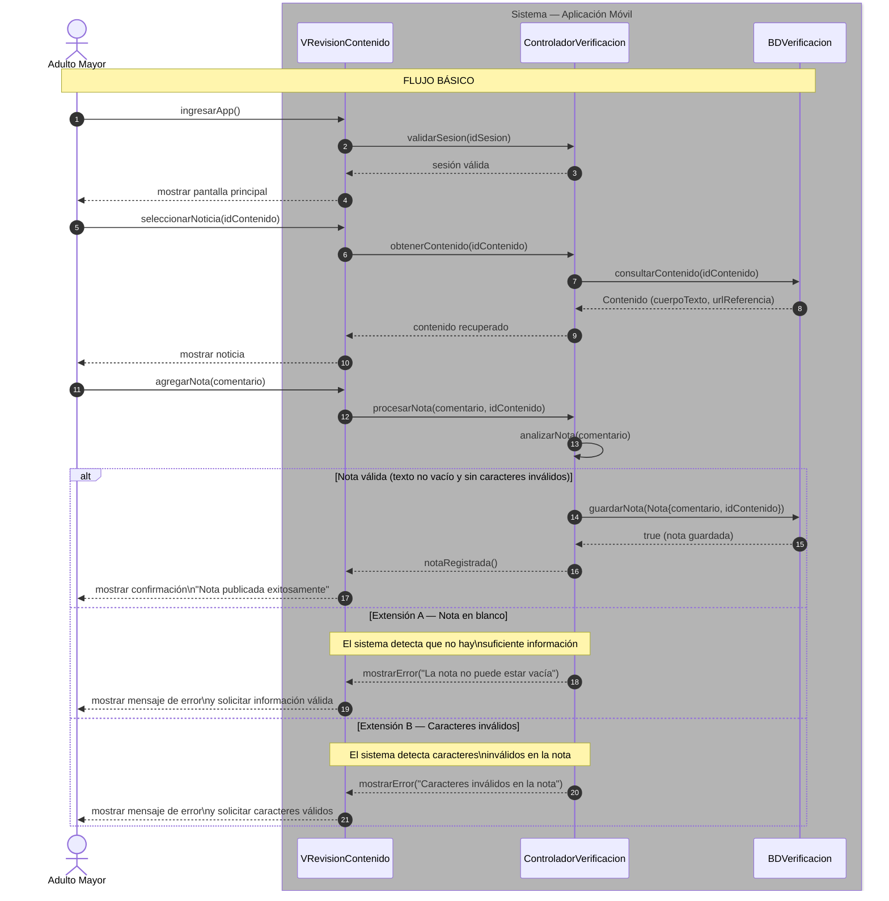

# Diagrama de Secuencia del Sistema
## CU 5.3.2.1 — Asignar Notas Complementarias

---

---

### Leyenda de participantes

| Participante | Clase del diagrama de clases | Rol |
|---|---|---|
| **Adulto Mayor** | Actor externo (`Usuario` con rol Adulto Mayor) | Inicia el caso de uso |
| **VRevisionContenido** | `VRevisionContenido` | Vista / interfaz de la app móvil |
| **ControladorVerificacion** | `ControladorVerificacion` | Lógica de negocio y validación |
| **BDVerificacion** | `BDVerificacion` | Persistencia — `guardarNota(Nota n): boolean` |

### Objetos creados durante la ejecución

| Clase | Atributos relevantes usados |
|---|---|
| `Nota` | `idNota`, `comentario`, `calificacion` |
| `Contenido` | `idContenido`, `cuerpoTexto`, `urlReferencia` |

### Notas de diseño
- El **sistema** (caja gris) encapsula las tres capas: Vista → Controlador → Base de datos.
- Las extensiones **A** y **B** se manejan íntegramente dentro del sistema; el Adulto Mayor solo recibe el mensaje de error y la solicitud de corrección.
- Tras el flujo básico exitoso, la nota queda disponible para que otros Adulto Mayors la califiquen (`Nota.getCalificacion()`).
