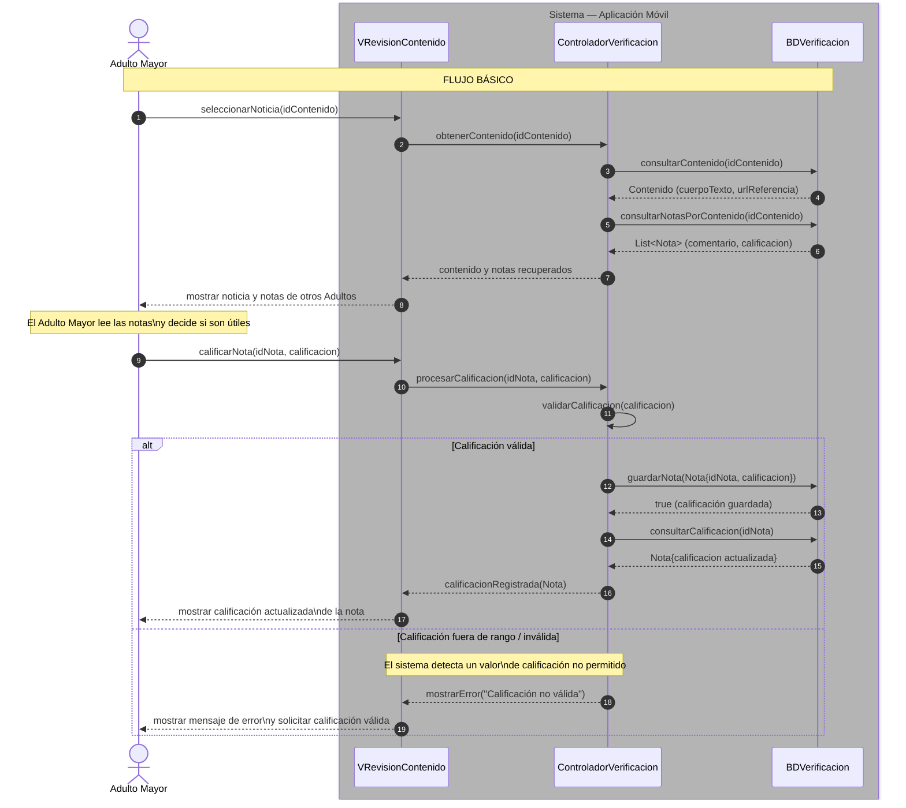

# Diagrama de Secuencia del Sistema
## CU 5.3.2.2 — Calificar Notas Complementarias

---

---

### Leyenda de participantes

| Participante | Clase del diagrama de clases | Rol |
|---|---|---|
| **Adulto Mayor** | Actor externo (`Usuario` con rol Adulto Mayor) | Inicia el caso de uso |
| **VRevisionContenido** | `VRevisionContenido` | Vista / interfaz de la app móvil |
| **ControladorVerificacion** | `ControladorVerificacion` | Lógica de negocio y validación |
| **BDVerificacion** | `BDVerificacion` | Persistencia — `guardarNota(Nota n): boolean` |

### Objetos creados/consultados durante la ejecución

| Clase | Atributos relevantes usados |
|---|---|
| `Nota` | `idNota`, `calificacion`, `comentario`, `getCalificacion()` |
| `Contenido` | `idContenido`, `cuerpoTexto`, `urlReferencia` |

### Notas de diseño
- El **sistema** (caja gris) encapsula las tres capas: Vista → Controlador → Base de datos.
- Las notas listadas corresponden a objetos `Nota` vinculados al `Contenido` seleccionado (relación `califica` del diagrama de clases).
- Tras guardar, el sistema consulta la calificación actualizada para reflejarla inmediatamente en la UI (`VRC` muestra el resultado al Adulto Mayor).
- La extensión de **calificación inválida** cubre el tema abierto sobre el sistema de calificación: cualquier valor fuera del rango definido es rechazado por `ControladorVerificacion` antes de persistir.
