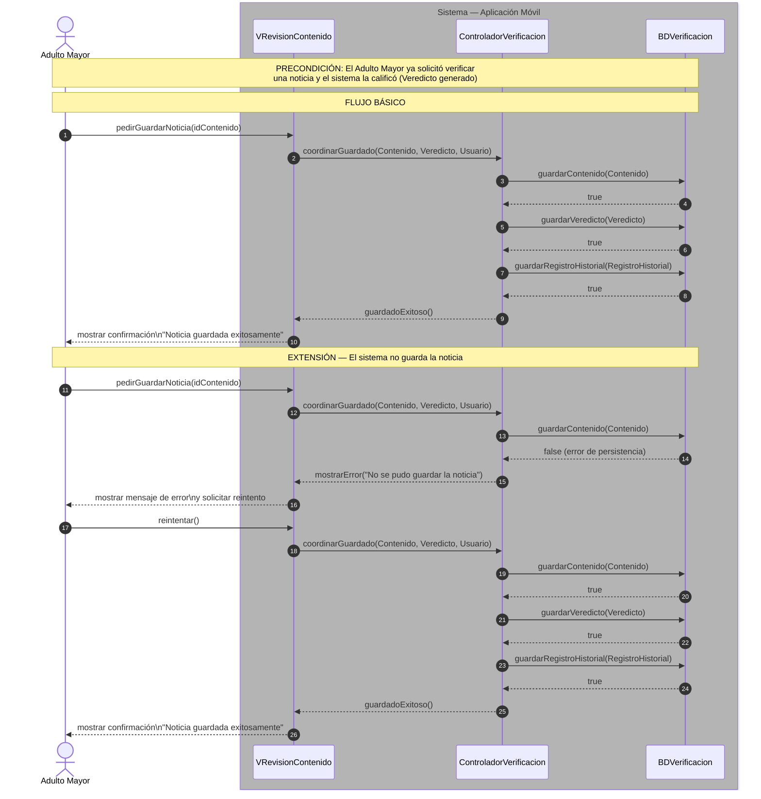

# Diagrama de Secuencia del Sistema
## CU 5.3.2.3 — Guardar Contenidos

---

---

### Leyenda de participantes

| Participante | Clase del diagrama de clases | Rol |
|---|---|---|
| **Adulto Mayor** | Actor externo (`Usuario` con rol Adulto Mayor) | Solicita el guardado del contenido |
| **VRevisionContenido** | `VRevisionContenido` | Vista / interfaz de la app móvil |
| **ControladorVerificacion** | `ControladorVerificacion` | Coordina el guardado — `coordinarGuardado(Contenido c, Veredicto v, Usuario u): boolean` |
| **BDVerificacion** | `BDVerificacion` | Persistencia en tres pasos: contenido, veredicto e historial |

### Objetos persistidos durante la ejecución

| Clase | Método de BD usado | Atributos relevantes |
|---|---|---|
| `Contenido` | `guardarContenido(Contenido c): boolean` | `idContenido`, `cuerpoTexto`, `urlReferencia`, `fechaRegistro` |
| `Veredicto` | `guardarVeredicto(Veredicto v): boolean` | `idVeredicto`, `nivelConfiabilidad`, `clasificacion`, `justificacion` |
| `RegistroHistorial` | `guardarRegistroHistorial(RegistroHistorial r): boolean` | `idRegistro`, `fechaHora`, `getResumen()` |

### Notas de diseño
- El **sistema** (caja gris) encapsula las tres capas: Vista → Controlador → Base de datos.
- El guardado se ejecuta en **tres pasos atómicos**: `Contenido` → `Veredicto` → `RegistroHistorial`, siguiendo la cadena de relaciones del diagrama de clases (`Contenido` evaluado en `Veredicto`, enviado a `RegistroHistorial`).
- La **extensión** modela el fallo en el primer paso (`guardarContenido` retorna `false`); el reintento repite todo el flujo de persistencia desde el inicio.
- El tema abierto sobre la asociación del contenido al Adulto Mayor se refleja en el parámetro `Usuario u` de `coordinarGuardado()`.
