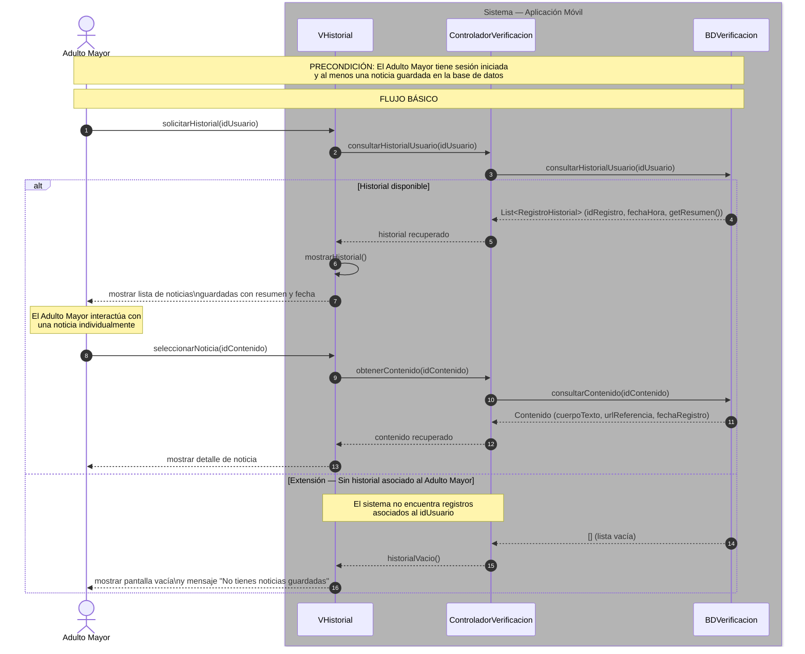

# Diagrama de Secuencia del Sistema
## CU 5.3.2.4 — Mostrar Historial de Contenidos

---

---

### Leyenda de participantes

| Participante | Clase del diagrama de clases | Rol |
|---|---|---|
| **Adulto Mayor** | Actor externo (`Usuario` con rol Adulto Mayor) | Solicita y navega el historial |
| **VHistorial** | `VHistorial` | Vista del historial — `solicitarHistorial(String idUser)`, `mostrarHistorial()` |
| **ControladorVerificacion** | `ControladorVerificacion` | Coordina la consulta del historial |
| **BDVerificacion** | `BDVerificacion` | Persistencia — `consultarHistorialUsuario(String idUser): List` |

### Objetos consultados durante la ejecución

| Clase | Método de BD usado | Atributos relevantes |
|---|---|---|
| `RegistroHistorial` | `consultarHistorialUsuario(String idUser): List` | `idRegistro`, `fechaHora`, `getResumen()` |
| `Contenido` | `consultarContenido(idContenido)` | `cuerpoTexto`, `urlReferencia`, `fechaRegistro` |

### Notas de diseño
- El **sistema** (caja gris) encapsula las tres capas: Vista → Controlador → Base de datos.
- Se usa **`VHistorial`** (no `VRevisionContenido`) como vista principal, ya que el diagrama de clases define esta clase específicamente para este caso de uso con los métodos `solicitarHistorial()` y `mostrarHistorial()`.
- La interacción individual con cada noticia dispara una segunda consulta a `BDVerificacion` para obtener el `Contenido` completo a partir del `RegistroHistorial`.
- La extensión de **historial vacío** retorna una lista vacía `[]` desde la BD; el controlador lo detecta y delega a `VHistorial` mostrar la pantalla informativa, sin lanzar un error técnico.
- El tema abierto sobre la **forma de mostrar el historial** queda reflejado en `VH.mostrarHistorial()`, cuya implementación visual (lista, tarjetas, cronología) es una decisión de diseño de UI pendiente.
