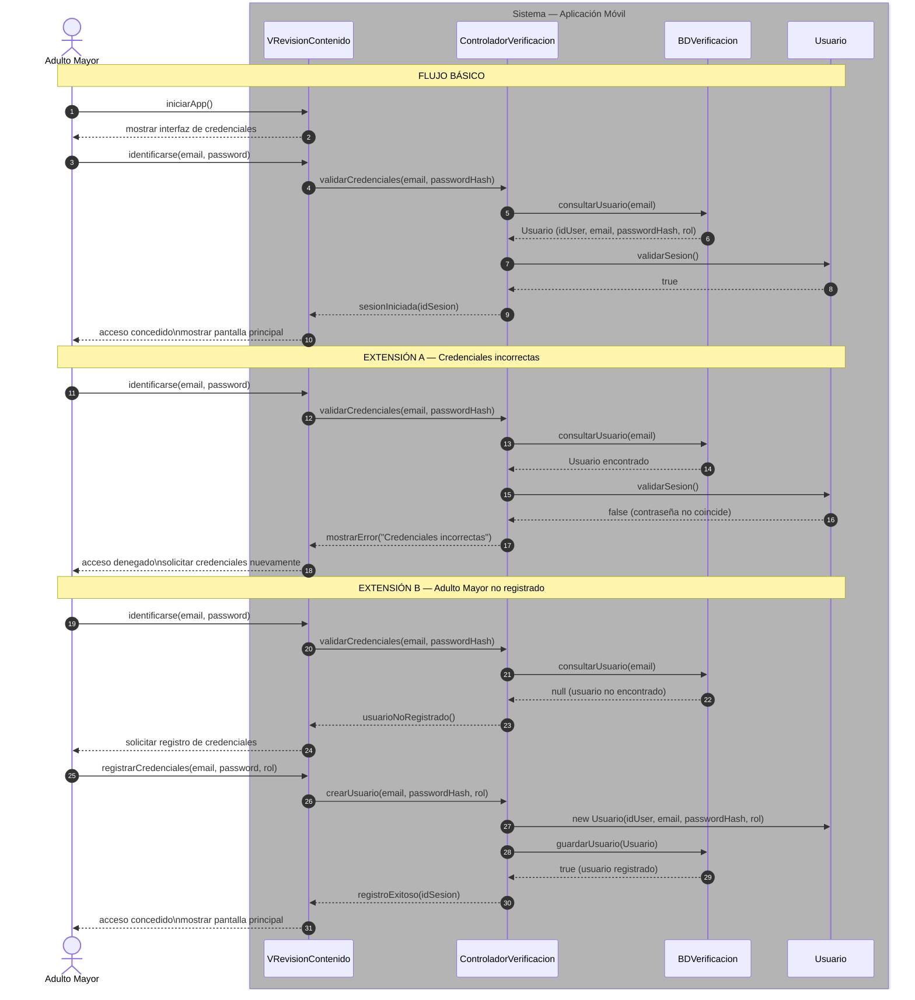

# Diagrama de Secuencia del Sistema
## CU 5.3.2.5 — Inicio de Sesión

---

---

### Leyenda de participantes

| Participante | Clase del diagrama de clases | Rol |
|---|---|---|
| **Adulto Mayor** | Actor externo (`Usuario` con rol Adulto Mayor) | Inicia sesión o se registra |
| **VRevisionContenido** | `VRevisionContenido` | Vista — muestra la interfaz de credenciales (`idSesion`) |
| **ControladorVerificacion** | `ControladorVerificacion` | Coordina la validación de credenciales |
| **BDVerificacion** | `BDVerificacion` | Persistencia — consulta y guarda `Usuario` |
| **Usuario** | `Usuario` | Objeto de dominio — `validarSesion(): boolean` |

### Atributos de `Usuario` usados en este flujo

| Atributo / Método | Uso |
|---|---|
| `email: String` | Clave de búsqueda en BD |
| `passwordHash: String` | Verificación de contraseña |
| `rol: String` | Asignado durante el registro |
| `validarSesion(): boolean` | Compara credenciales y retorna resultado |

### Notas de diseño
- El **sistema** (caja gris) encapsula cuatro elementos: Vista, Controlador, BD y el objeto `Usuario`.
- `VRevisionContenido` se usa como vista de sesión dado que posee el atributo `idSesion: String` en el diagrama de clases.
- La validación ocurre en **dos pasos**: primero la BD verifica que el `email` exista, luego el objeto `Usuario` ejecuta `validarSesion()` para comparar el `passwordHash`.
- La **Extensión B** incluye la creación de un nuevo objeto `Usuario` y su persistencia en BD, lo que responde al requisito de que las credenciales deben estar registradas en el sistema.
- El tema abierto sobre el **tipo de credenciales** queda representado genéricamente como `(email, password)`, y su implementación concreta (PIN, biometría, etc.) es una decisión pendiente.
