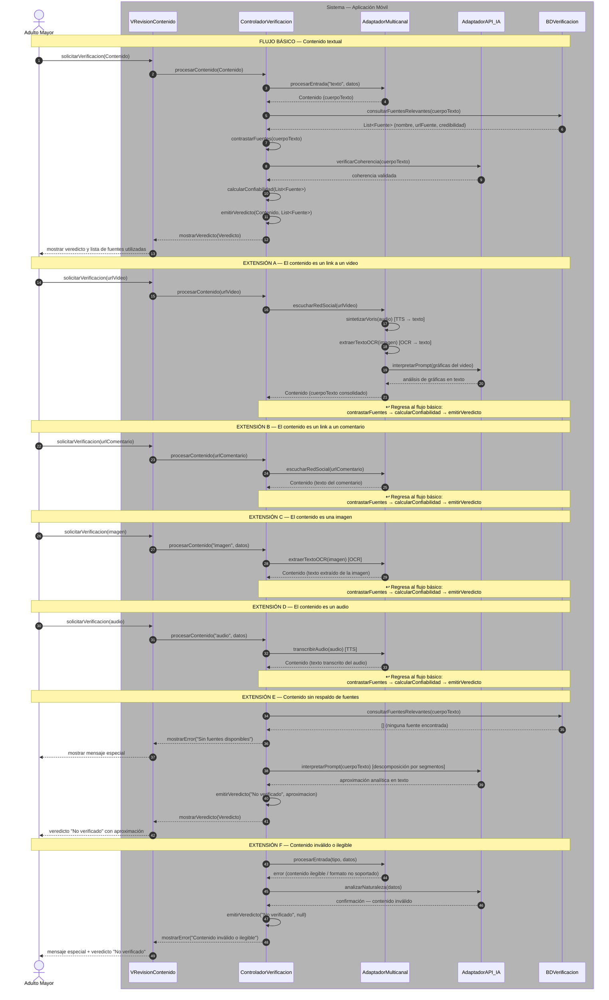

# Diagrama de Secuencia del Sistema
## CU 5.3.2.6 — Verificar Contenidos

---

---

### Leyenda de participantes

| Participante | Clase del diagrama de clases | Rol |
|---|---|---|
| **Adulto Mayor** | Actor externo (`Usuario` con rol Adulto Mayor) | Entrega el contenido a verificar |
| **VRevisionContenido** | `VRevisionContenido` | Vista — `solicitarVerificacion()`, `mostrarVeredicto()`, `mostrarError()` |
| **ControladorVerificacion** | `ControladorVerificacion` | Orquesta todo el proceso de verificación |
| **AdaptadorMulticanal** | `AdaptadorMulticanal` | Extrae texto de video, imagen, audio y redes sociales |
| **AdaptadorAPI_IA** | `AdaptadorAPI_IA` | Análisis de coherencia, gráficas y aproximación por IA |
| **BDVerificacion** | `BDVerificacion` | Persistencia — fuentes, contenido y veredicto |

### Métodos del diagrama de clases usados por extensión

| Extensión | Participante | Método |
|---|---|---|
| Texto (básico) | `ControladorVerificacion` | `contrastarFuentes()`, `calcularConfiabilidad()`, `emitirVeredicto()` |
| Video (A) | `AdaptadorMulticanal` | `escucharRedSocial()`, `sintetizarVoris()`, `extraerTextoOCR()` |
| Video (A) | `AdaptadorAPI_IA` | `interpretarPrompt()` |
| Comentario (B) | `AdaptadorMulticanal` | `escucharRedSocial()` |
| Imagen (C) | `AdaptadorMulticanal` | `extraerTextoOCR()` |
| Audio (D) | `AdaptadorMulticanal` | `transcribirAudio()` |
| Sin fuentes (E) | `AdaptadorAPI_IA` | `interpretarPrompt()` (descomposición) |
| Inválido (F) | `AdaptadorAPI_IA` | `analizarNaturaleza()` |

### Notas de diseño
- El **sistema** (caja gris) encapsula **cinco** participantes, el más complejo de todos los diagramas de la serie.
- Las extensiones A–D **convergen al flujo básico** una vez extraído el texto, siguiendo el principio DRY: un solo pipeline de verificación independientemente del formato de entrada.
- Las extensiones E y F terminan siempre con veredicto `"No verificado"`, diferenciándose en si hay aproximación analítica (E) o no (F).
- Los temas abiertos (lista de fuentes externas, APIs usadas, reglas de análisis) quedan representados como parámetros genéricos en `consultarFuentesRelevantes()`, `interpretarPrompt()` y `escucharRedSocial()`.
