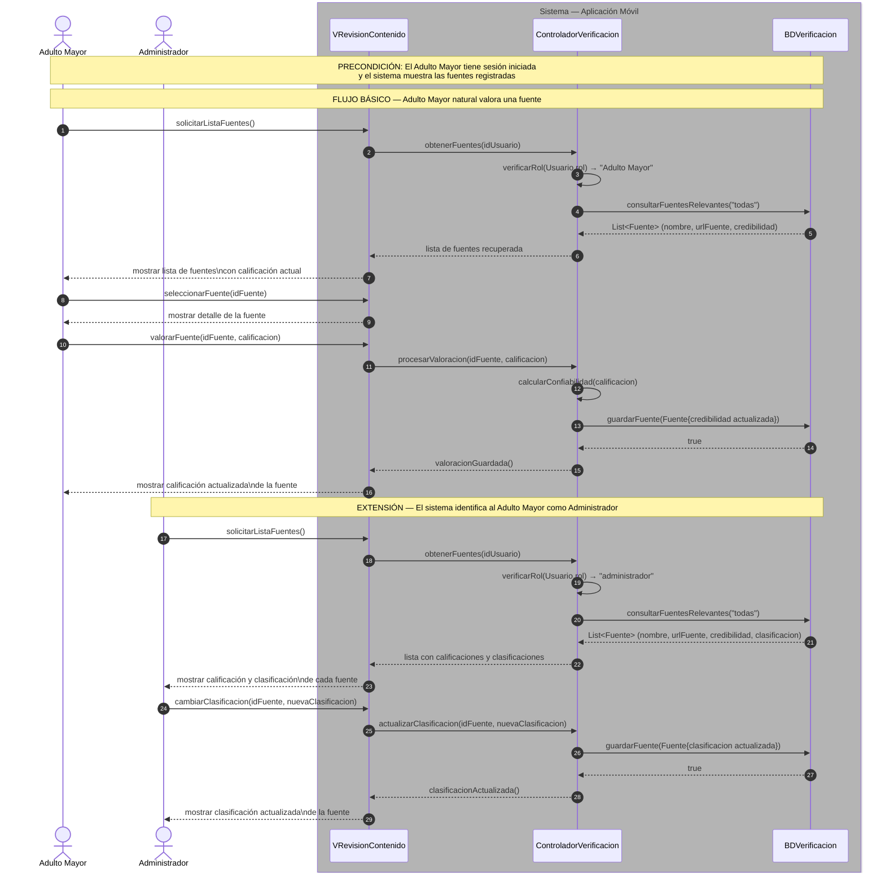

# Diagrama de Secuencia del Sistema
## CU 5.3.2.7 — Asignar Confiabilidad a las Fuentes

---

---

### Leyenda de participantes

| Participante | Clase del diagrama de clases | Rol |
|---|---|---|
| **Adulto Mayor** | `Usuario` con `rol = "Adulto Mayor"` | Valora la credibilidad de una fuente |
| **Administrador** | `Usuario` con `rol = "administrador"` | Cambia la clasificación de una fuente |
| **VRevisionContenido** | `VRevisionContenido` | Vista — muestra lista de fuentes, calificaciones y clasificaciones |
| **ControladorVerificacion** | `ControladorVerificacion` | Orquesta la lógica de roles y actualización de fuentes |
| **BDVerificacion** | `BDVerificacion` | Persistencia — `consultarFuentesRelevantes()`, `guardarFuente()` |

### Objetos usados durante la ejecución

| Clase | Atributos relevantes |
|---|---|
| `Usuario` | `rol: String` — bifurca el flujo entre "Adulto Mayor" y "administrador" |
| `Fuente` | `idFuente`, `nombre`, `urlFuente`, `credibilidad: float`, `getCredibilidad()` |

### Notas de diseño
- El **sistema** (caja gris) encapsula tres participantes; la diferenciación de comportamiento se delega al atributo `rol` de `Usuario`, que `ControladorVerificacion` inspecciona con `verificarRol()`.
- El **flujo básico** actualiza `Fuente.credibilidad` mediante `calcularConfiabilidad()`, método disponible en `ControladorVerificacion` del diagrama de clases.
- La **extensión** de Administrador añade la capacidad de cambiar la **clasificación** de la fuente, un campo complementario a `credibilidad` que permite una categorización editorial (ej. "oficial", "satírica", "no verificada").
- Los temas abiertos (reglas para ajustar confiabilidad y forma de mostrar calificaciones) quedan encapsulados en `calcularConfiabilidad()` y en la vista de `VRC`, cuya implementación visual es una decisión pendiente.
- Ambos actores comparten el mismo punto de entrada (`solicitarListaFuentes()`); la bifurcación ocurre **dentro del sistema**, manteniendo una interfaz uniforme para el usuario.
