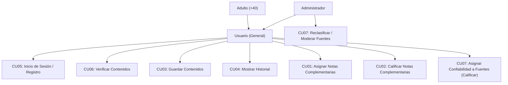

# DAGAZ — Especificación Detallada de Casos de Uso

> **Documento de Referencia de Requisitos y Flujos de Interacción**  
> **Proyecto:** DAGAZ  
> **Ubicación de Mockups Asociados:** `docs\iteracion-01\Mockups`  
> **Ubicación de Diagramas Asociados:** `docs\iteracion-01\Diagramas\DSS (Caja Gris)`

---

## 1. Actores del Sistema

1. **Adulto (+40) / Usuario Natural:**  
   Usuario final con necesidades particulares de accesibilidad, tipografía legible y navegación simplificada. Desea verificar contenidos que recibe por redes sociales o mensajería (WhatsApp, Telegram), agregar notas de contexto y valorar el trabajo de otros usuarios y la confiabilidad de los medios de comunicación.
2. **Administrador:**  
   Usuario con privilegios elevados que supervisa el grafo de credibilidad, modera notas, ajusta la clasificación de las fuentes y gestiona usuarios y parámetros del sistema.
3. **Sistema (DAGAZ Engine):**  
   Entidad autónoma encargada de procesar las solicitudes, coordinar los adaptadores de IA y multicanal (OCR, TTS/STT, scraping web), consultar la base de datos y emitir veredictos estructurados.

---

## 2. Fichas Técnicas de Casos de Uso

### CU01: Asignar Notas Complementarias
* **Identificador:** CU01
* **Actor Principal:** Adulto Mayor
* **Propósito:** Permitir al usuario aportar contexto relevante, enlaces de contraste o desmentidos a una noticia analizada por la comunidad (análogo a *Community Notes* de X).
* **Precondiciones:**
  1. El usuario tiene una sesión activa en la aplicación.
  2. El contenido o noticia ha sido previamente procesado y cuenta con un veredicto emitido.
* **Postcondiciones:**
  1. La nota se persiste en la tabla `notas` asociada al usuario y contenido.
  2. Queda visible para que otros usuarios la califiquen y enriquezcan la deliberación pública.
* **Flujo Básico:**
  1. El usuario navega al detalle de un contenido verificado.
  2. El usuario redacta una nota explicativa o de contexto en el campo correspondiente.
  3. El usuario pulsa el botón «Agregar nota».
  4. El sistema valida la coherencia y longitud del texto.
  5. El sistema guarda la nota en la base de datos con calificación inicial en 0.
  6. El sistema actualiza la interfaz mostrando la nota recién publicada.
* **Flujos Alternativos / Extensiones:**
  * **FA1: Nota en blanco:** Si el usuario envía el campo vacío o con solo espacios, el sistema detecta información insuficiente, muestra un mensaje de alerta en pantalla y solicita información válida.
  * **FA2: Caracteres inválidos / Texto malicioso:** Si el sistema detecta inyecciones de código o caracteres no legibles, rechaza la entrada con un mensaje claro y solicita la corrección.
* **Requisitos Especiales:** Textos simples, concisos y tipografía legible con alto contraste para adultos mayores.
* **Mockup de Referencia:** `Mockups/CU01_Mockup_Asignar_Notas.html`

---

### CU02: Calificar Notas Complementarias
* **Identificador:** CU02
* **Actor Principal:** Adulto Mayor
* **Propósito:** Permitir a la comunidad evaluar si una nota aportada por otro usuario es útil, neutral y certera.
* **Precondiciones:**
  1. Existe al menos una nota complementaria creada previamente por otro usuario sobre el contenido.
  2. El usuario evaluador tiene una sesión activa.
* **Postcondiciones:**
  1. Se actualiza el promedio de calificación de la nota en la tabla `notas`.
  2. Se recalculan los votos para determinar la visibilidad prioritaria de la nota.
* **Flujo Básico:**
  1. El usuario lee el contenido y las notas comunitarias asociadas.
  2. El usuario evalúa la utilidad seleccionando una valoración (Útil / Neutral / No útil o pulgar arriba/abajo).
  3. El sistema valida que el usuario no haya calificado previamente su propia nota o duplicado su voto.
  4. El sistema registra la calificación en la base de datos.
  5. La interfaz se refresca mostrando la nueva métrica acumulada.
* **Flujos Alternativos:**
  * **FA1: Error en el registro de calificación:** Si ocurre un fallo de conectividad con la base de datos, el sistema notifica al usuario que reintente en unos segundos.
* **Mockup de Referencia:** `Mockups/CU02_Mockup_Calificar_Notas.html`

---

### CU03: Guardar Contenidos
* **Identificador:** CU03
* **Actor Principal:** Sistema / Adulto Mayor
* **Propósito:** Almacenar permanentemente una noticia o afirmación verificada en el historial personal del usuario para consultas futuras.
* **Precondiciones:**
  1. La afirmación ha sido verificada y posee un veredicto emitido.
  2. El usuario se encuentra autenticado.
* **Postcondiciones:**
  1. Se crea un registro en la tabla `contenidos` y en `historial` asociado al `id_usuario`.
* **Flujo Básico:**
  1. Tras recibir el veredicto en pantalla, el usuario pulsa «Guardar en historial».
  2. El sistema recibe la petición y persiste el enlace entre el usuario, el contenido y la acción en `historial`.
  3. El sistema muestra un mensaje de confirmación («Noticia guardada exitosamente»).
* **Flujos Alternativos:**
  * **FA1: Fallo de persistencia:** El sistema detecta error en la transacción, emite notificación de error y permite reintentar la acción con un solo toque.
* **Mockup de Referencia:** `Mockups/CU03_Mockup_Guardar_Contenido.html`

---

### CU04: Mostrar Historial de Contenidos
* **Identificador:** CU04
* **Actor Principal:** Adulto Mayor
* **Propósito:** Visualizar la lista cronológica de contenidos que el usuario ha solicitado verificar o ha marcado como guardados.
* **Precondiciones:**
  1. El usuario tiene sesión iniciada.
* **Postcondiciones:**
  1. Se renderiza la lista de contenidos con sus fechas, titulares y badges de veredicto (Verdadero, Falso, Engañoso, No Verificado).
* **Flujo Básico:**
  1. El usuario accede a la sección «Historial».
  2. El sistema consulta las entradas asociadas al `id_usuario` en la tabla `historial` combinada con `contenidos` y `veredictos`.
  3. El sistema renderiza las tarjetas de resumen ordenadas de forma descendente por fecha.
  4. El usuario puede tocar cualquier elemento para abrir el detalle exhaustivo del veredicto y sus fuentes.
* **Flujos Alternativos:**
  * **FA1: Historial vacío:** Si el usuario no cuenta con registros previos, el sistema muestra una pantalla informativa con un diseño amigable invitándolo a verificar su primera noticia.
* **Mockup de Referencia:** `Mockups/CU04_Mockup_Historial_Noticias.html`

---

### CU05: Inicio de Sesión y Autenticación
* **Identificador:** CU05
* **Actor Principal:** Adulto Mayor / Administrador / Sistema
* **Propósito:** Gestionar el acceso seguro al sistema mediante validación de credenciales.
* **Precondiciones:**
  1. El usuario se encuentra en la pantalla de bienvenida o login.
* **Postcondiciones:**
  1. Se genera una sesión autenticada y se redirige a la vista principal según el rol asignado (`adulto` o `admin`).
* **Flujo Básico:**
  1. El usuario ingresa su correo electrónico y contraseña.
  2. El sistema cifra y contrasta las credenciales contra la tabla `usuarios`.
  3. Si la verificación es exitosa, se inicia la sesión y se otorga acceso a la pantalla principal.
* **Flujos Alternativos:**
  * **FA1: Credenciales incorrectas:** El sistema detecta inconsistencia en contraseña o email, muestra un mensaje claro («Credenciales incorrectas») y mantiene los campos limpios para un nuevo intento.
  * **FA2: Usuario no registrado:** El sistema detecta que el email no existe y ofrece un enlace directo a la pantalla de registro de credenciales.
* **Mockup de Referencia:** `Mockups/CU05_Mockup_Inicio_Sesion.html`

---

### CU06: Verificar Contenidos (Caso de Uso Nuclear)
* **Identificador:** CU06
* **Actor Principal:** Adulto Mayor / Sistema
* **Propósito:** Núcleo funcional de DAGAZ. Procesa una entrada multicanal (texto, URL, imagen, audio o video), extrae afirmaciones atómicas, consulta el grafo de fuentes confiables (enfocado en Colombia e internacional de Nivel 1) y emite un veredicto estructurado y trazable.
* **Precondiciones:**
  1. Usuario autenticado (o con acceso de prueba habilitado).
  2. Entrada de contenido no vacía provista por el usuario.
* **Postcondiciones:**
  1. Se genera un registro en `contenidos` con estado `'procesado'`.
  2. Se genera un registro en `procesos_verificacion` con el análisis de lenguaje y contraste de temas.
  3. Se emite un `veredicto` con puntuación de confianza (0.00 a 100.00) y etiqueta estructurada.
  4. Se asocian las fuentes empleadas en `veredicto_fuentes`.
  5. Se muestran los resultados con explicaciones legibles al usuario.
* **Flujo Básico (Entrada de Texto Directo):**
  1. El usuario pega el texto o titular en la pestaña «Texto» y pulsa «Verificar».
  2. El sistema (`ControladorVerificacion`) invoca a `AdaptadorMulticanal` para normalizar la cadena.
  3. El sistema consulta a `BDVerificacion` las fuentes relevantes asociadas al tema.
  4. El sistema invoca al módulo de IA (`AdaptadorAPI_IA`) para descomponer afirmaciones y contrastar coherencia semántica contra la evidencia.
  5. El sistema calcula la puntuación ponderada según el nivel de credibilidad de cada fuente consultada.
  6. El sistema genera el veredicto (Verdadero / Falso / Engañoso / No Verificado) con su justificación.
  7. La pantalla de resultados muestra el badge de veredicto, el resumen, las fuentes consultadas y las notas de la comunidad.
* **Flujos Alternativos (Multicanalidad y Casos Borde):**
  * **FA1: Enlace a video de redes sociales:** El sistema invoca la API correspondiente, extrae fotogramas para aplicar **OCR** (análisis de texto y gráficos en pantalla) y descarga el audio para procesarlo mediante **TTS/STT** (transcripción de voz a texto). Todo el contenido resultante se unifica en texto y continúa el flujo principal.
  * **FA2: Enlace a comentario o tweet:** El sistema realiza scraping o consulta vía API autorizada para aislar el texto del mensaje y prosigue la verificación.
  * **FA3: Imagen o captura de pantalla:** El sistema ejecuta el motor OCR para transcribir el texto impreso en la imagen (memes, capturas de chats, titulares) y deriva al flujo principal.
  * **FA4: Archivo de audio / Nota de voz:** El sistema procesa el archivo de sonido con reconocimiento de voz (STT) y continúa el análisis sobre la transcripción.
  * **FA5: Contenido sin evidencia concluyente en fuentes:** Si no hay suficientes fuentes registradas para confirmar o desmentir la afirmación, el sistema califica el contenido como **«No verificado»**, explica que no existen fuentes oficiales concluyentes y descompone las partes atómicas de la noticia para una aproximación preliminar.
  * **FA6: Contenido ilegible o inválido:** Si el texto o medio adjunto no contiene afirmaciones verificables (ruido, símbolos aislados), el sistema emite un mensaje explicativo y etiqueta como **«No verificado / No aplicable»**.
* **Mockups de Referencia:** `Mockups/CU06_Mockup_Verificar_Entrada.html` y `Mockups/CU06_Mockup_Verificar_Resultado.html`

---

### CU07: Asignar Confiabilidad a las Fuentes
* **Identificador:** CU07
* **Actor Principal:** Adulto Mayor, Administrador, Sistema
* **Propósito:** Gestionar y auditar la reputación de los medios de comunicación y fuentes de información que nutren el sistema de verificación.
* **Precondiciones:**
  1. Sesión activa en el sistema.
* **Postcondiciones:**
  1. Si es usuario común: se registra su voto de confianza/desconfianza sobre la fuente.
  2. Si es administrador: se actualiza formalmente la clasificación o índice base de credibilidad del medio en la tabla `fuentes`.
* **Flujo Básico (Usuario Natural / Adulto):**
  1. El usuario accede a la pestaña o catálogo de fuentes registradas.
  2. El sistema lista las fuentes mostrando su índice de credibilidad porcentual y su insignia de verificación mundial/nacional.
  3. El usuario selecciona una fuente y emite su valoración («Confiable» / «No confiable»).
  4. El sistema actualiza el registro estadístico de la fuente.
* **Flujo Alternativo (Administrador):**
  * **FA1: Clasificación de Fuentes por Administrador:** El sistema identifica el rol `admin`, presenta herramientas avanzadas de gestión, y el administrador puede modificar directamente el nivel de jerarquía (Nivel 1: Internacionales, Nivel 2: Regionales, Nivel 3: Nacionales Colombia, Nivel 4: Fact-checkers certificados) y su `indice_credibilidad`.
* **Mockup de Referencia:** `Mockups/CU07_Mockup_Confiabilidad_Fuentes.html`
