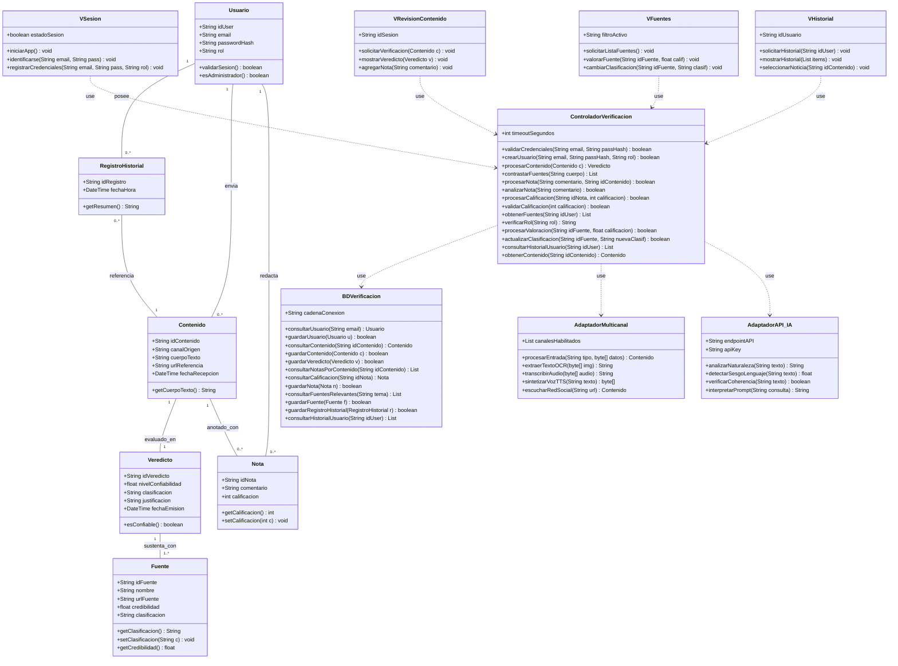
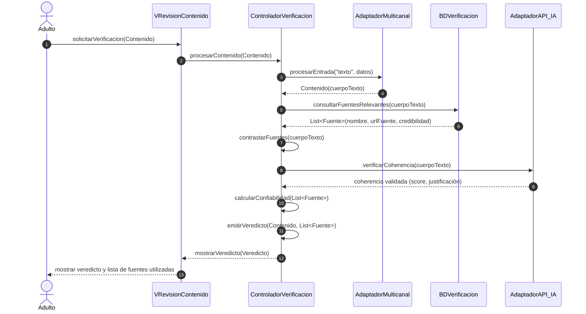
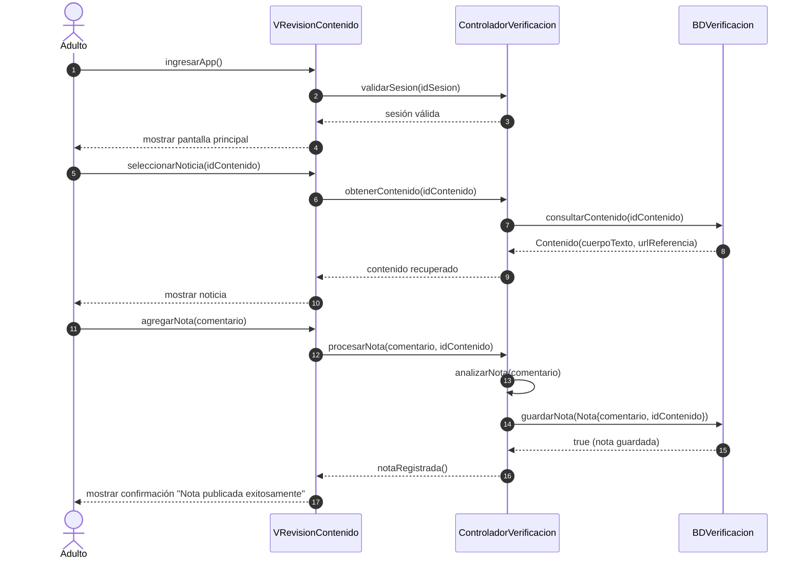
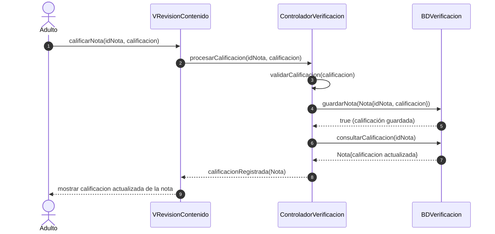
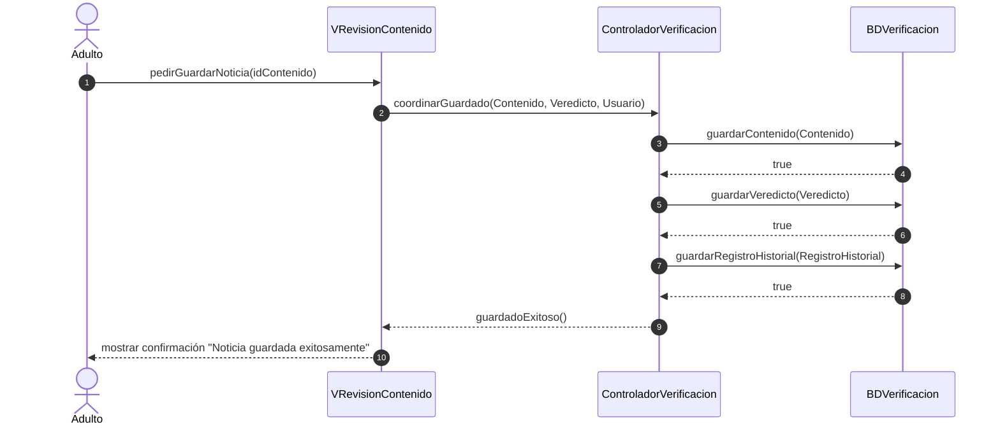
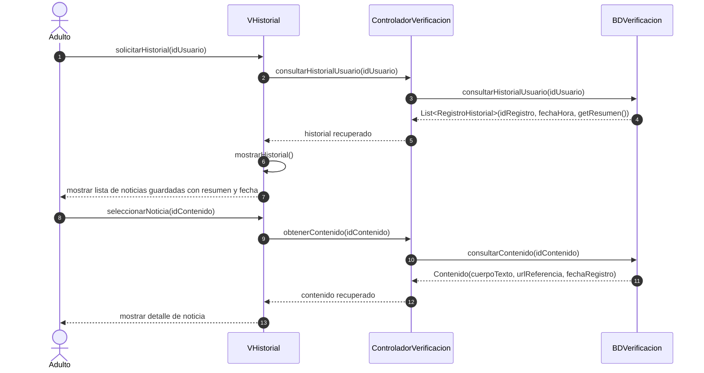
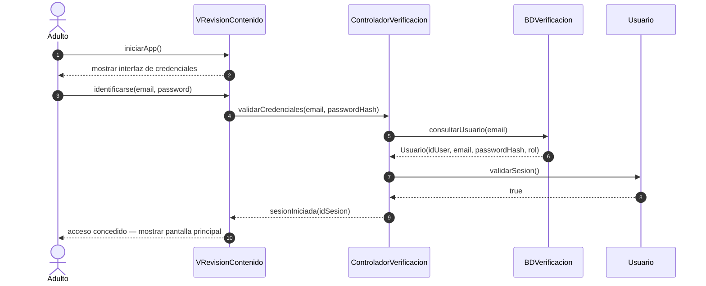
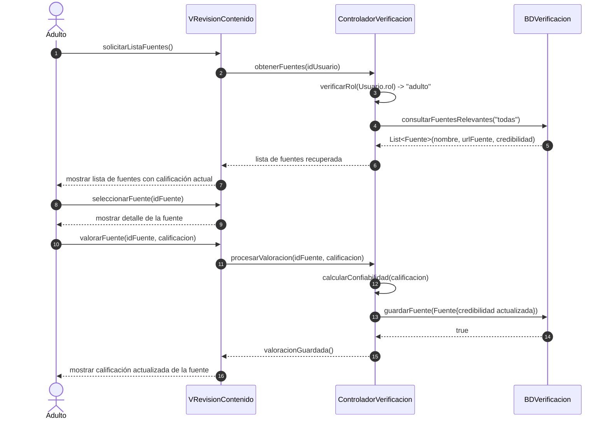

# DAGAZ — Arquitectura y Diseño de Software

> **Documento de Especificación Arquitectónica, Patrones y Diagramas de Interacción (Fase 0)**  
> **Proyecto:** DAGAZ  
> **Stack Técnico:** Laravel 13 (PHP 8.4), PostgreSQL 18 + `pgvector` (compatibilidad MariaDB), Python (FastAPI / Ingesta), Blade / Tailwind CSS v4, Capacitor 6 & Expo SDK 58  
> **Ubicación de DCD:** [`docs/iteracion-01/Diagramas/Clases de Diseno/Diagrama_Clases_Diseno.md`](../Diagramas/Clases%20de%20Diseno/Diagrama_Clases_Diseno.md)  
> **Ubicación de DSS (G):** [`docs/iteracion-01/Diagramas/DSS (Caja Gris)/`](../Diagramas/DSS%20%28Caja%20Gris%29/)  
> **Nota Evolutiva:** La especificación original de Fase 0 modelada con MariaDB evolucionó hacia PostgreSQL 18 + `pgvector`, `MultiModeloHarnessService` y clientes móviles duales; véase la versión actualizada en [`docs/iteracion-02/Guideline-Persistencia/03_Arquitectura_y_Diseno_Software.md`](../../iteracion-02/Guideline-Persistencia/03_Arquitectura_y_Diseno_Software.md).

---

## 1. Visión General de la Arquitectura

El sistema DAGAZ está concebido bajo el principio de **Backend-First**: el núcleo de verificación, reglas de negocio, persistencia y adaptadores externos debe estar 100% operativo y probado antes de acoplar las interfaces de usuario.

```text
┌───────────────────────────────────────────────────────────┐
│                 CAPA DE PRESENTACIÓN (UI)                 │
│      Laravel Blade Views (100% Responsivo Móvil)          │
│   (VRevisionContenido, VSesion, VFuentes, VHistorial)     │
└─────────────────────────────┬─────────────────────────────┘
                              │ HTTP / JSON API
┌─────────────────────────────▼─────────────────────────────┐
│                 CAPA DE APLICACIÓN / CONTROL              │
│                  ControladorVerificacion                  │
│   (Orquestación, Evaluación de Reglas, Ponderación)       │
└───────────────┬───────────────────────────┬───────────────┘
                │                           │
┌───────────────▼─────────────┐   ┌─────────▼───────────────┐
│    CAPA DE INFRAESTRUCTURA  │   │  SERVICIOS EXTERNOS / IA│
│       BDVerificacion        │   │   AdaptadorAPI_IA       │
│  (Eloquent ORM / PG-MariaDB)│   │  (Patrón Strategy/LLM)  │
│                             │   │   AdaptadorMulticanal   │
│                             │   │  (OCR, TTS/STT, APIs)   │
└─────────────────────────────┘   └─────────────────────────┘
```

### 1.1 Principios Arquitectónicos
1. **Agnosticismo de Modelos de Lenguaje (Patrón Strategy / Adapter):**  
   El consumo de Inteligencia Artificial para análisis de sesgo, descomposición de afirmaciones y verificación de coherencia semántica no se ata a un proveedor específico. Se define un contrato (`AdaptadorAPI_IA`) que permite conmutar dinámicamente entre OpenAI, OpenRouter, Google Gemini, Anthropic o modelos abiertos locales, integrando presupuestos de API y *circuit breaker*.
2. **Abstracción Multicanal de Entrada:**  
   Todo medio de entrada (texto directo, imagen con texto, nota de voz, URL de YouTube/TikTok/X) se normaliza a través del `AdaptadorMulticanal` hacia una estructura canónica `Contenido`.
3. **Ponderación Jerárquica de Fuentes (Ámbito Colombia e Internacional):**  
   El motor de veredictos no asigna igual peso a cualquier resultado de búsqueda. Pondera según el nivel de jerarquía:
   * **Nivel 1:** Agencias internacionales y organismos multilaterales (Reuters, AP, AFP, BBC, OMS, ONU, OCDE, EFE).
   * **Nivel 2:** Prensa regional colombiana validada.
   * **Nivel 3:** Prensa nacional de Colombia.
   * **Nivel 4:** Fact-checkers certificados por la IFCN (*International Fact-Checking Network*) como ColombiaCheck, AFP Factual, Chequeado.

---

## 2. Diagrama de Clases de Diseño (DCD)

El modelo de clases formaliza las responsabilidades y dependencias entre las entidades del dominio, las interfaces de usuario, el controlador de aplicación y los adaptadores de infraestructura.



---

## 3. Diagramas de Secuencia Detallados (Caja Gris)

### 3.1 CU06: Verificar Contenidos (Flujo Principal)


### 3.2 CU06: Flujos Alternativos de Entrada Multicanal
1. **Entrada de Video (FA1):**  
   `ControladorVerificacion` invoca `AdaptadorMulticanal.extraerTextoOCR(frames)` y `AdaptadorMulticanal.transcribirAudio(audioStream)`. Los textos combinados se envían como `cuerpoTexto` al flujo principal.
2. **Entrada de Comentario / Red Social (FA2):**  
   `AdaptadorMulticanal.escucharRedSocial(url)` extrae el texto del tweet/post, metadatos del autor y fecha, enviándolos normalizados a verificación.
3. **Entrada de Imagen / Captura de Pantalla (FA3):**  
   `AdaptadorMulticanal.extraerTextoOCR(byte[] img)` procesa la imagen con visión artificial para aislar las frases a contrastar.
4. **Contenido sin Evidencia en Fuentes (FA5):**  
   Si `BDVerificacion.consultarFuentesRelevantes` retorna un conjunto vacío o inferior al umbral, el controlador califica como `"No verificado"`, descompone la afirmación en términos clave y sugiere fuentes institucionales recomendadas.

### 3.3 CU01: Asignar Notas Complementarias


### 3.4 CU02: Calificar Notas Complementarias


### 3.5 CU03: Guardar Contenidos


### 3.6 CU04: Mostrar Historial de Contenidos


### 3.7 CU05: Inicio de Sesión


### 3.8 CU07: Asignar Confiabilidad a las Fuentes

