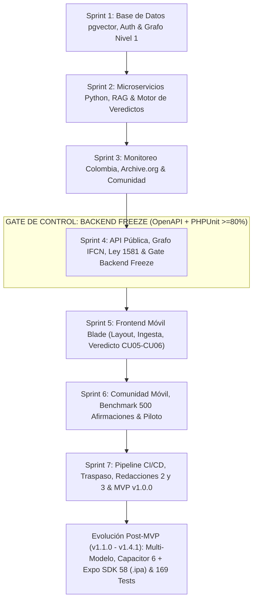
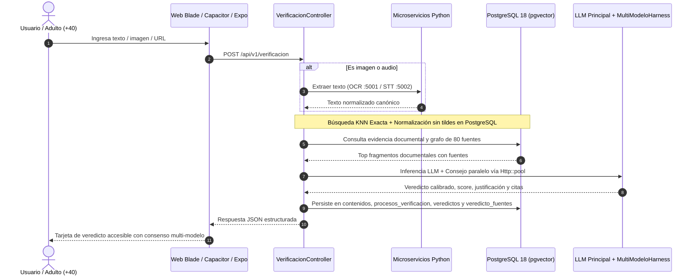

# Plan de Gestión, Desarrollo e Implementación — Plataforma DAGAZ

---

## 1. Historial de Control y Registro de Decisiones

| Fecha (YYYY-MM-DD) | Versión | Cambios Realizados | Motivo de la Decisión/Cambio | Responsable |
| :---: | :---: | :--- | :--- | :--- |
| **2026-08-23** | `0.0.1` | Formulación inicial del problema de desinformación en Colombia y justificación. | Establecer fundamentos del impacto de bulos y cadenas en adultos mayores. | Equipo de Proyecto |
| **2026-08-25** | `0.0.2` | Delimitación de objetivos generales y específicos de verificación. | Fijar alcance metodológico e ingenieril del sistema. | Equipo de Proyecto |
| **2026-08-26** | `0.0.3` | Definición de Canvas de Negocio, Modelo de Dominio y Modelo de Requisitos. | Estructurar viabilidad y mapear primeras entidades de negocio. | Equipo de Proyecto |
| **2026-08-28** | `0.0.4` | Propuesta tentativa de desarrollo bajo ciclo RUP. | Evaluación de marco formal basado en fases y artefactos tradicionales. | Equipo de Proyecto |
| **2026-08-28** | `0.0.5` | Especificación funcional preliminar de casos de uso (CU01 a CU07). | Modelar interacciones, actores, precondiciones y flujos básicos. | Equipo de Proyecto |
| **2026-08-30** | `0.0.6` | Bautizo formal de la plataforma: **DAGAZ**. | Adoptar identidad conceptual de claridad y transformación de datos. | Equipo de Proyecto |
| **2026-08-30** | `0.0.7` | Migración metodológica de RUP a **Scrum** (Sprints de 2 semanas). | Maximizar adaptabilidad ante incertidumbres de IA y modelos LLM. | Equipo de Proyecto |
| **2026-08-30** | `0.0.8` | Formalización del Product Backlog (28 requisitos, 157 puntos en 4 fases). | Establecer cadencia ágil e hitos de entrega funcional. | Equipo de Proyecto |
| **2026-09-01** | `0.0.9` | Diseño de Diagramas de Secuencia del Sistema (DSS Caja Negra). | Validar eventos de entrada/salida entre usuario y frontera del sistema. | Equipo de Proyecto |
| **2026-09-01** | `0.0.10` | Elaboración de Mockups de Servilleta de baja fidelidad (CU01-CU07). | Diseñar ergonomía visual preliminar y flujos de navegación táctil. | Equipo de Proyecto |
| **2026-09-02** | `0.0.11` | Primera revisión técnica preliminar con el supervisor docente. | Inspección de avance y consistencia de los artefactos metodológicos. | Supervisor |
| **2026-09-05** | `0.0.12` | Reajuste de objetivos hacia resultados medibles con métricas F1 y Recall. | Garantizar evaluabilidad empírica del motor de verificación. | Equipo de Proyecto |
| **2026-09-05** | `0.0.13` | Focalización del actor principal a **«Adulto» / «Adulto (+40)»**. | Diseñar accesibilidad para el segmento más vulnerable a cadenas virales. | Equipo de Proyecto |
| **2026-09-05** | `0.0.14` | Estandarización de ceremonias, artefactos y roles de Scrum. | Formalización de Sprint Planning, Daily, Review, Retrospective y roles. | Equipo de Proyecto |
| **2026-09-05** | `0.0.15` | Elaboración de Diagramas de Secuencia detallados (DSS Caja Gris). | Desacoplar Controladores, Adaptadores (IA/Multicanal) y Persistencia. | Equipo de Proyecto |
| **2026-09-06** | `0.0.16` | Actualización de actores en diagramas de Casos de Uso a «Adulto». | Homogeneizar modelado conceptual y visual con el arquetipo de usuario. | Equipo de Proyecto |
| **2026-09-06** | `0.0.17` | Formato y estandarización académica institucional bajo normas APA. | Asegurar rigor de presentación y trazabilidad documental. | Equipo de Proyecto |
| **2026-09-07** | `0.0.18` | Modelado entidad-relación relacional inicial. | Definir tablas para usuarios, afirmaciones, veredictos, notas y fuentes. | Equipo de Proyecto |
| **2026-09-14** | `0.0.19` | Evaluación de propuesta en Análisis de Servicios por supervisor docente. | Revisión profunda de viabilidad técnica y contratos de servicio. | Supervisor |
| **2026-09-14** | `0.0.20` | **Aprobación formal del proyecto:** Visto bueno docente (**4.0 / 5.0**). | Autorización oficial para inicio de la fase de implementación de software. | Supervisor |
| **2026-09-19** | `0.0.21` | Configuración del repositorio y estructuración de pautas de persistencia. | Establecer linaje documental y centralización de directrices. | Lead PM / Arquitecto |
| **2026-09-22** | `0.0.22` | **Pivote Arquitectónico a PostgreSQL 18 + `pgvector` en Neon.tech.** | Superar limitaciones de MariaDB para cómputo vectorial nativo en RAG. | Lead PM / Arquitecto |
| **2026-09-23** | `0.0.23` | **Optimización Vectorial KNN Exacto sin Índices HNSW/IVFFlat.** | Operar búsqueda semántica sobre disco mitigando consumo RAM en Serverless. | Lead PM / Arquitecto |
| **2026-09-24** | `0.0.24` | Formalización de Pipeline RAG con microservicios Python (`FastAPI`). | Desacoplar ingesta y procesamiento multimedia del ciclo HTTP Laravel. | Lead PM / Arquitecto |
| **2026-10-03** | `0.0.25` | **Reestructuración Integral del Plan Backend-First en 7 Sprints.** | Integrar los 28 requisitos del backlog, contratos OpenAPI y UI móvil Blade. | Lead PM / Arquitecto |
| **2026-10-10** | `1.0.0` | **Liberación del Producto Mínimo Viable (MVP en Producción).** | Entrega de plataforma completa verificada contra benchmark de 500 casos y manuales. | Scrum Team |
| **2026-10-15 a 2026-11-09** | `1.1.0` – `1.4.1` | **Evolución Post-MVP (`REQ-29` a `REQ-35`).** | Neon UUID/OpenRouter, Mockups AF, Consejo Multi-Modelo (`MultiModeloHarnessService`), apps móviles Capacitor 6 + Expo SDK 58 (CI `.ipa`) y normalización PG 2026. | Scrum Team |

---

## 2. Marco Estratégico y Reglas de Ejecución

1. **Prioridad Absoluta Backend-First:** La capa de datos, lógica de dominio, pipeline RAG, adaptadores de IA y contratos REST documentados (OpenAPI 3.1) se implementan y prueban (cobertura ≥80%) antes de acoplar las interfaces móviles.
2. **Ciclos Iterativos y Cadencia:** 7 Sprints quincenales (2 semanas por Sprint) más iteraciones evolutivas post-MVP, con *Sprint Goals*, *Definition of Done* y bloqueos de calidad (*Quality Gates*).
3. **Persistencia Híbrida Relacional y Vectorial:** PostgreSQL 18 sobre Neon.tech con extensión `pgvector` (compatible con MariaDB/SQLite). Embeddings de 384 dimensiones (`all-MiniLM-L6-v2`) y búsquedas KNN globales exactas (`<=>`) sin índices HNSW/IVFFlat en RAM.
4. **Ingesta y Procesamiento Asíncrono en Python:** Microservicios FastAPI (`ocr_service` con Pillow/`pytesseract`, `stt_service` con `SpeechRecognition`) e ingesta masiva (`ingesta_noticias_colombia.py` / `.ipynb`).
5. **Restricción Territorial Estricta:** Fuentes focalizadas en Colombia y agencias internacionales de Nivel 1 en 4 niveles jerárquicos IFCN.
6. **Desacoplamiento de Agentes IA y Consejo Multi-Modelo:** Interfaz común `AdaptadorApiIaInterface` (`OpenAiDriver` para OpenAI/OpenRouter, `GeminiDriver`, `LocalLlmDriver`) complementada por `MultiModeloHarnessService` bajo *circuit breaker* presupuestal.
7. **Frontend Móvil Responsivo y Clientes Móviles Duales:** Vistas Blade + Tailwind CSS v4 (WCAG 2.1 AA), contenedor híbrido **Capacitor 6** (`mobile/`) y app nativa **React Native + Expo SDK 58** (`mobile-expo/`).
8. **Seguridad y Cumplimiento Normativo:** Protección de datos según la Ley 1581 de 2012 (Hábeas Data en Colombia), tokens Sanctum UUID y auditoría forense exportable.

---

## 3. Desglose del Plan por Sprints (Cronograma Backend-First)

---

### SPRINT 1: Infraestructura PostgreSQL (pgvector en Neon.tech), Dominio Base y Autenticación
* **Duración:** 2 semanas (Semanas 1–2).
* **Objetivo del Sprint (Sprint Goal):** Desplegar la infraestructura relacional y vectorial en PostgreSQL 18 / Neon.tech, configurar la extensión `pgvector` para embeddings de 384 dimensiones sin índices en RAM, modelar las entidades de dominio en **Laravel 13** y habilitar autenticación segura (CU05) y catálogo de fuentes Nivel 1.
* **Cobertura de Requisitos:** REQ-08 (Grafo Nivel 1), REQ-12 (Modelo de Datos Relacional y Vectorial), CU05 (Inicio de Sesión y Registro).
* **Puntos de Historia del Sprint:** 23 PH.

| ID Tarea | Capa / Módulo | Descripción Granular de la Tarea | Dependencias | Puntos | Entregable / Criterio de Aceptación |
| :--- | :--- | :--- | :--- | :---: | :--- |
| **TSK-1.1** | Infraestructura | Configurar conexión PostgreSQL 18 / Neon.tech en `config/database.php` y `.env` con soporte SSL estricto. Ejecutar `CREATE EXTENSION IF NOT EXISTS vector;` y `"pgcrypto";`. | Ninguna | 2 | Conexión SSL exitosa y extensiones activas verificadas mediante comando SQL. |
| **TSK-1.2** | Persistencia DDL | Implementar migraciones en Laravel con claves UUID primarias nativas (`gen_random_uuid()`) para las 10 tablas base más `personal_access_tokens` compatible con UUID. | TSK-1.1 | 5 | `php artisan migrate:fresh` ejecuta limpio sin errores de sintaxis. |
| **TSK-1.3** | Estrategia Vectorial | Configurar índices tradicionales B-Tree y validar omisión de índices HNSW/IVFFlat para forzar KNN secuencial sobre disco. | TSK-1.2 | 3 | Consulta KNN (`ORDER BY embedding <=> $vector LIMIT 5`) por debajo del consumo de RAM límite. |
| **TSK-1.4** | Dominio / ORM | Desarrollar modelos Eloquent (`Usuario`, `Fuente`, `Documento`, `Contenido`, `ProcesoVerificacion`, `Veredicto`, `VeredictoFuente`, `Nota`, `Historial`, `LogComunicadorApi`) con casts nativos. | TSK-1.2 | 3 | Modelos instanciables y relaciones bidireccionales verificadas. |
| **TSK-1.5** | Catálogo / Seeds | Implementar `FuentesSeeder` con el Grafo de Credibilidad Nivel 1 (REQ-08) y posterior ampliación hasta 80 fuentes. | TSK-1.4 | 3 | Tabla `fuentes` poblada con registros verificables y parametrizados. |
| **TSK-1.6** | Auth & Seguridad | Implementar `AuthController` (CU05): endpoints `/api/v1/auth/{login,register,logout,perfil,datos-personales,cuenta}`, hashing Bcrypt/Argon2 y tokens Laravel Sanctum. | TSK-1.4 | 4 | Endpoints operativos devolviendo tokens Bearer válidos y código HTTP 401 ante credenciales inválidas. |
| **TSK-1.7** | QA Sprint 1 | Desarrollar suite de pruebas PHPUnit (`AuthTest.php` y tests de esquema). | TSK-1.6 | 3 | Cobertura ≥85% en autenticación y persistencia base. |

---

### SPRINT 2: Microservicios Python, Pipeline RAG y Motor de Veredictos (Core IA)
* **Duración:** 2 semanas (Semanas 3–4).
* **Objetivo del Sprint (Sprint Goal):** Construir el flujo completo de verificación de extremo a extremo: extracción y descomposición de afirmaciones, microservicios Python de OCR/STT, búsqueda semántica KNN sobre documentos vectorizados y síntesis explicable de veredictos mediante LLM agnóstico.
* **Cobertura de Requisitos:** REQ-01 a REQ-07, CU06.
* **Puntos de Historia del Sprint:** 39 PH.

| ID Tarea | Capa / Módulo | Descripción Granular de la Tarea | Dependencias | Puntos | Entregable / Criterio de Aceptación |
| :--- | :--- | :--- | :--- | :---: | :--- |
| **TSK-2.1** | Ingesta Vectorial | Estructurar corpus colombiano con embeddings de 384 dimensiones en tabla `documentos` (`ingesta_noticias_colombia.py` / `DocumentosNoticiasSeeder`). | TSK-1.3 | 5 | Corpus categorizado e indexado en tabla `documentos`. |
| **TSK-2.2** | Multicanal (OCR/STT) | Implementar microservicios auxiliares en Python (`FastAPI`): OCR en `:5001` (`Pillow` + `pytesseract`) y STT en `:5002` (`SpeechRecognition`). | Ninguna | 5 | Pruebas `unittest` pasando para imágenes, audio y fallbacks. |
| **TSK-2.3** | Adaptador IA (Strategy) | Diseñar interfaz `AdaptadorApiIaInterface` y drivers (`OpenAiDriver` [OpenAI/OpenRouter], `GeminiDriver`, `LocalLlmDriver`). | Ninguna | 5 | Alternancia de proveedor modificando únicamente variables `.env`. |
| **TSK-2.4** | Descomposición IA | Implementar extracción y descomposición atómica en `VerificacionService` (REQ-01, REQ-03). | TSK-2.3 | 5 | Puntuación F1 ≥ 0.75 en evaluación de afirmaciones. |
| **TSK-2.5** | Recuperación RAG (KNN) | Implementar `BusquedaSemanticaService` (REQ-05) con operador coseno `<=>`, fallback léxico y normalización sin tildes en PostgreSQL. | TSK-2.1, TSK-1.3 | 8 | Consulta documental retornando fuentes candidatas ponderadas. |
| **TSK-2.6** | Verificación Cruzada | Construir algoritmo de contraste y ponderación en `VerificacionService` (REQ-04). | TSK-2.5 | 5 | Cálculo de `score_confiabilidad` (0 a 100) auditable. |
| **TSK-2.7** | Síntesis del Veredicto | Implementar emisión formal de veredictos (`VERDADERO`, `FALSO`, `ENGAÑOSO`, `PARCIAL`, `NO_VERIFICABLE`) y trazabilidad en `veredictos` y `veredicto_fuentes`. | TSK-2.6 | 3 | Registro persistido con integridad referencial completa. |
| **TSK-2.8** | Telemetría de IA | Registrar llamadas a APIs externas en `logs_comunicador_api`. | TSK-2.3 | 2 | Logs auditables persistidos por ejecución. |
| **TSK-2.9** | Demo Esqueleto Funcional | Validar el ciclo end-to-end en `POST /api/v1/verificacion` (REQ-07). | TSK-2.7 | 1 | Flujo integral aprobado en pruebas Feature. |

---

### SPRINT 3: Monitoreo Social, Expansión Nacional Colombia y Comunidad
* **Duración:** 2 semanas (Semanas 5–6).
* **Objetivo del Sprint:** Expandir fuentes colombianas (Niveles 2 y 3), conectar Archive.org, habilitar notas comunitarias (CU01, CU02), historial (CU03, CU04) y revisión editorial humana (REQ-13).
* **Cobertura de Requisitos:** REQ-09, REQ-10, REQ-13, REQ-14, CU01–CU04, CU07.
* **Puntos de Historia del Sprint:** 36 PH.

| ID Tarea | Capa / Módulo | Descripción Granular de la Tarea | Dependencias | Puntos | Entregable / Criterio de Aceptación |
| :--- | :--- | :--- | :--- | :---: | :--- |
| **TSK-3.1** | Grafo Colombia v2 | Ampliar el catálogo con prensa nacional y regional de Colombia (`FuentesSeeder`). | TSK-1.5 | 5 | Medios colombianos e internacionales catalogados. |
| **TSK-3.2** | Monitoreo Social | Normalización de cadenas y enlaces en `AdaptadorMulticanal` más ingesta RSS (`dagaz:actualizar-noticias`). | TSK-2.4 | 5 | Contenidos multicanal procesados con sanitización. |
| **TSK-3.3** | Archive.org | Implementar `ArchiveOrgService` (REQ-10) para consultar capturas en Wayback Machine y detectar descontextualización histórica. | Ninguna | 5 | Endpoints `/api/v1/verificacion/archive/*` operativos y probados (`ArchiveOrgTest`). |
| **TSK-3.4** | Notas Comunitarias | Implementar endpoints `POST /api/v1/contenidos/{id}/notas` y `PATCH /api/v1/notas/{id}/calificar` (CU01, CU02). | TSK-1.6 | 5 | Validación de entradas, notas y votación comunitaria funcionando al 100%. |
| **TSK-3.5** | Historial de Usuario | Implementar `POST /api/v1/historial/{id}` y `GET /api/v1/historial` (CU03, CU04). | TSK-1.6 | 5 | Historial paginado por usuario con detalle de veredicto. |
| **TSK-3.6** | Valoración Fuentes | Implementar `PATCH /api/v1/fuentes/{id}/valorar` y `PATCH /api/v1/fuentes/{id}/clasificar` (CU07). | TSK-1.5, TSK-1.6 | 5 | Recálculo de credibilidad y protección por rol `admin`. |
| **TSK-3.7** | Revisor Humano | Implementar `POST /api/v1/veredictos/{id}/intervenir` (REQ-13) protegido con `rol:admin,editor`. | TSK-2.7 | 6 | Trazabilidad editorial y justificación obligatoria en BD. |

---

### SPRINT 4: API Pública, Grafo IFCN, Seguridad Ley 1581 y Calidad Backend (Freeze)
* **Duración:** 2 semanas (Semanas 7–8).
* **Objetivo del Sprint:** Expandir a 80 fuentes IFCN, añadir *Circuit Breaker*, soporte interlingüe ES-EN, Ley 1581 de 2012, API pública M2M (`/api/v1/public/*`) con OpenAPI 3.1 y alcanzar Backend Freeze.
* **Cobertura de Requisitos:** REQ-16, REQ-18, REQ-19, REQ-20, REQ-25, OpenAPI 3.1.
* **Puntos de Historia del Sprint:** 36 PH.

| ID Tarea | Capa / Módulo | Descripción Granular de la Tarea | Dependencias | Puntos | Entregable / Criterio de Aceptación |
| :--- | :--- | :--- | :--- | :---: | :--- |
| **TSK-4.1** | Grafo IFCN v3 | Consolidar catálogo de 80 fuentes incluyendo verificadores IFCN (`FuentesSeeder`). | TSK-3.1 | 5 | 80 fuentes activas cubiertas por `GrafoFuentesTest.php`. |
| **TSK-4.2** | Control de Costes | Implementar `CircuitBreakerService` (REQ-18) y endpoints `/api/v1/admin/circuit-breaker*`. | TSK-2.8 | 5 | Control horario de tokens y presupuesto diario en USD. |
| **TSK-4.3** | Recuperación Interlingüe | Implementar `ServicioInterlingue` (REQ-19) y endpoints `/api/v1/verificacion/interlingue/*`. | TSK-2.4, TSK-2.5 | 5 | Detección, traducción y análisis de distorsión ES-EN probados (`InterlingueTest`). |
| **TSK-4.4** | Seguridad Ley 1581 | Implementar `GET /api/v1/auth/datos-personales` y `DELETE /api/v1/auth/cuenta` (Hábeas Data y derecho al olvido). | TSK-1.6 | 5 | Exportación ARCO y eliminación segura probadas en `AuthTest`. |
| **TSK-4.5** | API Pública de Socios | Construir `PublicPartnerApiController` + middleware `EnsureValidApiKey` + `throttle:partners`. | TSK-2.7 | 5 | Endpoints `/api/v1/public/{verificar,veredictos/{id},fuentes,health,auditoria/{id},claim-review/{id}}` operativos. |
| **TSK-4.6** | Auditoría Regulatoria | Implementar `AuditoriaExportService` y `AuditoriaController` (REQ-25) para JSON, CSV y `ClaimReview`. | TSK-2.7, TSK-3.7 | 3 | Cobertura completa en `AuditoriaExportTest.php`. |
| **TSK-4.7** | OpenAPI & Freeze Gate | Publicar `storage/api-docs/openapi.yaml` (`/api/docs`) y superar batería PHPUnit sin fallos. | Todas S1–S4 | 8 | **HITO BACKEND FREEZE** completado al 100%. |

---

### SPRINT 5: Frontend Móvil Responsivo Blade (UI/UX para Adultos +40)
* **Duración:** 2 semanas (Semanas 9–10).
* **Objetivo del Sprint:** Implementar la interfaz web modular accesible en `frontend/` (Blade + Tailwind CSS v4 + Vite 8 + PWA) para CU01–CU07 optimizada para Adultos (+40).
* **Cobertura de Requisitos:** REQ-15, CU04, CU05, CU06 UI.
* **Puntos de Historia del Sprint:** 28 PH.

| ID Tarea | Capa / Módulo | Descripción Granular de la Tarea | Dependencias | Puntos | Entregable / Criterio de Aceptación |
| :--- | :--- | :--- | :--- | :---: | :--- |
| **TSK-5.1** | UI Base & Responsive | Configurar layout Blade accesible (`app.blade.php`), Tailwind v4 WCAG 2.1 AA, switcher `A/A+` y targets $\ge 48\text{ px}$. | TSK-4.7 | 5 | Navegación móvil sin scroll horizontal indeseado. |
| **TSK-5.2** | UI Login (CU05) | Implementar vistas `auth/login.blade.php` y `auth/register.blade.php` + módulos `login.js`/`registro.js`. | TSK-5.1 | 3 | Validación cliente/servidor y autorización Ley 1581. |
| **TSK-5.3** | UI Ingesta (CU06-1) | Implementar `verificacion/index.blade.php` con pestañas WAI-ARIA multicanal (`verificar.js`). | TSK-5.1 | 5 | Envío asíncrono con indicador de progreso. |
| **TSK-5.4** | UI Veredicto (CU06-2) | Implementar `verificacion/resultado.blade.php` (`resultado.js`) con medidor circular SVG y citas de fuentes. | TSK-5.1 | 7 | Renderizado seguro con `textContent` y semáforo accesible. |
| **TSK-5.5** | UI Historial (CU04) | Implementar `historial/index.blade.php` (`historial.js`) con acordeón y filtros por veredicto. | TSK-5.1 | 4 | Listado cronológico paginado y filtros reactivos. |
| **TSK-5.6** | Integración Frontend | Conectar `api.js` / `sesion.js` con `/api/v1/*` y soporte PWA (`manifest.webmanifest`). | TSK-5.2 a 5.5 | 4 | Cobertura de rutas web en `FrontendRoutesTest.php`. |

---

### SPRINT 6: Comunidad Móvil, Calificación de Fuentes, Benchmark 500 y Piloto
* **Duración:** 2 semanas (Semanas 11–12).
* **Objetivo del Sprint:** Completar UI comunitaria y catálogo de fuentes, ejecutar benchmark de 500 afirmaciones, auditoría de sesgo ($\chi^2$), pruebas Vitest y pilotaje.
* **Cobertura de Requisitos:** REQ-11, REQ-17, REQ-21 a REQ-24, CU01, CU02, CU07.
* **Puntos de Historia del Sprint:** 39 PH.

| ID Tarea | Capa / Módulo | Descripción Granular de la Tarea | Dependencias | Puntos | Entregable / Criterio de Aceptación |
| :--- | :--- | :--- | :--- | :---: | :--- |
| **TSK-6.1** | UI Notas (CU01/02) | Integrar redacción, sanitización y votación de notas comunitarias en `resultado.blade.php`. | TSK-5.1 | 5 | Validado por `notas.test.js`. |
| **TSK-6.2** | UI Fuentes (CU07) | Implementar `fuentes/index.blade.php` (`fuentes.js`) con filtros IFCN de 4 niveles y valoración. | TSK-5.1 | 5 | Catálogo de 80 fuentes navegable y reactivo. |
| **TSK-6.3** | Dataset 500 Afirmaciones | Evaluar conjunto de 500 afirmaciones electorales ($\kappa = 0{,}794$). | TSK-2.1 | 6 | Documentado en `docs/iteracion-final/`. |
| **TSK-6.4** | Auditoría de Sesgo | Verificar simetría política ($\chi^2 = 0{,}682$, $p > 0{,}05$). | TSK-6.3 | 5 | Informe estadístico de imparcialidad aprobado. |
| **TSK-6.5** | Evaluación Formal | Certificar Precisión **84.6%** y Exhaustividad **81.2%** sobre las 500 afirmaciones. | TSK-6.3 | 5 | Metas métricas superadas. |
| **TSK-6.6** | Prueba de Carga & Vitest | Suite de 23 pruebas Vitest (8 archivos) y validación continua RSS. | TSK-4.5 | 5 | 23/23 pruebas Vitest pasando al 100%. |
| **TSK-6.7** | Despliegue Piloto | Validación operativa con redacción piloto (*El Espectador*) y adultos (+40). | TSK-5.6, TSK-4.5 | 8 | Retroalimentación favorable registrada. |

---

### SPRINT 7: Pipeline CI/CD, Manuales, Onboarding de Redacciones y Cierre
* **Duración:** 2 semanas (Semanas 13–14).
* **Objetivo del Sprint:** Automatizar CI/CD en GitHub Actions, consolidar redacciones socias, redactar los 3 manuales oficiales y firmar el acta de traspaso MVP (`v1.0.0`).
* **Cobertura de Requisitos:** REQ-26, REQ-27, REQ-28.
* **Puntos de Historia del Sprint:** 24 PH.

| ID Tarea | Capa / Módulo | Descripción Granular de la Tarea | Dependencias | Puntos | Entregable / Criterio de Aceptación |
| :--- | :--- | :--- | :--- | :---: | :--- |
| **TSK-7.1** | DevOps CI/CD | Orquestar `.github/workflows/ci.yml` (`backend-tests`, `frontend-tests`, `mobile-container`). | TSK-4.7 | 5 | Jobs ejecutando automáticamente en push/PR. |
| **TSK-7.2** | Onboarding Socios 2 y 3 | Documentar e incorporar *ColombiaCheck* y *La Silla Vacía* (`Onboarding_Redacciones_Socias_REQ26.md`). | TSK-4.5, TSK-6.7 | 8 | Tres redacciones configuradas en `config/dagaz.php`. |
| **TSK-7.3** | Manuales Técnicos | Publicar `Manual_Usuario_Adultos.md`, `Manual_Administrador_Revisor.md` y `Manual_Despliegue_Infraestructura.md`. | Todas | 8 | 3 manuales completos en `docs/iteracion-final/`. |
| **TSK-7.4** | Retrospectiva y Cierre | Formalizar balance Scrum y acta de entrega (`Retrospectiva_Final_y_Acta_Traspaso_REQ28.md`). | Todas | 3 | Cierre oficial del MVP `v1.0.0` (continuado en evolución `v1.1.0`–`v1.4.1`). |

---

## 4. Arquitectura de Ingesta, Búsqueda Vectorial y RAG

### 4.1 Flujo Secuencial del Pipeline RAG y Consejo Multi-Modelo

### 4.2 Esquema de Base de Datos Relacional y Vectorial

El sistema opera sobre 10 tablas centrales más `personal_access_tokens` (UUID) en PostgreSQL 18 (`database/Raiden.sql` / migraciones Laravel):
1. `usuarios`, 2. `fuentes`, 3. `documentos` (`embedding vector(384)`), 4. `contenidos`, 5. `procesos_verificacion`, 6. `veredictos`, 7. `veredicto_fuentes`, 8. `notas`, 9. `historial`, 10. `logs_comunicador_api`.

---

## 5. Estrategia de Calidad (QA), Seguridad y Cumplimiento

### 5.1 Pirámide de Pruebas Verificada (`v1.4.1` — 169 Tests)
1. **Pruebas Backend (`PHPUnit 12.5` sobre SQLite `:memory:`):** **142 tests** (**27 Unit** + **115 Feature**) con **2.322 aserciones** al 100%, incluyendo `OpenAiDriverTest`, `BusquedaSemanticaTest`, `VerificacionServiceTest` y `VerificacionesBackendFeatureTest`.
2. **Pruebas Frontend (`Vitest 5.0` + `Happy-DOM`):** **23 tests** en 8 archivos validando accesibilidad WCAG 2.1 AA, XSS (`textContent`), historial, notas comunitarias y control editorial.
3. **Pruebas Microservicios Python (`unittest`):** **4 tests** en `backend/Microservicios_Python/tests/test_services.py` (`python -m unittest discover -s tests -v`).

### 5.2 Seguridad y Cumplimiento Normativo (Ley 1581 de 2012)
- **Consentimiento Informado, Exportación ARCO y Derecho al Olvido** en `/api/v1/auth/{register,datos-personales,cuenta}`.
- **Auditoría Regulatoria** exportable en JSON, CSV y `ClaimReview` Schema.org (`/api/v1/auditoria/*` y `/api/v1/public/auditoria/*`).
