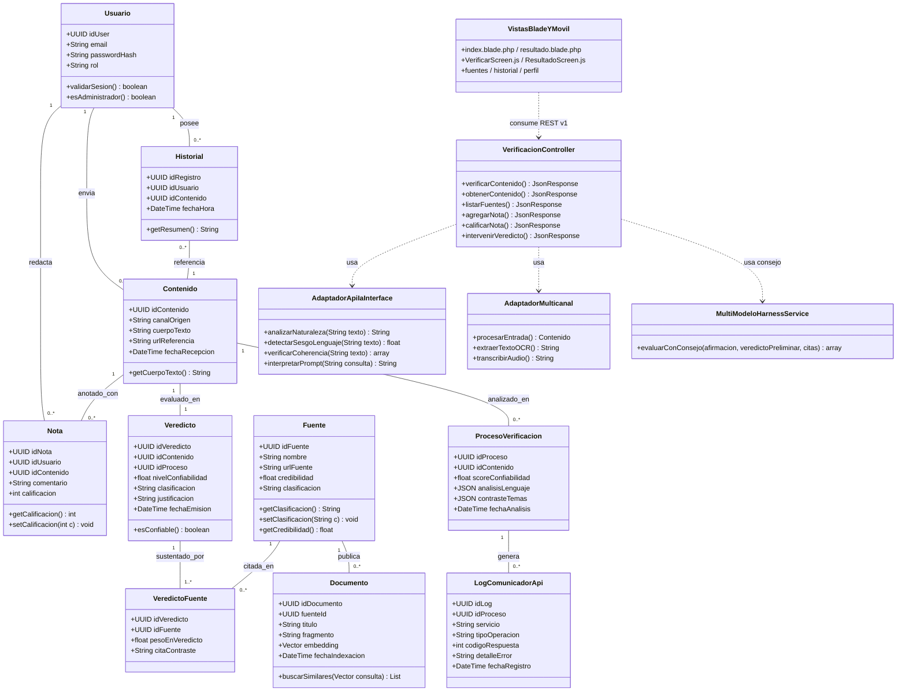
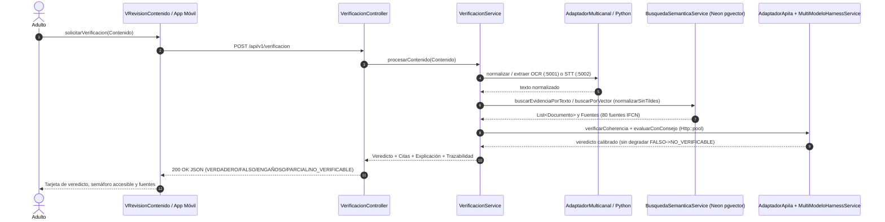
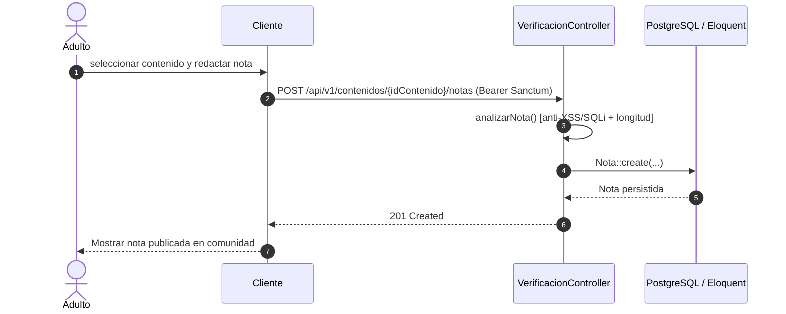
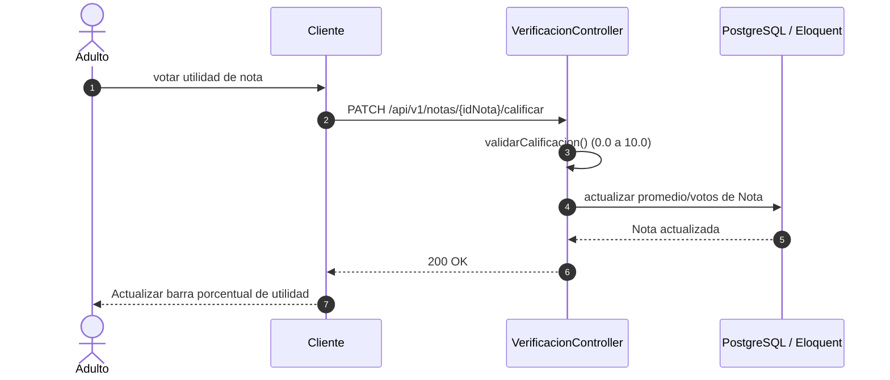
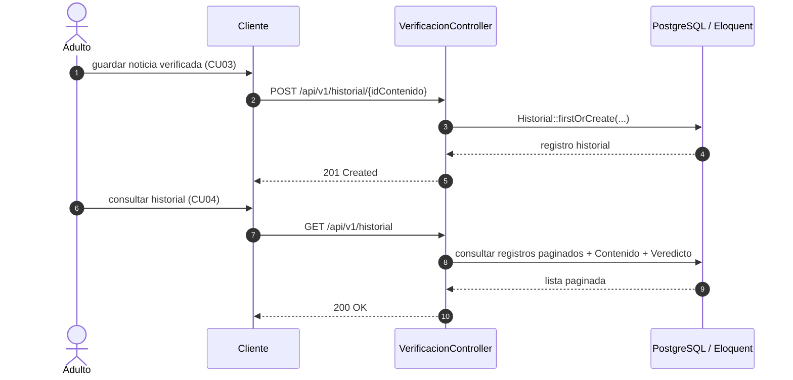
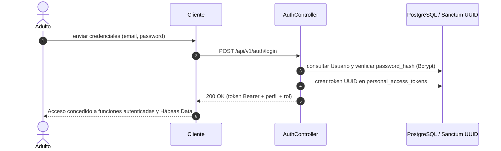
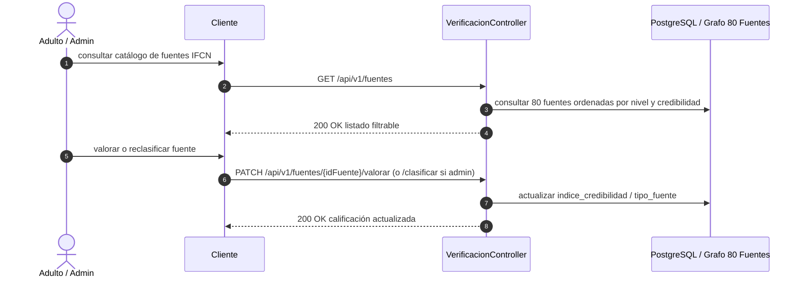

# DAGAZ — Arquitectura y Diseño de Software

> **Documento de Especificación Arquitectónica, Patrones y Diagramas de Interacción**  
> **Proyecto:** DAGAZ  
> **Stack Técnico Vigente (`v1.4.1`):** **Laravel 13 (`^13.17`)** / PHP `^8.3`–`8.4`, PostgreSQL 18 + `pgvector` en Neon.tech (compatibilidad MariaDB/SQLite), Python FastAPI (OCR/STT), Vite 8 + Tailwind CSS v4 + Blade, **Capacitor 6** (`mobile/`) y **React Native / Expo SDK 58** (`mobile-expo/`).  
> **Ubicación de DCD:** [`Diagrama_Clases_Diseno.md`](../../iteracion-01/Diagramas/Clases%20de%20Diseno/Diagrama_Clases_Diseno.md)  
> **Ubicación de DSS (Caja Gris):** [`DSS (Caja Gris)/`](../../iteracion-01/Diagramas/DSS%20%28Caja%20Gris%29/)

---

## 1. Visión General de la Arquitectura

El sistema DAGAZ sigue un diseño modular **Backend-First** con separación estricta entre clientes (Web Blade/Vite, Capacitor 6, Expo SDK 58, API pública M2M para redacciones) y el núcleo de dominio en Laravel 13:

```text
┌────────────────────────────────────────────────────────────────────────────────────────┐
│                        CAPA DE PRESENTACIÓN / CLIENTES (UI & M2M)                      │
│  - Web Móvil SSR/PWA (+40 WCAG 2.1 AA): Vite 8 + Tailwind CSS v4 + Blade               │
│    (frontend/views/* e index.html, fuentes.html, resultado.html, acerca.html)          │
│  - App Híbrida Android/iOS: mobile/ (Capacitor 6, webDir: ../frontend/dist)            │
│  - App Nativa Multiplataforma: mobile-expo/ (Expo SDK 58, timeout 120s, CI .ipa)       │
│  - Redacciones Socias M2M: Endpoints /api/v1/public/* con X-API-KEY                    │
└───────────────────────────────┬────────────────────────────┬───────────────────────────┘
                                │ HTTP / REST (JSON)         │ CORS / X-API-KEY / Bearer
                                ▼                            ▼
┌────────────────────────────────────────────────────────────────────────────────────────┐
│                        CAPA DE SEGURIDAD, ENRUTAMIENTO Y ACCESO                        │
│  - Middleware auth:sanctum (Tokens Bearer UUID en personal_access_tokens)              │
│  - Middleware EnsureValidApiKey ('api.key') + 'throttle:partners'                      │
│  - Middleware VerificarRol ('rol:admin,editor') + CORS + Servidor backend/api_server   │
└───────────────────────────────────────────┬────────────────────────────────────────────┘
                                            │
                                            ▼
┌────────────────────────────────────────────────────────────────────────────────────────┐
│                              CONTROLADORES DE APLICACIÓN REST                          │
│   AuthController │ VerificacionController │ PublicPartnerApiController │ AuditoriaCtrl │
└───────────────────────────────────────────┬────────────────────────────────────────────┘
                                            │
               ┌────────────────────────────┴────────────────────────────┐
               ▼                                                         ▼
┌──────────────────────────────────────────────┐  ┌──────────────────────────────────────┐
│        SERVICIOS DE DOMINIO Y CORE           │  │       SERVICIOS DE IA Y SOPORTE      │
│ - VerificacionService (Pipeline 14 etapas)   │  │ - MultiModeloHarnessService (Pool)   │
│ - BusquedaSemanticaService (KNN + Léxico +   │  │   (GPT-4o, Claude, Gemini, DeepSeek, │
│   normalizarSinTildes + Contraste 2026)      │  │    Qwen; salvaguarda anti-downgrade) │
│ - ArchiveOrgService (Wayback / CDX 365d)     │  │ - AuditoriaExportService (ClaimReview│
│ - ServicioInterlingue (Contraste ES <-> EN)  │  │   JSON Forense SHA-256, CSV BOM)     │
│ - CircuitBreakerService (Costes/Tokens LLM)  │  │ - PartnerApiService (M2M Socios)     │
└──────────────────────┬───────────────────────┘  └──────────────────────────────────────┘
                       │
        ┌──────────────┴─────────────────────────┐
        ▼                                        ▼
┌─────────────────────────────────┐   ┌──────────────────────────────────────────────────┐
│  ADAPTADORES DE INFRAESTRUCTURA │   │             CAPA DE PERSISTENCIA Y DATOS         │
│ - IaDriverFactory / Drivers IA  │   │  PostgreSQL 18 + pgvector en Neon.tech (SSL)     │
│   (OpenAI, OpenRouter <think>/  │   │  - 10 Tablas de dominio UUID + tokens Sanctum    │
│    reasoning, Gemini, Local LLM)│   │  - Tabla documentos: vector(384) KNN en SSD      │
│ - AdaptadorMulticanal (HTTP)    │   │  - Grafo de 80 Fuentes categorizadas IFCN        │
│   - Microservicio OCR (:5001)   │   │  - Entorno local compatible: MariaDB / SQLite    │
│   - Microservicio STT (:5002)   │   │  - Ingesta: ActualizarNoticiasCommand / Python   │
└─────────────────────────────────┘   └──────────────────────────────────────────────────┘
```

### 1.1 Principios Arquitectónicos Clave
1. **Agnosticismo Strategy + Consejo Multi-Modelo en Paralelo:**  
   `AdaptadorApiIaInterface` desacopla el motor de inferencia (`OpenAiDriver` compatible con OpenAI y OpenRouter —limpiando `<think>` y leyendo `reasoning`—, `GeminiDriver`, `LocalLlmDriver`). Además, [`MultiModeloHarnessService`](../../../backend/app/Services/MultiModeloHarnessService.php) ejecuta validaciones paralelas vía `Http::pool` con calibración configurable y salvaguarda explícita que evita degradar `FALSO` a `NO_VERIFICABLE`.
2. **Abstracción Multicanal de Entrada:**  
   Texto plano, URLs, imágenes (vía OCR `ocr_service/app.py` con Pillow y `pytesseract` en `:5001`) y audios (vía STT `stt_service/app.py` con `SpeechRecognition` en `:5002`) se normalizan hacia `Contenido`.
3. **Ponderación Jerárquica en 4 Niveles IFCN (80 Fuentes):**  
   * **Nivel 1:** Agencias internacionales y multilaterales (Reuters, AP, AFP, BBC, OMS, ONU, OCDE, EFE).
   * **Nivel 2:** Prensa regional colombiana validada.
   * **Nivel 3:** Prensa nacional de Colombia.
   * **Nivel 4:** Fact-checkers certificados IFCN (ColombiaCheck, La Silla Vacía, AFP Factual, Chequeado, Snopes) y organismos oficiales de control (Registraduría, CNE, DANE, BanRep).

---

## 2. Diagrama de Clases de Diseño (DCD)

El modelo de clases de análisis/diseño que dio origen al esquema relacional y a los servicios Eloquent mantiene la correspondencia dominio-controlador-infraestructura:



---

## 3. Diagramas de Secuencia Detallados (Caja Gris)

### 3.1 CU06: Verificar Contenidos (Flujo Principal con Consejo Multi-Modelo)


### 3.2 CU06: Flujos Alternativos de Entrada Multicanal
1. **Entrada de Imagen / Captura de Pantalla:**  
   `AdaptadorMulticanal` envía el recurso al microservicio OCR (`POST /ocr` en `:5001` con Pillow + `pytesseract`), extrae texto con preprocesamiento en escala de grises y continúa al pipeline semántico.
2. **Entrada de Audio / Nota de Voz:**  
   `AdaptadorMulticanal` envía el audio al microservicio STT (`POST /transcribe` en `:5002` con `SpeechRecognition`), obtiene la transcripción y la contrasta con el grafo.
3. **Contenido sin Evidencia Coincidente en BD:**  
   `BusquedaSemanticaService` y `VerificacionService` activan el fallback pedagógico (`REQ-30`), clasificando como `NO_VERIFICABLE` e informando con lenguaje claro que ningún organismo oficial o medio del grafo se ha pronunciado aún.

### 3.3 CU01: Asignar Notas Complementarias


### 3.4 CU02: Calificar Notas Complementarias


### 3.5 CU03: Guardar Contenidos & CU04: Historial


### 3.6 CU05: Inicio de Sesión & Ley 1581


### 3.7 CU07: Asignar Confiabilidad a las Fuentes

