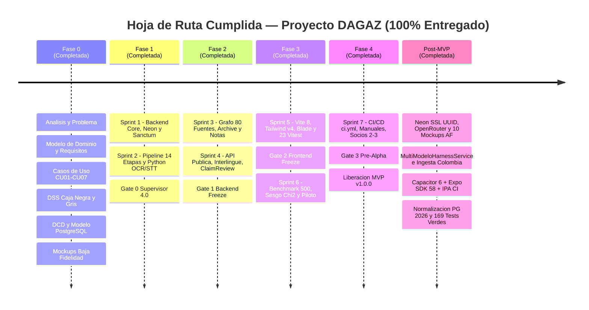

# Presentación General del Proyecto — Plataforma DAGAZ

> **Sistema:** DAGAZ — Plataforma Multicanal de Detección de Desinformación y Verificación de Contenidos  
> **Organización:** ISI-CORP (Periodo Académico 2026-II)  
> **Autores:** Alberto Mario Galvis Echeverria, Camilo Isaac Acevedo Rueda  
> **Estado Global del Proyecto:** ✅ **100% Completado — Versión Vigente `v1.4.1`** (MVP Liberado + Consejo Multi-Modelo + Ecosistema Móvil Dual Capacitor 6 / Expo SDK 58)  
> **Fecha de Actualización:** 09 de Noviembre de 2026

---

## 1. Resumen Ejecutivo (Executive Summary)

La viralización masiva de noticias falsas, contenidos manipulados y titulares sensacionalistas representa una amenaza directa a la deliberación democrática, la cohesión social y la toma de decisiones informadas. En el contexto de **Colombia**, este fenómeno impacta con especial severidad a los **Adultos (+40 años)** mediante cadenas difundidas en WhatsApp, Telegram y redes sociales.

**DAGAZ** cierra la brecha de velocidad, cobertura y trazabilidad del *fact-checking* tradicional permitiendo verificar afirmaciones desde texto, enlaces web/redes, imágenes (OCR) o notas de voz (STT), para luego:
1. **Aislar y descomponer afirmaciones atómicas** verificables.
2. **Contrastar evidencia documental y semántica** contra un **Grafo de Credibilidad de 80 Fuentes en 4 Niveles IFCN** almacenado en PostgreSQL 18 + `pgvector` (Neon.tech).
3. **Auditar mediante un Consejo Multi-Modelo en paralelo** (`MultiModeloHarnessService`: GPT-4o / OpenRouter, Claude 3.5 Sonnet, Gemini 2.0 Flash, DeepSeek-R1 y Qwen) con salvaguardas anti-degradación.
4. **Emitir veredictos explicables y exportables** (`ClaimReview` Schema.org, JSON forense SHA-256, CSV BOM) con participación ciudadana mediante **Notas Comunitarias**.

---

## 2. Definición Operativa del Dominio y Problemática

El proyecto aborda tres fallos estructurales del fact-checking convencional:
* **Asimetría de Velocidad:** La verificación manual tarda entre 4 y 24 horas; la desinformación se viraliza en minutos.
* **Sesgo de Cobertura:** El periodismo tradicional suele descuidar rumores regionales e hiperlocales.
* **Falta de Trazabilidad Máquina:** Se requiere trazabilidad estandarizada y auditable por redacciones y entes regulatorios.

Taxonomía aplicada:
* **Desinformación (*Disinformation*):** Información falsa creada y difundida deliberadamente para engañar.
* **Información errónea (*Misinformation*):** Falsedades compartidas sin intención deliberada de daño.
* **Información maliciosa (*Malinformation*):** Información real descontextualizada temporal o espacialmente para causar perjuicio.

---

## 3. Objetivos del Proyecto

### 3.1 Objetivo General
Construir un sistema integral para la detección y mitigación de desinformación apoyándose en tecnologías de Internet, análisis automatizado de fuentes y consenso multi-agente de IA.

### 3.2 Objetivos Específicos
1. **Ingeniería de Requisitos y Modelado:** Formalizar requisitos, casos de uso (`CU01`–`CU07`), diagramas UML/DSS y esquema relacional-vectorial.
2. **Arquitectura por Capas:** Desacoplar presentación Web/Móvil, controladores REST v1, adaptadores IA/multicanal, consejo multi-modelo y persistencia.
3. **Implementación Multiplataforma:** Backend en **Laravel 13 (`PHP 8.3–8.4`)** sobre **PostgreSQL 18 + `pgvector`** (con soporte MariaDB/SQLite), microservicios **Python FastAPI**, frontend **Vite 8 + Tailwind CSS v4 + Blade** y clientes móviles **Capacitor 6** (`mobile/`) y **Expo SDK 58** (`mobile-expo/`).
4. **Validación Estadística, QA y Cumplimiento:** **169 pruebas automatizadas aprobadas al 100%**, benchmark de 500 afirmaciones ($\kappa = 0{,}794$, Precisión **84.6%**, Exhaustividad **81.2%**, $F_1 = 0{,}828$), auditoría de sesgo ($\chi^2 = 0{,}682$, $p > 0{,}05$) y cumplimiento **Ley 1581 de 2012**.

---

## 4. Alcance Funcional: Catálogo de Casos de Uso (`CU01`–`CU07`) + Panel Editorial (`REQ-13`)

| Código | Caso de Uso / Capacidad | Propósito Principal |
| :--- | :--- | :--- |
| **CU01** | Asignar notas complementarias | Ciudadano aporta contexto y fuentes adicionales tras sanitización anti-XSS. |
| **CU02** | Calificar notas complementarias | Votación comunitaria de utilidad (`0.0` a `10.0`). |
| **CU03** | Guardar contenidos | Persistencia de noticias verificadas en el historial personal. |
| **CU04** | Mostrar historial de contenidos | Consulta cronológica paginada de verificaciones guardadas. |
| **CU05** | Inicio de sesión y Hábeas Data | Autenticación Bcrypt + tokens Sanctum UUID, descarga ARCO y derecho al olvido. |
| **CU06** | Verificar contenidos *(Core)* | Pipeline de 14 etapas multicanal + Búsqueda Semántica + Consejo Multi-Modelo. |
| **CU07** | Confiabilidad de fuentes | Consulta de 80 fuentes en 4 niveles IFCN, valoración y reclasificación editorial. |
| **REQ-13** | Panel de intervención humana | Rectificación justificada de veredictos por editores y administradores (`rol:admin,editor`). |

---

## 5. Arquitectura del Sistema y Stack Tecnológico Vigente (`v1.4.1`)

```text
┌──────────────────────────────────────────────────────────────────────────────┐
│                        ARQUITECTURA POR CAPAS (DAGAZ v1.4.1)                 │
├──────────────────────────────────────────────────────────────────────────────┤
│ 1. CLIENTES Y PRESENTACIÓN (+40 WCAG 2.1 AA)                                 │
│    • Web SSR/PWA: Vite 8 + Tailwind CSS v4 + Blade (frontend/views/)         │
│    • Móvil Híbrido: mobile/ (Capacitor 6, Android & iOS webDir)              │
│    • Móvil Nativo: mobile-expo/ (React Native + Expo SDK 58 + CI DAGAZ.ipa)  │
│    • Redacciones Aliadas M2M: Endpoints /api/v1/public/* con X-API-KEY       │
├───────────────────────────────────────┬──────────────────────────────────────┤
│ 2. NÚCLEO BACKEND (Laravel 13)        │ 3. ADAPTADORES IA & MULTICANAL       │
│    • VerificacionController           │    • AdaptadorApiIaInterface:        │
│    • PublicPartnerApiController       │      OpenAI, OpenRouter (<think>/    │
│    • AuditoriaController (ClaimReview)│      reasoning), Gemini, Ollama      │
│    • AuthController (Sanctum / Ley1581)│   • MultiModeloHarnessService (Pool) │
│    • BusquedaSemantica (normalizarSin │    • Microservicios Python FastAPI:  │
│      Tildes + contraste 2026)         │      OCR (:5001) & STT (:5002)       │
├───────────────────────────────────────┴──────────────────────────────────────┤
│ 4. PERSISTENCIA DUAL (PostgreSQL 18 pgvector Neon SSL / MariaDB / SQLite)    │
│    • 10 Tablas de dominio UUID + personal_access_tokens UUID (Sanctum)       │
│    • Grafo de 80 fuentes IFCN + corpus vectorizado e ingesta RSS/Colab       │
└──────────────────────────────────────────────────────────────────────────────┘
```

### Grafo Jerárquico de Fuentes de Información (`80` Fuentes)
* **Nivel 1 (`20` — Internacional / Multilateral):** Reuters, AP, AFP, BBC News Mundo, OMS, ONU, OCDE, EFE, DW.
* **Nivel 2 (`20` — Prensa Regional Colombiana):** El Colombiano, El Heraldo, El País Cali, Vanguardia, La Patria, El Universal.
* **Nivel 3 (`20` — Prensa Nacional Colombiana):** El Tiempo, El Espectador, Noticias Caracol, RCN, W Radio, Blu Radio, Portafolio, Cambio.
* **Nivel 4 (`20` — Fact-Checkers IFCN & Control Estatal):** ColombiaCheck, La Silla Vacía, AFP Factual, Chequeado, Snopes, PolitiFact, Registraduría, CNE, DANE, BanRep.

---

## 6. Fases Ejecutadas y Evolución del Proyecto (`v0.0.1` → `v1.4.1`)



---

## 7. Presupuesto Base y Recursos Asignados

El presupuesto base del proyecto se estimó en **$32.415.600 COP** para el ciclo completo de ingeniería y desarrollo:

| Rubro / Concepto | Duración | Inversión (COP) |
| :--- | :--- | :---: |
| Desarrollador Full Stack Junior (Remoto) | 16 semanas | $16.400.000 |
| Analista de Requerimientos Junior | 16 semanas | $12.800.000 |
| Licencia Enterprise Architect Corporate | 1 usuario | $916.000 |
| Licencia TablePlus | 1 usuario | $236.000 |
| GitHub Team (Suscripción x 4 meses) | 2 usuarios | $520.000 |
| Fondo de Imprevistos y Contingencias (5%) | Global | $1.543.600 |
| **TOTAL PRESUPUESTADO ESTIMADO** | | **$32.415.600 COP** |

---

## 8. Marco de Calidad, Seguridad y Gobernanza

1. **Pirámide de Pruebas Automatizadas (`169` Pruebas al 100%):**
   * **Backend (PHPUnit 12.5 sobre Laravel 13):** **142 pruebas** (`27 Unit` con 94 aserciones + `115 Feature` con 2.228 aserciones = **2.322 aserciones**, 0 fallos).
   * **Frontend (Vitest 5.0 + Happy-DOM):** **23 pruebas** en **8 suites**, 0 fallos.
   * **Microservicios Python (`unittest`):** **4 pruebas** en `test_services.py`, 0 fallos.
   * **Pipeline CI/CD Dual:** Validación automática en [`.github/workflows/ci.yml`](../../../.github/workflows/ci.yml) (backend PHP 8.4 + frontend Vite/Vitest + Capacitor `mobile-container`) y compilación nativa iOS `.ipa` en [`.github/workflows/build-ios-ipa.yml`](../../../.github/workflows/build-ios-ipa.yml).
2. **Seguridad, Resiliencia y Ley 1581 de 2012:**
   * Hashing **Bcrypt**, autenticación **Sanctum UUID** (`personal_access_tokens`), descarga ARCO y derecho al olvido en cascada (`DELETE /api/v1/auth/cuenta`).
   * SSL obligatorio en Neon (`DB_SSLMODE=require`), control de costes vía **Circuit Breaker** y auditoría `logs_comunicador_api`.

---

## 9. Resumen del Estado Final Vigente (`v1.4.1`)

| Bloque / Componente | Estado Actual |
| :--- | :--- |
| Fase 0: Análisis, UML, DSS Caja Negra/Gris, DCD y Mockups Baja Fidelidad | ✅ **100% Completado** |
| Sprints 1–4: Backend Laravel 13, PostgreSQL 18 Neon, OCR/STT, Grafo 80 Fuentes, API M2M, ClaimReview | ✅ **100% Completado** |
| Sprints 5–7: Frontend Vite 8 / Tailwind v4 / Blade (+40), Benchmark 500 ($F_1=0{,}828$), Sesgo ($\chi^2=0{,}682$), Manuales y CI/CD | ✅ **100% Completado** |
| Post-MVP `v1.1.0`–`v1.2.0`: Neon UUID, OpenRouter, Fallback Semántico y 10 Mockups Alta Fidelidad | ✅ **100% Completado** |
| Post-MVP `v1.3.0`: Consejo Multi-Modelo Paralelo (`MultiModeloHarnessService`) + Ingesta Colombia (`ingesta_noticias_colombia.py`) | ✅ **100% Completado** |
| Post-MVP `v1.4.0`–`v1.4.1`: Dual Móvil (`Capacitor 6` + `Expo SDK 58` + `.ipa` CI), `normalizarSinTildes()`, Contraste 2026, `<think>`/`reasoning` y **169 Tests Verdes** | ✅ **100% Completado** |
