# Cronograma Maestro y Diagrama de Gantt — Proyecto DAGAZ

> **Sistema:** DAGAZ — Plataforma Multicanal de Detección de Desinformación y Verificación de Contenidos  
> **Organización:** ISI-CORP (Periodo Académico 2026-II)  
> **Integrantes:** Alberto Mario Galvis Echeverria, Camilo Isaac Acevedo Rueda  
> **Metodología:** Scrum con Enfoque Backend-First (8 Sprints / 16 Semanas)  
> **Fecha de Actualización:** 14 de Noviembre de 2026  
> **Versión del Plan:** `v0.1.6`  

---

## 📑 Tabla de Contenidos

- [Cronograma Maestro y Diagrama de Gantt — Proyecto DAGAZ](#cronograma-maestro-y-diagrama-de-gantt--proyecto-dagaz)
  - [📑 Tabla de Contenidos](#-tabla-de-contenidos)
  - [1. Visión General del Cronograma y Hitos de Control (Gates)](#1-visión-general-del-cronograma-y-hitos-de-control-gates)
    - [Hitos de Control Formales (Quality Gates)](#hitos-de-control-formales-quality-gates)
  - [2. Diagrama de Gantt Oficial en Sintaxis Mermaid](#2-diagrama-de-gantt-oficial-en-sintaxis-mermaid)
  - [3. Diagrama de Flujo de Ruta Crítica y Dependencias (Mermaid)](#3-diagrama-de-flujo-de-ruta-crítica-y-dependencias-mermaid)
  - [4. Representación Visual del Cronograma (Timeline Semanal)](#4-representación-visual-del-cronograma-timeline-semanal)
  - [5. Matriz Detallada de Tareas WBS y Estado de Avance](#5-matriz-detallada-de-tareas-wbs-y-estado-de-avance)
  - [6. Análisis de Riesgos, Camino Crítico y Desviaciones](#6-análisis-de-riesgos-camino-crítico-y-desviaciones)
    - [5.1 Ruta Crítica (Critical Path)](#51-ruta-crítica-critical-path)
    - [5.2 Desviaciones y Logros Anticipados](#52-desviaciones-y-logros-anticipados)

---

## 1. Visión General del Cronograma y Hitos de Control (Gates)

El proyecto DAGAZ se ejecuta a lo largo de un ciclo de **16 semanas de desarrollo** organizado en **8 Sprints de 2 semanas (10 días hábiles por sprint)**, distribuidos bajo el principio de ingeniería **Backend-First**: asegurar la estabilidad de datos, lógica de contraste de IA y contratos de API antes de acoplar y pulir las interfaces de usuario web y móviles.

> 💡 **Documento Complementario:** Para consultar el desglose exhaustivo de las historias de usuario, criterios de aceptación, tareas técnicas WBS y evidencias de código de cada sprint realizado (Sprints 1 al 8), consulte **[`Sprint_Backlog_Realizados.md`](Sprint_Backlog_Realizados.md)**.


```
+---------------------------------------------------------------------------------------------------+
|                                  CRONOGRAMA MAESTRO POR SPRINTS                                   |
+----------+-----------------------+-----------------------------+--------------+-------------------+
| Sprint   | Fechas                | Enfoque Principal           | Puntos Total | Estado Actual     |
+----------+-----------------------+-----------------------------+--------------+-------------------+
| Sprint 1 | 23-Ago-26 - 05-Sep-26 | Req/Modelado (22) + DB (23) | 45 pts       | ✅ COMPLETADO (100%)|
| Sprint 2 | 06-Sep-26 - 19-Sep-26 | CU/UI (31) + Pipeline (42)  | 73 pts       | ✅ COMPLETADO (100%)|
| Sprint 3 | 20-Sep-26 - 03-Oct-26 | Monitoreo, Comunidad & 80 F.| 41 pts       | ✅ COMPLETADO (100%)|
| Sprint 4 | 27-Sep-26 - 02-Oct-26 | API Pública, Auditoría & QA | 33 pts       | ✅ COMPLETADO (100%)|
| Sprint 5 | 02-Oct-26 - 05-Oct-26 | Frontend Móvil Blade/Vitest | 26 pts       | ✅ COMPLETADO (100%)|
| Sprint 6 | 03-Oct-26 - 06-Oct-26 | Benchmark 500, Sesgo, Piloto| 39 pts       | ✅ COMPLETADO (100%)|
| Sprint 7 | 05-Oct-26 - 06-Oct-26 | CI/CD, Manuales, Traspaso    | 24 pts       | ✅ COMPLETADO (100%)|
| Sprint 8 | 08-Oct-26 - 14-Nov-26 | App Móvil, SSE, Multi-Modelo| 45 pts       | ✅ COMPLETADO (100%)|
+----------+-----------------------+-----------------------------+--------------+-------------------+
| TOTAL    | 16 Semanas (S1 - S8)  | Culminación Total Solución  | 326 pts      | ✅ COMPLETADO (100%)|
+----------+-----------------------+-----------------------------+--------------+-------------------+
```

### Hitos de Control Formales (Quality Gates)
* **GATE 0 — Aprobación Metodológica (2026-09-14):** Aprobación formal del proyecto por el docente supervisor (Calificación: 4.0 / 5.0).
* **GATE 1 — Backend Freeze (2026-10-02):** Congelamiento del núcleo transaccional, pipeline de 14 etapas, API pública con API Key, y certificación de 107 pruebas automatizadas PHPUnit al 100%.
* **GATE 2 — Frontend & Multicanal Freeze (2026-10-05):** Vistas Blade responsivas (`frontend/views/`), PWA accesible (+40 WCAG 2.1 AA) y certificación de 23 pruebas de interfaz en Vitest.
* **GATE SUPERVISOR — Revisión Formal del Supervisor (2026-10-16):** Segunda auditoría académica formal por el docente supervisor (Calificación: **5.0 / 5.0 — 5/5**). Visto bueno de avance, arquitectura y componentes de verificación.
* **GATE 3 — Consolidación de la Versión Pre-Alpha (2026-10-06):** Publicación formal de la versión pre-alpha de DAGAZ, funcional de extremo a extremo en interfaz web responsiva y API REST, CI/CD en GitHub Actions, Benchmark de 500 afirmaciones ($F_1 = 0{,}828$), cero sesgo político y acta de traspaso formal para inicio de la fase de pruebas intensivas de calidad.
* **GATE 4 — Certificación Móvil Nativa, Streaming Reactivo y Consejo Multi-Modelo (2026-11-14):** Despliegue de aplicación móvil completa React Native Expo en `mobile-expo/` con accesibilidad (+40), APK autónomo Android en `mobile/` (`app-debug.apk`), workflow GitHub Actions macOS para compilación de `DAGAZ.ipa` sin firma, orquestación de consejo multi-agente (`MultiModeloHarnessService`), canal de eventos SSE (`/api/v1/verificacion/stream`), Consola de Pensamiento CoT, blindaje factual en búsqueda semántica PostgreSQL 2026 y certificación de 171 pruebas automatizadas (144 PHPUnit con 2.334 aserciones, 23 Vitest, 4 Python) pasando al 100%.

---

## 2. Diagrama de Gantt Oficial en Sintaxis Mermaid

```mermaid
gantt
    title Cronograma Maestro y Diagrama de Gantt — Proyecto DAGAZ (14 Semanas)
    dateFormat  YYYY-MM-DD
    axisFormat  %d/%m
    tickInterval 1week

    section Sprint 1: Requisitos, Negocio & DB
    Ideacion y Problemas ACT-01                 :done, s1_act1, 2026-08-23, 2026-08-26
    Metodologia Scrum vs RUP ACT-02             :done, s1_act2, 2026-08-26, 2026-08-30
    Analisis y Canvas Negocio ACT-03 ACT-04     :done, s1_act3, 2026-08-25, 2026-08-30
    Analisis y Modelo Requisitos ACT-05 ACT-06  :done, s1_act4, 2026-08-28, 2026-09-01
    Conexion Neon pgvector (TSK-1.1)            :done, s1_1, 2026-08-23, 2026-08-28
    DDL 10 Tablas Raiden.sql (TSK-1.2)          :done, s1_2, 2026-08-28, 2026-09-02
    Indices B-Tree y KNN exacto (TSK-1.3)       :done, s1_3, 2026-09-01, 2026-09-04
    Modelos Eloquent y Relaciones (TSK-1.4)     :done, s1_4, 2026-09-02, 2026-09-05
    Seeder Grafo Nivel 1 (TSK-1.5)              :done, s1_5, 2026-09-03, 2026-09-05
    Auth Sanctum y Hashing (TSK-1.6 TSK-1.7)    :done, s1_6, 2026-09-03, 2026-09-05

    section Sprint 2: Casos de Uso, UI & Core IA
    Analisis y Descripcion CU01-CU07 ACT-07/08  :done, s2_act1, 2026-09-06, 2026-09-11
    Modelado UML Casos de Uso ACT-09            :done, s2_act2, 2026-09-08, 2026-09-13
    Modelado Secuencias DSS y DS ACT-10         :done, s2_act3, 2026-09-09, 2026-09-14
    Propuesta Mockups UI Servilleta ACT-11      :done, s2_act4, 2026-09-10, 2026-09-15
    Strategy Drivers IA (TSK-2.1)               :done, s2_1, 2026-09-06, 2026-09-10
    Extractor de Afirmaciones REQ-01 (TSK-2.2)  :done, s2_2, 2026-09-09, 2026-09-13
    Microservicios Python OCR y STT (TSK-2.3)   :done, s2_3, 2026-09-11, 2026-09-16
    Aprobacion Formal Supervisor (4.0/5.0)      :milestone, done, m0, 2026-09-14, 0d
    Recuperacion de Evidencia REQ-05 (TSK-2.4)  :done, s2_4, 2026-09-13, 2026-09-17
    Verificacion Cruzada y Ponderacion (TSK-2.5):done, s2_5, 2026-09-15, 2026-09-18
    Sintesis Veredicto y Telemetria (TSK-2.6/7) :done, s2_6, 2026-09-16, 2026-09-19

    section Sprint 3: Grafo 80 Fuentes & Redes
    Grafo 80 Fuentes IFCN (TSK-3.1)             :done, s3_1, 2026-09-20, 2026-09-25
    Ingesta 8.000 Noticias Neon (TSK-3.2)       :done, s3_2, 2026-09-24, 2026-09-30
    Conector Wayback Machine Archive (TSK-3.3)  :done, s3_3, 2026-09-26, 2026-09-30
    Notas Comunitarias CU01 CU02 (TSK-3.4)      :done, s3_4, 2026-09-27, 2026-10-02
    Historial CU03 CU04 y Fuentes CU07 (TSK-3.5):done, s3_5, 2026-09-29, 2026-10-03

    section Sprint 4: API Publica & Auditoria
    API Publica REST Redacciones (TSK-4.1)      :done, s4_1, 2026-09-27, 2026-09-30
    Middleware EnsureValidApiKey (TSK-4.2)      :done, s4_2, 2026-09-28, 2026-10-01
    Circuit Breaker Costes LLM (TSK-4.3)        :done, s4_3, 2026-09-29, 2026-10-01
    Recuperacion Interlingue ES-EN (TSK-4.4)    :done, s4_4, 2026-09-30, 2026-10-02
    Exportador Forense ClaimReview (TSK-4.5)    :done, s4_5, 2026-10-01, 2026-10-02
    Gate 1 - Backend Freeze (107 Tests)         :milestone, done, m1, 2026-10-02, 0d

    section Sprint 5: Frontend Movil (+40)
    UI Tailwind y Alpine.js (TSK-5.1 TSK-5.2)   :done, s5_1, 2026-10-02, 2026-10-04
    Pestanas Ingesta y Audio Web (TSK-5.3)      :done, s5_2, 2026-10-03, 2026-10-04
    Tarjeta Veredicto y Semaforo SVG (TSK-5.4)  :done, s5_3, 2026-10-03, 2026-10-04
    Explorador 80 Fuentes fuentes.html (TSK-5.5):done, s5_4, 2026-10-03, 2026-10-04
    Servidor Ligero api_server y CORS (TSK-5.6) :done, s5_5, 2026-10-03, 2026-10-04
    Suite Pruebas VerificacionesBackend (TSK-5.7):done, s5_6, 2026-10-04, 2026-10-04
    Vistas Blade, PWA y Vitest (TSK-5.8)        :done, s5_7, 2026-10-04, 2026-10-05
    Gate 2 - Frontend Freeze (23 Vitest)        :milestone, done, m2, 2026-10-05, 0d
    Revision Formal Supervisor (5.0/5.0)        :milestone, done, m_sup, 2026-10-16, 0d

    section Sprint 6: Benchmark & Piloto
    UI Notas Comunitarias y Calificacion (TSK-6.1):done, s6_1, 2026-10-03, 2026-10-05
    Benchmark 500 Afirmaciones REQ-11 (TSK-6.2) :done, s6_2, 2026-10-04, 2026-10-06
    Auditoria Sesgo Politico REQ-17 (TSK-6.3)   :done, s6_3, 2026-10-04, 2026-10-06
    Evaluacion Formal F1 Precision REQ-24 (TSK-6.4):done, s6_4, 2026-10-05, 2026-10-06
    Prueba Carga y Flujo Continuo REQ-21 (TSK-6.5):done, s6_5, 2026-10-05, 2026-10-06
    Piloto Redaccion 1 - 50 Veredictos (TSK-6.6):done, s6_6, 2026-10-05, 2026-10-06
    section Sprint 7: CI/CD & Cierre Pre-Alpha
    Pipeline GitHub Actions CI/CD (TSK-7.1)     :done, s7_1, 2026-10-05, 2026-10-06
    Onboarding Redacciones 2 y 3 REQ-26 (TSK-7.2):done, s7_2, 2026-10-05, 2026-10-06
    Manuales de Usuario y Despliegue REQ-27 (TSK-7.3):done, s7_3, 2026-10-05, 2026-10-06
    Retrospectiva Final y Traspaso REQ-28 (TSK-7.4):done, s7_4, 2026-10-06, 2026-10-06
    Gate 3 - Consolidacion Version Pre-Alpha    :milestone, done, m3, 2026-10-06, 0d

    section Sprint 8: Ecosistema Móvil & Multi-Modelo
    Mantenimiento Rutas y CI Artifact (TSK-8.1) :done, s8_1, 2026-10-08, 2026-10-12
    Consejo Multi-Modelo MultiModeloHarness (TSK-8.2) :done, s8_2, 2026-10-15, 2026-11-03
    Mockups Alta Fidelidad WCAG 2.1 AA (TSK-8.3) :done, s8_3, 2026-10-20, 2026-11-03
    Ingesta RAG 50.000 Noticias Neon (TSK-8.4)  :done, s8_4, 2026-10-25, 2026-11-03
    App Movil React Native Expo (TSK-8.5)       :done, s8_5, 2026-10-28, 2026-11-06
    Contenedor Android Capacitor (TSK-8.6)      :done, s8_6, 2026-11-04, 2026-11-06
    Workflow CI macOS DAGAZ.ipa (TSK-8.7)       :done, s8_7, 2026-11-07, 2026-11-09
    Busqueda PostgreSQL 2026 y 144 PHPUnit (TSK-8.8):done, s8_8, 2026-11-08, 2026-11-10
    Streaming SSE, CoT Console y APK Autonomo (TSK-8.9):done, s8_9, 2026-11-10, 2026-11-14
    Gate 4 - Certificacion Movil, SSE y Multi-Modelo (171 Tests):milestone, done, m4, 2026-11-14, 0d
```



---

## 3. Diagrama de Flujo de Ruta Crítica y Dependencias (Mermaid)

```mermaid
flowchart TD
    classDef done fill:#d4edda,stroke:#28a745,stroke-width:2px,color:#155724;
    classDef inprog fill:#fff3cd,stroke:#ffc107,stroke-width:2px,color:#856404;
    classDef planned fill:#f8f9fa,stroke:#6c757d,stroke-width:2px,stroke-dasharray: 5 5,color:#383d41;
    classDef gate fill:#cce5ff,stroke:#004085,stroke-width:3px,color:#004085;

    G0["GATE 0: Aprobación Supervisor (4.0/5.0)<br/>2026-09-14"]:::done

    subgraph S1["SPRINT 1: Requisitos, Negocio & DB (23-Ago a 05-Sep)"]
        A1["ACT-1: Requisitos & Modelo de Negocio (22 pts)"]:::done
        T11["TSK-1.1: Conexión Neon pgvector"]:::done
        T12["TSK-1.2: DDL 10 Tablas Raiden.sql"]:::done
        T14["TSK-1.4: Modelos Eloquent"]:::done
        T16["TSK-1.6: Auth Sanctum CU05"]:::done
    end

    subgraph S2["SPRINT 2: Casos de Uso, UI & Core IA (06-Sep a 19-Sep)"]
        A2["ACT-2: Casos de Uso, Secuencias & Mockups (31 pts)"]:::done
        T21["TSK-2.1: Strategy Drivers IA"]:::done
        T22["TSK-2.2: Extractor Afirmaciones"]:::done
        T23["TSK-2.3: Microservicios OCR/STT"]:::done
        T25["TSK-2.5: Verificación Cruzada"]:::done
        T26["TSK-2.6: Síntesis de Veredicto"]:::done
    end

    subgraph S3["SPRINT 3: Grafo 80 Fuentes & Monitoreo (20-Sep a 03-Oct)"]
        T31["TSK-3.1: Grafo 80 Fuentes IFCN"]:::done
        T32["TSK-3.2: Conector Archive.org"]:::done
        T33["TSK-3.3: Notas Comunitarias CU01/02"]:::done
        T35["TSK-3.5: Historial CU03/04"]:::done
        T38["Ingesta 8.000 noticias Neon"]:::done
    end

    subgraph S4["SPRINT 4: API Pública & Auditoría (27-Sep a 02-Oct)"]
        T42["TSK-4.2: API Key Redacciones M2M"]:::done
        T43["TSK-4.3: Circuit Breaker Costes"]:::done
        T44["TSK-4.4: Interlingüe ES-EN"]:::done
        T46["TSK-4.6: Auditoría ClaimReview"]:::done
        T47["TSK-4.7: 107 Pruebas PHPUnit"]:::done
    end

    G1["GATE 1: Backend Freeze<br/>107 Tests Pasando (100%)<br/>2026-10-02"]:::done

    subgraph S5["SPRINT 5: Frontend Móvil (+40) & Blade (02-Oct a 05-Oct)"]
        T51["TSK-5.1: UI Tailwind & Alpine.js"]:::done
        T53["TSK-5.3: UI Ingesta Multicanal"]:::done
        T54["TSK-5.4: UI Veredicto & Semáforo"]:::done
        T57["TSK-5.7: Servidor api_server & CORS"]:::done
        T58["TSK-5.8: Pruebas VerificacionesBackend"]:::done
        T56["TSK-5.6: Vistas Blade, PWA & Vitest"]:::done
    end

    G2["GATE 2: Frontend & Multicanal Freeze<br/>23 Tests Vitest (100%)<br/>2026-10-05"]:::done
    GSUP["GATE SUPERVISOR: Revisión Formal (5.0/5.0)<br/>2026-10-16"]:::done

    subgraph S6["SPRINT 6: Benchmark & Piloto (03-Oct a 06-Oct)"]
        T61["TSK-6.1: UI Notas y Calificación CU01/02"]:::done
        T62["TSK-6.2: Benchmark 500 Afirmaciones"]:::done
        T63["TSK-6.3: Auditoría de Sesgo Electoral"]:::done
        T64["TSK-6.4: Evaluación Formal F1=0.828"]:::done
        T67["TSK-6.7: Piloto Socio 1 (50 Ver.)"]:::done
    end

    subgraph S7["SPRINT 7: CI/CD & Traspaso (05-Oct a 06-Oct)"]
        T71["TSK-7.1: Pipeline GitHub Actions CI/CD"]:::done
        T72["TSK-7.2: Onboarding Redacciones Socias REQ-26"]:::done
        T73["TSK-7.3: Manuales Usuario, Admin & Despliegue"]:::done
        T74["TSK-7.4: Retrospectiva & Acta Traspaso Pre-Alpha"]:::done
    end

    G3["GATE 3: Publicación Versión Pre-Alpha<br/>149 Tests Automatizados (100%)<br/>2026-10-06"]:::done

    subgraph S8["SPRINT 8: Ecosistema Móvil Nativo & Streaming (08-Oct a 14-Nov)"]
        T82["TSK-8.2: MultiModeloHarnessService"]:::done
        T83["TSK-8.3: Mockups Alta Fidelidad"]:::done
        T84["TSK-8.4: Ingesta 50k Noticias Neon"]:::done
        T85["TSK-8.5: App Móvil Expo & Capacitor"]:::done
        T87["TSK-8.7: Workflow macOS DAGAZ.ipa"]:::done
        T88["TSK-8.8: Blindaje Semántico & 144 PHPUnit"]:::done
        T89["TSK-8.9: Streaming SSE & CoT Console"]:::done
    end

    G4["GATE 4: Certificación Móvil, SSE & Multi-Modelo<br/>171 Tests QA Totales (100%)<br/>2026-11-14"]:::done

    %% Conexiones de Dependencia
    S1 --> S2
    S2 --> S3
    S2 --> S4
    S3 --> S4
    S4 --> G1
    G1 --> S5
    S5 --> G2
    G2 --> GSUP
    GSUP --> S6
    S6 --> S7
    S7 --> G3
    G3 --> S8
    S8 --> G4
```



---

## 4. Representación Visual del Cronograma (Timeline Semanal)

A continuación se ilustra la escala cronológica de las 14 semanas del proyecto (Semana 1 a Semana 14):

```
Leyenda:
[████] = Tarea Completada al 100%
[ ❖  ] = Hito de Calidad Aprobado (Quality Gate)

SEMANA:        | S1 | S2 | S3 | S4 | S5 | S6 | S7 | S8 | S9 | S10| S11| S12| S13| S14|
MES:           |   AGOSTO   |       SEPTIEMBRE        |        OCTUBRE        | NOVIEMBRE |
SPRINT:        |   SPRINT 1 |   SPRINT 2 |   SPRINT 3 |   SPRINT 4 |   SPRINT 5 |   SPRINT 6 |   SPRINT 7 |

1. REQUISITOS, NEGOCIO & PERSISTENCIA
- Ideación & Problemas (ACT-01)   [████]
- Metodología & Canvas (ACT-02/04)[████]
- Backlog & Req Model (ACT-05/06) [████]
- Conexión Neon pgvector (TSK-1.1)[████]
- DDL Raiden (10 tablas) (TSK-1.2)[████]
- Modelos Eloquent       (TSK-1.4)[████]
- Auth Sanctum (CU05)    (TSK-1.6)[████]

2. CASOS DE USO, UI & PIPELINE CORE IA
- Casos de Uso CU01-CU07 (ACT-07/08)   [████]
- Modelado UML & Secuencias (ACT-09/10)[████]
- Mockups Servilleta UI  (ACT-11)      [████]
- Strategy Drivers IA    (TSK-2.1)     [████]
- Extracción Afirmaciones(TSK-2.2)     [████]
- Microservicios OCR/STT (TSK-2.3)     [████]
- Contraste Semántico    (TSK-2.5)     [████]
- Síntesis de Veredicto  (TSK-2.6)     [████]
* GATE 0: APROBACIÓN SUPERVISOR 4.0/5.0      [ ❖  ] (14-Sep)

3. GRAFO FUENTES & COMUNIDAD
- Grafo 80 Fuentes IFCN            [████]
- Ingesta 8.000 Noticias Neon      [████]
- Conector Archive.org             [████]
- Notas Comunitarias (CU01/02)     [████]
- Historial Usuario (CU03/04)      [████]

4. API PÚBLICA & AUDITORÍA
- API Key M2M Socias                    [████]
- Circuit Breaker Costes                [████]
- Interlingüe ES-EN                     [████]
- Exportador ClaimReview                [████]
- 107 Pruebas PHPUnit (100%)            [████]
* GATE 1: BACKEND FREEZE                      [ ❖  ] (02-Oct)

5. FRONTEND MÓVIL (+40) & BLADE
- UI Tailwind & Alpine.js                    [████]
- Pestañas Ingesta Multicanal                [████]
- Tarjeta Veredicto & Semáforo               [████]
- Servidor Ligero & CORS                     [████]
- Vistas Blade en frontend/views/            [████]
- Suite 23 Tests Vitest                      [████]
* GATE 2: FRONTEND FREEZE                         [ ❖  ] (05-Oct)
* GATE SUPERVISOR: REVISIÓN FORMAL 5.0/5.0 (5/5)  [ ❖  ] (16-Oct)

6. BENCHMARK & PILOTO
- Benchmark 500 Afirmaciones (F1=0.828)                   [████]
- Auditoría de Sesgo Electoral (Chi2=0.682)               [████]
- Piloto Sala de Redacción (50 veredictos)                [████]

7. CI/CD & TRASPASO
- Pipeline GitHub Actions CI/CD                                [████]
- Onboarding Redacciones Socias REQ-26                         [████]
- Manuales Usuario, Admin & Despliegue                         [████]
- Retrospectiva Final & Acta de Traspaso                       [████]
* GATE 3: PUBLICACIÓN VERSIÓN PRE-ALPHA                        [ ❖  ] (06-Oct)
```

---

## 5. Matriz Detallada de Tareas WBS y Estado de Avance

| WBS ID | Sprint | Módulo / Tarea | Responsable | Inicio | Fin | Duración | Pts | Estado |
| :--- | :---: | :--- | :--- | :---: | :---: | :---: | :---: | :---: |
| **ACT-1.1** | S1 | Matriz de ideación/identificación de problemáticas | Equipo Scrum | 23-Ago-26 | 26-Ago-26 | 3 días | 3 | ✅ Completado |
| **ACT-1.2** | S1 | Elección de metodología (Scrum vs RUP) | Equipo Scrum | 26-Ago-26 | 30-Ago-26 | 4 días | 5 | ✅ Completado |
| **ACT-1.3** | S1 | Análisis de negocio (Objetivos y viabilidad) | Equipo Scrum | 25-Ago-26 | 28-Ago-26 | 3 días | 3 | ✅ Completado |
| **ACT-1.4** | S1 | Modelado del negocio (Lienzo Canvas y Dominio) | Equipo Scrum | 26-Ago-26 | 30-Ago-26 | 4 días | 5 | ✅ Completado |
| **ACT-1.5** | S1 | Análisis de requisitos (Product Backlog 28 reqs) | Alberto Galvis | 28-Ago-26 | 30-Ago-26 | 3 días | 3 | ✅ Completado |
| **ACT-1.6** | S1 | Modelado de requisitos (Taxonomía y jerarquía) | Camilo Acevedo | 28-Ago-26 | 31-Ago-26 | 3 días | 3 | ✅ Completado |
| **TSK-1.1** | S1 | Conexión PostgreSQL 18 / Neon.tech con `pgvector` | Alberto Galvis | 23-Ago-26 | 28-Ago-26 | 5 días | 2 | ✅ Completado |
| **TSK-1.2** | S1 | Migraciones y DDL 10 Tablas (`Raiden.sql`) | Alberto Galvis | 28-Ago-26 | 02-Sep-26 | 5 días | 5 | ✅ Completado |
| **TSK-1.3** | S1 | Índices B-Tree y estrategia KNN sin HNSW | Camilo Acevedo | 01-Sep-26 | 04-Sep-26 | 4 días | 2 | ✅ Completado |
| **TSK-1.4** | S1 | Modelos Eloquent y relaciones relacionales | Alberto Galvis | 02-Sep-26 | 05-Sep-26 | 4 días | 3 | ✅ Completado |
| **TSK-1.5** | S1 | Seeder inicial Grafo Nivel 1 (10 fuentes) | Camilo Acevedo | 03-Sep-26 | 05-Sep-26 | 3 días | 3 | ✅ Completado |
| **TSK-1.6** | S1 | Controladores Auth Sanctum y hashing Argon2 (CU05) | Alberto Galvis | 03-Sep-26 | 05-Sep-26 | 3 días | 5 | ✅ Completado |
| **TSK-1.7** | S1 | Pruebas unitarias de esquema y autenticación | Camilo Acevedo | 04-Sep-26 | 05-Sep-26 | 2 días | 3 | ✅ Completado |
| **ACT-2.1** | S2 | Análisis de casos de uso (CU01-CU07 y Adulto Mayor) | Alberto Galvis | 06-Sep-26 | 10-Sep-26 | 4 días | 5 | ✅ Completado |
| **ACT-2.2** | S2 | Descripción de casos de uso (Fichas narrativas) | Camilo Acevedo | 07-Sep-26 | 11-Sep-26 | 4 días | 5 | ✅ Completado |
| **ACT-2.3** | S2 | Modelado de casos de uso (Diagramas UML de CU) | Alberto Galvis | 08-Sep-26 | 13-Sep-26 | 5 días | 8 | ✅ Completado |
| **ACT-2.4** | S2 | Modelado de secuencias (DSS Caja Negra / DS Gris) | Camilo Acevedo | 09-Sep-26 | 14-Sep-26 | 4 días | 5 | ✅ Completado |
| **ACT-2.5** | S2 | Propuesta de mockups de la UI del servicio | Alberto Galvis | 10-Sep-26 | 15-Sep-26 | 5 días | 8 | ✅ Completado |
| **TSK-2.1** | S2 | Drivers IA con patrón Strategy (`IaDriverFactory`) | Alberto Galvis | 06-Sep-26 | 10-Sep-26 | 5 días | 5 | ✅ Completado |
| **TSK-2.2** | S2 | Agente Extractor de Afirmaciones (REQ-01) | Alberto Galvis | 09-Sep-26 | 13-Sep-26 | 5 días | 8 | ✅ Completado |
| **TSK-2.3** | S2 | Microservicios Python OCR y STT (`:5001`, `:5002`) | Camilo Acevedo | 11-Sep-26 | 16-Sep-26 | 6 días | 5 | ✅ Completado |
| **TSK-2.4** | S2 | Recuperación de Evidencia documental y semántica | Alberto Galvis | 13-Sep-26 | 17-Sep-26 | 5 días | 8 | ✅ Completado |
| **TSK-2.5** | S2 | Verificación Cruzada y Ponderación por nivel | Alberto Galvis | 15-Sep-26 | 18-Sep-26 | 4 días | 8 | ✅ Completado |
| **TSK-2.6** | S2 | Agente de Síntesis del Veredicto explicable | Camilo Acevedo | 16-Sep-26 | 19-Sep-26 | 4 días | 5 | ✅ Completado |
| **TSK-2.7** | S2 | Telemetría y registro en `logs_comunicador_api` | Camilo Acevedo | 18-Sep-26 | 19-Sep-26 | 2 días | 3 | ✅ Completado |
| **TSK-3.1** | S3 | Ampliación a Grafo de 80 Fuentes IFCN en 4 niveles | Camilo Acevedo | 20-Sep-26 | 25-Sep-26 | 6 días | 8 | ✅ Completado |
| **TSK-3.2** | S3 | Ingesta masiva de 8.000+ noticias vectorizadas | Alberto Galvis | 24-Sep-26 | 30-Sep-26 | 7 días | 8 | ✅ Completado |
| **TSK-3.3** | S3 | Conector Archive.org / Wayback Machine (REQ-10) | Alberto Galvis | 26-Sep-26 | 30-Sep-26 | 5 días | 5 | ✅ Completado |
| **TSK-3.4** | S3 | Endpoints de Notas Comunitarias (CU01 y CU02) | Camilo Acevedo | 27-Sep-26 | 02-Oct-26 | 6 días | 10 | ✅ Completado |
| **TSK-3.5** | S3 | Historial de Usuario y consultas guardadas (CU03/04) | Camilo Acevedo | 29-Sep-26 | 03-Oct-26 | 5 días | 5 | ✅ Completado |
| **TSK-3.6** | S3 | Panel de moderación y valoración de fuentes (CU07) | Alberto Galvis | 30-Sep-26 | 03-Oct-26 | 4 días | 5 | ✅ Completado |
| **TSK-4.1** | S4 | API Pública REST v1 para salas de redacción (REQ-16)| Alberto Galvis | 27-Sep-26 | 30-Sep-26 | 4 días | 5 | ✅ Completado |
| **TSK-4.2** | S4 | Middleware `EnsureValidApiKey` y Rate Limiting | Alberto Galvis | 28-Sep-26 | 01-Oct-26 | 4 días | 5 | ✅ Completado |
| **TSK-4.3** | S4 | Circuit Breaker y control presupuestal de LLMs | Camilo Acevedo | 29-Sep-26 | 01-Oct-26 | 3 días | 5 | ✅ Completado |
| **TSK-4.4** | S4 | Recuperación interlingüe y contraste ES-EN | Alberto Galvis | 30-Sep-26 | 02-Oct-26 | 3 días | 8 | ✅ Completado |
| **TSK-4.5** | S4 | Exportador forense ClaimReview, JSON y CSV (REQ-25)| Camilo Acevedo | 01-Oct-26 | 02-Oct-26 | 2 días | 5 | ✅ Completado |
| **TSK-4.6** | S4 | **Gate 1: Backend Freeze — Batería de 107 Pruebas** | Equipo Scrum | 01-Oct-26 | 02-Oct-26 | 2 días | 5 | ✅ Completado |
| **TSK-5.1** | S5 | Framework Frontend Tailwind CSS + Alpine.js | Alberto Galvis | 02-Oct-26 | 03-Oct-26 | 2 días | 5 | ✅ Completado |
| **TSK-5.2** | S5 | Diseño accesible (+40) WCAG 2.1 AA | Camilo Acevedo | 02-Oct-26 | 04-Oct-26 | 3 días | 3 | ✅ Completado |
| **TSK-5.3** | S5 | Vista de Ingesta Multicanal y grabación de audio | Alberto Galvis | 03-Oct-26 | 04-Oct-26 | 2 días | 5 | ✅ Completado |
| **TSK-5.4** | S5 | Tarjeta de Veredicto con medidor circular SVG | Alberto Galvis | 03-Oct-26 | 04-Oct-26 | 2 días | 5 | ✅ Completado |
| **TSK-5.5** | S5 | Explorador de Fuentes y filtros IFCN (`fuentes.html`)| Camilo Acevedo | 03-Oct-26 | 04-Oct-26 | 2 días | 3 | ✅ Completado |
| **TSK-5.6** | S5 | Servidor Ligero `api_server.php` y soporte CORS | Alberto Galvis | 03-Oct-26 | 04-Oct-26 | 2 días | 3 | ✅ Completado |
| **TSK-5.7** | S5 | Suite `VerificacionesBackendFeatureTest.php` (7 req)| Camilo Acevedo | 04-Oct-26 | 04-Oct-26 | 1 día | 2 | ✅ Completado |
| **TSK-5.8** | S5 | Vistas Blade (`frontend/views/`), PWA y 23 Vitest | Equipo Scrum | 04-Oct-26 | 05-Oct-26 | 2 días | 5 | ✅ Completado |
| **GATE-SUP** | S5 | **Gate Supervisor: Revisión Formal Segunda Auditoría (Calificación 5/5)** | Supervisor / Equipo | 16-Oct-26 | 16-Oct-26 | 1 día | 5 | ✅ Aprobado (5/5) |
| **TSK-6.1** | S6 | Maquetación UI Notas complementarias y votos | Camilo Acevedo | 03-Oct-26 | 05-Oct-26 | 2 días | 5 | ✅ Completado |
| **TSK-6.2** | S6 | Carga y etiquetado de benchmark 500 afirmaciones | Equipo Scrum | 04-Oct-26 | 06-Oct-26 | 2 días | 8 | ✅ Completado |
| **TSK-6.3** | S6 | Auditoría de sesgo político electoral (REQ-17) | Alberto Galvis | 04-Oct-26 | 06-Oct-26 | 2 días | 8 | ✅ Completado |
| **TSK-6.4** | S6 | Evaluación formal de métricas (F1=0.828, P=84.6%) | Camilo Acevedo | 05-Oct-26 | 06-Oct-26 | 2 días | 5 | ✅ Completado |
| **TSK-6.5** | S6 | Ingesta continua RSS y flujo sin interrupciones | Alberto Galvis | 05-Oct-26 | 06-Oct-26 | 2 días | 8 | ✅ Completado |
| **TSK-6.6** | S6 | Integración piloto con redacción socia 1 (50 ver.) | Equipo Scrum | 05-Oct-26 | 06-Oct-26 | 2 días | 5 | ✅ Completado |
| **TSK-7.1** | S7 | Configuración de pipeline CI/CD en GitHub Actions | Camilo Acevedo | 05-Oct-26 | 06-Oct-26 | 2 días | 5 | ✅ Completado |
| **TSK-7.2** | S7 | Onboarding de redacciones socias 2 y 3 (REQ-26) | Alberto Galvis | 05-Oct-26 | 06-Oct-26 | 2 días | 8 | ✅ Completado |
| **TSK-7.3** | S7 | Elaboración de manuales de usuario y despliegue | Camilo Acevedo | 05-Oct-26 | 06-Oct-26 | 2 días | 8 | ✅ Completado |
| **TSK-7.4** | S7 | Retrospectiva final y traspaso oficial versión pre-alpha | Equipo Scrum | 06-Oct-26 | 06-Oct-26 | 1 día | 3 | ✅ Completado |
| **TSK-8.1** | S8 | Mantenimiento de rutas frontend y fijación de artifact CI v4.1.3 | Alberto Galvis | 08-Oct-26 | 12-Oct-26 | 4 días | 3 | ✅ Completado |
| **TSK-8.2** | S8 | Orquestación Consejo Multi-Modelo (`MultiModeloHarnessService`) | Camilo Acevedo | 15-Oct-26 | 03-Nov-26 | 19 días | 8 | ✅ Completado |
| **TSK-8.3** | S8 | Creación de 10 Mockups de Alta Fidelidad HTML5 (WCAG 2.1 AA) | Alberto Galvis | 20-Oct-26 | 03-Nov-26 | 14 días | 5 | ✅ Completado |
| **TSK-8.4** | S8 | Script de Ingesta Masiva RAG de 50.000 noticias colombianas en Neon | Camilo Acevedo | 25-Oct-26 | 03-Nov-26 | 9 días | 8 | ✅ Completado |
| **TSK-8.5** | S8 | App Móvil Nativa React Native Expo (`mobile-expo/`) con selector `A/A+` | Alberto Galvis | 28-Oct-26 | 06-Nov-26 | 9 días | 8 | ✅ Completado |
| **TSK-8.6** | S8 | Restauración y segregación de contenedor Android Capacitor (`mobile/`) | Camilo Acevedo | 04-Nov-26 | 06-Nov-26 | 2 días | 3 | ✅ Completado |
| **TSK-8.7** | S8 | Workflow CI macOS para generar `DAGAZ.ipa` sin firma para Sideloadly | Camilo Acevedo | 07-Nov-26 | 09-Nov-26 | 2 días | 5 | ✅ Completado |
| **TSK-8.8** | S8 | Búsqueda semántica PostgreSQL 2026, blindaje factual y 144 tests PHPUnit | Equipo Scrum | 08-Nov-26 | 10-Nov-26 | 2 días | 5 | ✅ Completado |
| **TSK-8.9** | S8 | Streaming SSE (`/verificacion/stream`), Consola CoT y APK autónomo Android | Equipo Scrum | 10-Nov-26 | 14-Nov-26 | 4 días | 5 | ✅ Completado |

---

## 6. Análisis de Riesgos, Camino Crítico y Desviaciones

### 5.1 Ruta Crítica (Critical Path)
La ruta crítica del proyecto comprende las dependencias estructurales que determinan la fecha mínima de liberación:
1. `TSK-1.2` (DDL de 10 Tablas) $\rightarrow$ `TSK-2.4` (Búsqueda semántica) $\rightarrow$ `TSK-3.2` (8.000 noticias en Neon) $\rightarrow$ `TSK-4.6` (Backend Freeze) $\rightarrow$ `TSK-5.3/5.4` (Frontend Ingesta/Veredicto) $\rightarrow$ `TSK-6.6` (Piloto Redacción Socia) $\rightarrow$ `TSK-7.4` (Publicación Versión Pre-Alpha).

### 5.2 Desviaciones y Logros Anticipados
* **Adelanto del Grafo de Credibilidad:** La meta inicial del Sprint 3 era alcanzar 40 fuentes (REQ-14); sin embargo, el equipo adelantó la consolidación a **80 fuentes clasificadas en 4 niveles IFCN** (REQ-20) desde finales de septiembre.
* **Corpus Documental Vectorizado:** Se ingirieron tempranamente más de **8.200 noticias reales** en Neon.tech, reduciendo drásticamente el riesgo de alucinación de los modelos LLM en el pipeline de verificación.
* **Acelerador Frontend:** Gracias a la arquitectura desacoplada y al servidor ligero `api_server.php`, las vistas del frontend móvil (`index.html`, `fuentes.html`, `resultado.html`, `acerca.html`) fueron prototipadas e integradas antes de la fecha límite prevista del Sprint 5.
