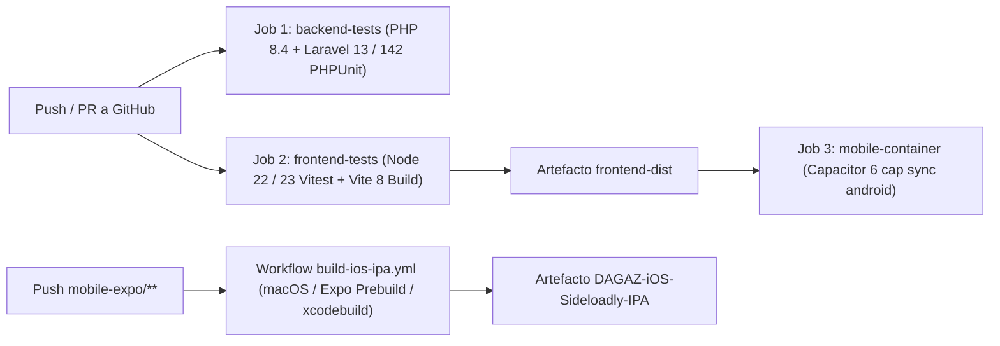

# Plan de Gestión, Desarrollo e Implementación — Plataforma DAGAZ

---

## 1. Historial de Control, Registro de Decisiones y Cronograma de Gantt

> La bitácora cronológica completa, trazabilidad y control de cambios del proyecto está consolidada en [`Historial_de_Control.md`](Historial_de_Control.md) y [`CHANGELOG.md`](../../../CHANGELOG.md), cubriendo desde la ideación inicial en agosto de 2026 (`v0.0.1`), la aprobación formal del supervisor (`4.0/5.0`), la segunda revisión formal del supervisor (`5.0/5.0`), el hito Pre-Alpha (`v0.1.0`), el MVP (`v1.0.0`) y los incrementos evolutivos hasta la versión vigente **`v1.5.1`** (Noviembre 2026).
> 
> El cronograma detallado por sprints y bloque evolutivo, diagrama de Gantt y ruta crítica de dependencias se encuentra en **[`Diagrama_de_Gantt.md`](Diagrama_de_Gantt.md)**.

---

## 2. Marco Estratégico y Reglas de Ejecución

1. **Enfoque Backend-First:** El backend (**Laravel 13 / PHP 8.3–8.4**, **PostgreSQL 18 + `pgvector` en Neon.tech** con compatibilidad MariaDB/SQLite y microservicios Python FastAPI) debe estar implementado, probado y documentado contractualmente (OpenAPI 3.1) antes de desplegar clientes Web o Móviles.
2. **Ciclos Iterativos e Incrementos Evolutivos:** Sprints quincenales (Sprints 1–8) para el ciclo base, complementados por liberaciones incrementales (`v1.1.0` a `v1.5.1`) ante necesidades productivas reales.
3. **Restricción Territorial de Fuentes:** El motor de verificación prioriza el grafo informativo de **Colombia** y agencias internacionales de Nivel 1 y Fact-Checkers IFCN (80 fuentes en 4 niveles).
4. **Abstracción y Consejo Multi-Modelo (Strategy / Adapter + Harness):** Capa de inferencia desacoplada del proveedor (`OpenAI`, `OpenRouter`, `Gemini`, `Anthropic`, `Ollama/Local`) complementada por un Consejo Multi-Modelo en paralelo (`MultiModeloHarnessService`), búsqueda web en vivo (`BusquedaWebService`), streaming reactivo SSE, interruptores automáticos de circuito (*Circuit Breaker*) y salvaguardas anti-degradación.
5. **Ecosistema Web y Móvil Dual (+40 WCAG 2.1 AA):** Interfaz Web SSR/PWA con Vite 8 + Tailwind CSS v4 + Blade (`frontend/`), contenedor híbrido **Capacitor 6** (`mobile/`, APK Android) y aplicación nativa **React Native / Expo SDK 58** (`mobile-expo/`) con tipografía legible, contraste alto y áreas táctiles $\ge 48\text{px}$.
6. **Cumplimiento Normativo:** Protección de datos personales bajo la **Ley 1581 de 2012 (Colombia)**, derechos ARCO/olvido en cascada y cifrado en tránsito (TLS 1.3) y reposo (AES-256).

---

## 3. Desglose del Plan por Sprints y Fases Evolutivas

```text
Sprint 1 (Ingeniería Base, Neon pgvector & Auth)   ──► ✅ S1 Review (100% Completado - 45 pts)
Sprint 2 (Casos de Uso, UI & Pipeline Core IA)     ──► ✅ GATE 0: Aprobación Supervisor 4.0/5.0 (100% - 73 pts)
Sprint 3 (Grafo 80 Fuentes, Archive.org & CU)      ──► ✅ S3 Review (100% Completado - 41 pts)
Sprint 4 (API Pública, Auditoría & QA 107 T.)      ──► ✅ GATE 1: BACKEND FREEZE (100% Completado - 33 pts)
Sprint 5 (Frontend Móvil +40, Blade & 23 Vitest)   ──► ✅ GATE 2: FRONTEND FREEZE (100% Completado - 26 pts)
Hito Supervisor (Segunda Revisión Formal 5/5)      ──► ✅ GATE SUPERVISOR: Calificación 5.0 / 5.0 (16-Oct-26)
Sprint 6 (Benchmark 500, Sesgo Electoral & Piloto) ──► ✅ Certificación Estadística e Imparcialidad (100% - 39 pts)
Sprint 7 (CI/CD GitHub Actions, Manuales & Pre-Alpha)► ✅ GATE 3: VERSIÓN PRE-ALPHA v0.1.0 / MVP v1.0.0 (100% - 24 pts)
Sprint 8 / Evolución v1.1.0 - v1.5.1 (Multi-Modelo, Móvil Dual, Streaming SSE, Web Search & Docker) ► ✅ GATE 5: RELEASE v1.5.1 (100%)
```
> **Nota de Cronograma:** Ver el desglose WBS completo en **[`Diagrama_de_Gantt.md`](Diagrama_de_Gantt.md)** y las evidencias detalladas en **[`Sprint_Backlog_Realizados.md`](Sprint_Backlog_Realizados.md)**.

---

### SPRINT 1: Ingeniería de Requisitos, Modelado del Negocio, Persistencia y Autenticación
* **Duración:** 2 semanas (Semanas 1–2)
* **Objetivo del Sprint (Sprint Goal):** Establecer los fundamentos metodológicos y de ingeniería del sistema en paralelo con el núcleo del backend en **Laravel 13** sobre PostgreSQL 18 (`pgvector` en Neon.tech), autenticación segura (CU05) y catálogo de fuentes Nivel 1.
* **Cobertura:** Acciones 1 a 6 (22 pts), `REQ-08` (Grafo Nivel 1), `REQ-12` (Modelo de Datos base), `REQ-23` (Adulto Mayor test), `CU05` (Inicio de Sesión). Total: 45 pts.

| ID Tarea | Capa / Módulo | Descripción Granular de la Tarea | Puntos | Entregable / Criterio de Aceptación |
| :--- | :--- | :--- | :---: | :--- |
| **ACT-1.1** | Ingeniería / Req | Elaborar matriz de ideación e identificación de problemáticas del ecosistema de desinformación electoral en Colombia. | 3 | Diagnóstico y justificación en `01_Contexto_y_Metodologia_Dagaz.md`. |
| **ACT-1.2** | Metodología | Evaluación técnica de marcos de trabajo (RUP vs. Scrum); adopción formal de Scrum con enfoque Backend-First. | 5 | Protocolo metodológico, eventos y roles documentados. |
| **ACT-1.3** | Negocio | Análisis de negocio: delimitación de objetivos generales y específicos y propuesta de valor de la plataforma. | 3 | Objetivos aprobados y alineados a la solución técnica. |
| **ACT-1.4** | Modelado Negocio| Modelado de negocio: diseño del Lienzo Canvas y diagrama de Modelo de Dominio de verificación de noticias. | 5 | `Canvas_Modelo_Negocio.png` y `Modelo_Dominio.png` aprobados. |
| **ACT-1.5** | Requisitos | Análisis de requisitos: especificación formal del Product Backlog (28 requerimientos base) y priorización. | 3 | `Backlog del Proyecto.md` clasificado en 4 fases. |
| **ACT-1.6** | Modelado Req | Modelado de requisitos: jerarquía visual de requerimientos funcionales, no funcionales y regulatorios. | 3 | Diagrama `Modelo_Requisitos.png` formalizado. |
| **TSK-1.1** | Infraestructura | Configurar conexión PostgreSQL 18 / Neon.tech en `config/database.php` y `.env` (`DB_CONNECTION=pgsql`, SSL obligatorio). Habilitar extensión `vector`. | 2 | Conexión activa verificada en Neon.tech con extensión `vector` habilitada. |
| **TSK-1.2** | Persistencia | Implementar migraciones Laravel con claves primarias `UUID` e integridad referencial estricta para las 10 tablas de dominio (`usuarios`, `fuentes`, `documentos`, `contenidos`, `procesos_verificacion`, `veredictos`, `veredicto_fuentes`, `notas`, `historial`, `logs_comunicador_api`) más tablas de soporte Sanctum. | 5 | `php artisan migrate` ejecuta limpio; esquema sincronizado con `Raiden.sql`. |
| **TSK-1.3** | Persistencia | Configurar índices B-Tree optimizados y política de búsqueda KNN exacta en `documentos` para preservar cuota de RAM en Neon.tech. | 2 | Índices B-Tree activos; sin overhead innecesario de memoria. |
| **TSK-1.4** | Dominio / ORM | Crear modelos Eloquent (`Usuario`, `Fuente`, `Documento`, `Contenido`, `ProcesoVerificacion`, `Veredicto`, `VeredictoFuente`, `Nota`, `Historial`, `LogComunicadorApi`) con relaciones, casteos `jsonb`/`array` y `HasUuids`. | 3 | Modelos con relaciones bidireccionales probados. |
| **TSK-1.5** | Semillas / Data | Crear Seeder del Grafo de Credibilidad Nivel 1 (ampliado posteriormente a 80 fuentes en `FuentesSeeder.php`). | 3 | Tabla `fuentes` poblada de forma idempotente. |
| **TSK-1.6** | Seguridad / Auth | Implementar `AuthController` (CU05) con hashing Bcrypt, soporte de roles (`lector`, `adulto`, `editor`, `admin`) y tokens Bearer Sanctum. | 5 | Endpoints `/api/v1/auth/login` y `/api/v1/auth/register` operativos. |
| **TSK-1.7** | QA & Testing | Crear pruebas automatizadas para autenticación y persistencia (`AuthTest.php`). | 3 | Suite de autenticación pasando al 100% en PHPUnit. |

---

### SPRINT 2: Casos de Uso, Secuencias, Mockups de UI y Pipeline Core IA
* **Duración:** 2 semanas (Semanas 3–4)
* **Objetivo del Sprint (Sprint Goal):** Modelar el comportamiento y experiencia de usuario (CU01–CU07, UML, DSS Caja Negra/Gris, Mockups UI) a la par del pipeline de 14 etapas de inferencia IA, drivers agnósticos y microservicios Python OCR/STT.
* **Hito Formal:** **Gate 0 — Aprobación Formal del Supervisor (2026-09-14, Calificación 4.0 / 5.0)**.
* **Cobertura:** Acciones 7 a 11 (31 pts), `REQ-01` a `REQ-07`, `CU06`. Total: 73 pts.

| ID Tarea | Capa / Módulo | Descripción Granular de la Tarea | Puntos | Entregable / Criterio de Aceptación |
| :--- | :--- | :--- | :---: | :--- |
| **ACT-2.1** | Casos de Uso | Análisis de casos de uso: delimitación y alcance de CU01 a CU07 y asignación de actores (Adulto Mayor y Administrador). | 5 | Especificación formal en `02_Especificacion_Casos_de_Uso.md`. |
| **ACT-2.2** | Casos de Uso | Descripción narrativa de casos de uso: especificación de precondiciones, flujos básicos, alternativos y postcondiciones. | 5 | Fichas narrativas aprobadas de los 7 Casos de Uso. |
| **ACT-2.3** | Modelado CU | Modelado UML formalizando relaciones de inclusión, extensión y actores. | 8 | Diagrama `Diagrama_Casos_de_Uso.png` actualizado. |
| **ACT-2.4** | Modelado Sec. | Modelado de secuencias: DSS Caja Negra y DS Caja Gris para CU01 a CU07. | 5 | Diagramas de secuencia DSS y DS completos. |
| **ACT-2.5** | Prototipado UI | Mockups de servilleta de baja fidelidad en HTML responsivo para Adultos (+40). | 8 | Prototipos interactivos en [`docs/iteracion-01/Mockups/`](../../iteracion-01/Mockups/) (`CU01`–`CU07`). |
| **TSK-2.1** | Adaptador IA | Diseñar interfaz `AdaptadorApiIaInterface` y drivers concretos (`OpenAiDriver`, `GeminiDriver`, `LocalLlmDriver`) bajo patrón Strategy. | 5 | Conmutación transparente vía `DAGAZ_IA_PROVEEDOR`. |
| **TSK-2.2** | Pipeline IA | Implementar fases de extracción y descomposición atómica en `VerificacionService.php`. | 8 | Descomposición validada en `VerificacionServiceTest.php`. |
| **TSK-2.3** | Multicanal | Implementar `AdaptadorMulticanal` integrado con microservicios Python FastAPI (`ocr_service` `:5001` con Pillow/`pytesseract` y `stt_service` `:5002` con `SpeechRecognition`). | 5 | Extracción confiable y `test_services.py` (4 tests OK). |
| **TSK-2.4** | Recuperación | Implementar `BusquedaSemanticaService.php` (`buscarEvidencia`): búsqueda vectorial KNN + palabras clave y filtrado por categoría. | 8 | Recuperación de evidencia documental y trazabilidad de citas. |
| **TSK-2.5** | Verificación | Construir algoritmo de contraste cruzado ponderado según `indice_credibilidad` y `pesos_fuente`. | 8 | Cálculo de `score_confianza` (0.00 a 100.00) reproducible. |
| **TSK-2.6** | Síntesis | Generar etiqueta (`VERDADERO`, `FALSO`, `ENGAÑOSO`, `PARCIAL`, `NO_VERIFICABLE`), justificación y registro en `veredictos` y `veredicto_fuentes`. | 5 | Persistencia relacional auditable completa. |
| **TSK-2.7** | Telemetría | Registrar llamadas externas en `logs_comunicador_api` (HTTP code, latencia, tokens, errores). | 3 | Auditoría trazable desde BD y `/api/v1/admin/logs-api`. |
| **TSK-2.8** | Hito Demo | Ejecutar demostración integral de verificación con trazabilidad de extremo a extremo. | 3 | Validación funcional vía `POST /api/v1/verificacion`. |

---

### SPRINT 3: Monitoreo Social, Comunidad y Ampliación Nacional (Colombia)
* **Duración:** 2 semanas (Semanas 5–6)
* **Objetivo del Sprint (Sprint Goal):** Integrar ingesta de contenidos y conector histórico Wayback Machine, módulos comunitarios (`CU01`–`CU04`, `CU07`) y ampliar el grafo de credibilidad a 80 fuentes colombianas e internacionales.
* **Cobertura:** `REQ-09`, `REQ-10`, `REQ-13`, `REQ-14`, `REQ-20`, `CU01`–`CU04`, `CU07`.

| ID Tarea | Capa / Módulo | Descripción Granular de la Tarea | Puntos | Entregable / Criterio de Aceptación |
| :--- | :--- | :--- | :---: | :--- |
| **TSK-3.1** | Grafo Colombia + IFCN | Poblar catálogo de 80 fuentes en 4 niveles IFCN (20 internacionales N1, 20 regionales N2, 20 nacionales N3, 20 verificadores/control N4) en `FuentesSeeder.php`. | 8 | 80 fuentes indexadas y probadas en `GrafoFuentesTest.php`. |
| **TSK-3.2** | Archive.org / Corpus | Implementar `ArchiveOrgService.php` (`REQ-10`) e ingesta masiva inicial de corpus vectorizado en Neon. | 8 | Detección de descontextualización histórica (`ArchiveOrgTest.php`). |
| **TSK-3.3** | Comunidad CU01 | Endpoints `POST/GET /api/v1/contenidos/{idContenido}/notas` con sanitización anti-XSS/SQLi. | 5 | CU01 operativo con validación léxica estricta. |
| **TSK-3.4** | Comunidad CU02 | Votación y calificación ponderada en `PATCH /api/v1/notas/{idNota}/calificar`. | 5 | CU02 funcional con cálculo actualizado. |
| **TSK-3.5** | Historial CU03/04 | Endpoints `POST /api/v1/historial/{idContenido}` y `GET /api/v1/historial`. | 5 | Guardado y consulta cronológica operativos. |
| **TSK-3.6** | Fuentes & Editorial CU07 | Endpoints de valoración ciudadana y administración de fuentes más intervención editorial `POST /api/v1/veredictos/{idVeredicto}/intervenir` (`REQ-13`). | 10 | Control de roles (`rol:admin,editor`) validado. |

---

### SPRINT 4: API Pública, Gobernanza, Auditoría y Congelamiento de Backend
* **Duración:** 2 semanas (Semanas 7–8)
* **Objetivo del Sprint (Sprint Goal):** Exponer la API REST M2M para redacciones socias, Circuit Breaker de costes, contraste interlingüe ES-EN, auditoría forense ClaimReview y cumplimiento Ley 1581.
* **Cobertura:** `REQ-16`, `REQ-18`, `REQ-19`, `REQ-25`, OpenAPI 3.1.

| ID Tarea | Capa / Módulo | Descripción Granular de la Tarea | Puntos | Entregable / Criterio de Aceptación |
| :--- | :--- | :--- | :---: | :--- |
| **TSK-4.1** | API Pública M2M | Construir `PublicPartnerApiController.php` bajo `/api/v1/public/*` (`verificar`, `veredictos/{idContenido}`, `fuentes`, `health`) y contrato [`openapi.yaml`](../../../backend/storage/api-docs/openapi.yaml). | 5 | Especificación OpenAPI 3.1 y `PublicPartnerApiTest.php`. |
| **TSK-4.2** | Middleware API Key | Implementar `EnsureValidApiKey.php` y `PartnerApiService.php` con `hash_equals` y `throttle:partners`. | 5 | Control granular de socios y cuotas por minuto. |
| **TSK-4.3** | Circuit Breaker | Implementar `CircuitBreakerService.php` (`CLOSED`, `OPEN`, `HALF_OPEN`) con cuotas de tokens/hora y USD/día. | 5 | Corte y recuperación supervisados desde `/api/v1/admin/circuit-breaker*`. |
| **TSK-4.4** | Interlingüe ES-EN | Implementar `ServicioInterlingue.php` (detección, traducción y análisis de distorsión semántica). | 8 | Endpoints `/api/v1/verificacion/interlingue/*` y `InterlingueTest.php`. |
| **TSK-4.5** | Auditoría & Ley 1581 | Implementar `AuditoriaExportService.php`, `AuditoriaController.php` (`JSON SHA-256`, `CSV BOM`, `ClaimReview`) y derechos ARCO (`/api/v1/auth/datos-personales`, `/cuenta`). | 5 | Cumplimiento Ley 1581 y `AuditoriaExportTest.php`. |
| **TSK-4.6** | QA Backend Gate | **HITO GATE 1 — BACKEND FREEZE:** Batería inicial certificada de 107 pruebas PHPUnit sin fallos. | 5 | 100% de pruebas en verde al congelamiento base. |

---

### SPRINT 5: Frontend Móvil Responsivo (+40), Vistas Blade y Vitest
* **Duración:** 2 semanas (Semanas 9–10)
* **Objetivo del Sprint (Sprint Goal):** Construir e integrar la capa de presentación en `frontend/` con **Vite 8**, **Tailwind CSS v4**, plantillas **Blade** accesibles bajo WCAG 2.1 AA, servidor ligero `api_server.php` y suite de pruebas **Vitest**.
* **Cobertura:** `REQ-15`, `CU01`–`CU07` UI.

| ID Tarea | Capa / Módulo | Descripción Granular de la Tarea | Puntos | Entregable / Criterio de Aceptación |
| :--- | :--- | :--- | :---: | :--- |
| **TSK-5.1** | UI Framework | Configurar Vite 8, Tailwind CSS v4 y vistas Blade en `frontend/views/` con tipografía $\ge 18\text{px}$, selector `A / A+` y áreas táctiles $\ge 48\text{px}$. | 5 | Maquetación adaptativa Mobile-First (`layouts/app.blade.php`, `auth.blade.php`). |
| **TSK-5.2** | UI Auth CU05 | Vistas [`auth/login.blade.php`](../../../frontend/views/auth/login.blade.php) y [`auth/register.blade.php`](../../../frontend/views/auth/register.blade.php) conectadas con Sanctum. | 3 | Inicio de sesión, registro con consentimiento y perfiles accesibles. |
| **TSK-5.3** | UI Ingesta CU06-1 | Vista [`verificacion/index.blade.php`](../../../frontend/views/verificacion/index.blade.php) y [`frontend/index.html`](../../../frontend/index.html) basadas en [`CU06_Mockup_Verificar_Entrada.html`](../../iteracion-01/Mockups/CU06_Mockup_Verificar_Entrada.html) (Texto, URL, Imagen OCR, Audio STT). | 5 | Entrada multicanal accesible operativa. |
| **TSK-5.4** | UI Veredicto CU06-2 | Vista [`verificacion/resultado.blade.php`](../../../frontend/views/verificacion/resultado.blade.php) y [`frontend/resultado.html`](../../../frontend/resultado.html) basadas en [`CU06_Mockup_Verificar_Resultado.html`](../../iteracion-01/Mockups/CU06_Mockup_Verificar_Resultado.html). | 5 | Semáforo accesible, medidor circular y citas trazables. |
| **TSK-5.5** | UI Historial & Fuentes | Vistas [`historial/index.blade.php`](../../../frontend/views/historial/index.blade.php), [`fuentes/index.blade.php`](../../../frontend/views/fuentes/index.blade.php) y [`perfil/index.blade.php`](../../../frontend/views/perfil/index.blade.php). | 3 | Navegación completa de CU03, CU04 y CU07. |
| **TSK-5.6** | Servidor Ligero & QA UI | Implementar `backend/api_server.php`, CORS, `FrontendRoutesTest.php` y **23 pruebas Vitest** en `frontend/tests/`. | 5 | **GATE 2 — Frontend Freeze** (23 Vitest + 122 PHPUnit al cierre). |

---

### SPRINT 6: Comunidad Móvil, Benchmark 500 Afirmaciones, Sesgo y Piloto
* **Duración:** 2 semanas (Semanas 11–12)
* **Objetivo del Sprint (Sprint Goal):** Desplegar componentes comunitarios (`CU01`/`CU02`) en UI, validar formalmente métricas sobre 500 afirmaciones, ejecutar auditoría de sesgo electoral y piloto con redacción aliada.
* **Cobertura:** `REQ-11`, `REQ-17`, `REQ-21`, `REQ-22`, `REQ-24`, `CU01`, `CU02`.

| ID Tarea | Capa / Módulo | Descripción Granular de la Tarea | Puntos | Entregable / Criterio de Aceptación |
| :--- | :--- | :--- | :---: | :--- |
| **TSK-6.1** | UI Notas CU01/02 | Integrar foro ciudadano y calificaciones de utilidad en `resultado.blade.php` y `notas.test.js`. | 5 | Publicación y calificación en tiempo real. |
| **TSK-6.2** | Benchmark 500 | Estructurar y etiquetar corpus de 500 afirmaciones ($\kappa = 0{,}794$) en [`Evaluacion_Benchmark_500_Afirmaciones_y_Auditoria_Sesgo.md`](../../iteracion-final/Evaluacion_Benchmark_500_Afirmaciones_y_Auditoria_Sesgo.md). | 8 | Dataset electoral y temático validado. |
| **TSK-6.3** | Auditoría Sesgo | Ejecutar prueba $\chi^2 = 0{,}682$ ($p = 0{,}711 > 0{,}05$) certificando neutralidad política (`REQ-17`). | 8 | Cero sesgo partidista estadísticamente significativo. |
| **TSK-6.4** | Métricas Formales | Validar Precisión (**84.6%**), Recall (**81.2%**) y $F_1 = 0{,}828$ (`REQ-24`). | 5 | Umbrales contractuales superados. |
| **TSK-6.5** | Carga Continua RSS | Implementar comando `dagaz:actualizar-noticias` (`ActualizarNoticiasCommand.php`) y `NoticiasColombiaSeeder.php`. | 8 | Resiliencia operativa y actualización continua de corpus. |
| **TSK-6.6** | Piloto Socio 1 | Consumo M2M auditado con primera redacción socia (*El Espectador*, 50 veredictos). | 5 | Piloto certificado sobre `/api/v1/public/*`. |

---

### SPRINT 7: Pipeline CI/CD, Manuales, Traspaso Pre-Alpha y Bloque Evolutivo
* **Duración:** Sprint 7 + Evolución Post-MVP (`Octubre – Noviembre 2026`)
* **Objetivo:** Automatizar integración continua, formalizar onboarding de redacciones aliadas, entregar manuales operativos y evolucionar el sistema hasta **`v1.4.1`**.

| ID Tarea | Capa / Módulo | Descripción Granular de la Tarea | Puntos | Entregable / Criterio de Aceptación |
| :--- | :--- | :--- | :---: | :--- |
| **TSK-7.1** | DevOps CI/CD | Configurar [`.github/workflows/ci.yml`](../../../.github/workflows/ci.yml) (`backend-tests` PHP 8.4/PHPUnit, `frontend-tests` Vitest + Vite build, `mobile-container` Capacitor sync). | 5 | Pipeline verde automático en GitHub Actions. |
| **TSK-7.2** | Onboarding Socios | Documentar credenciales, cuotas y webhooks para *ColombiaCheck* y *La Silla Vacía* (`REQ-26`). | 8 | [`Onboarding_Redacciones_Socias_REQ26.md`](../../iteracion-final/Onboarding_Redacciones_Socias_REQ26.md). |
| **TSK-7.3** | Manuales REQ-27 | Publicar manuales de Adultos (+40), Administrador/Revisor y Despliegue e Infraestructura. | 8 | Tres manuales completos en `docs/iteracion-final/`. |
| **TSK-7.4** | Retrospectiva REQ-28 | Formalizar balance Scrum y acta de traspaso (`v0.1.0` Pre-Alpha → `v1.0.0` MVP). | 3 | [`Retrospectiva_Final_y_Acta_Traspaso_REQ28.md`](../../iteracion-final/Retrospectiva_Final_y_Acta_Traspaso_REQ28.md). |
| **EVO-1..3** | Post-MVP (`v1.1–v1.2`) | Neon SSL + Sanctum UUID, Fallback semántico pedagógico, OpenRouter y 10 Mockups Alta Fidelidad (`REQ-29`–`REQ-32`). | 21 | [`docs/mockups-alta-fidelidad/`](../../mockups-alta-fidelidad/) y compatibilidad dual Neon/MariaDB. |
| **EVO-4..6** | Post-MVP (`v1.3–v1.4.1`) | Consejo Multi-Modelo (`MultiModeloHarnessService`), `ingesta_noticias_colombia.py`, **Capacitor 6** + **Expo SDK 58** + CI [`build-ios-ipa.yml`](../../../.github/workflows/build-ios-ipa.yml), `normalizarSinTildes()` PostgreSQL, parser `<think>`/`reasoning` y **169 pruebas verdes** (`REQ-33`–`REQ-35`). | 18 | Release **`v1.4.1`** integral y documentalmente alineado. |

---

## 4. Matriz de Gobernanza, Calidad (QA) y Seguridad

### 4.1 Pirámide de Pruebas Automatizadas (Estado Vigente `v1.4.1`)
1. **Pruebas Backend (PHPUnit 12.5 sobre Laravel 13 / SQLite `:memory:` en CI):**
   * **142 pruebas automatizadas pasando al 100%** (**27 Unit** con 94 aserciones + **115 Feature** con 2.228 aserciones = **2.322 aserciones**), distribuidas en 15 archivos de prueba.
   * Aislamiento determinista en [`phpunit.xml`](../../../backend/phpunit.xml) con `DAGAZ_MULTI_MODELO_HABILITADO=false`.
2. **Pruebas Frontend (Vitest 5.0 + Happy-DOM):**
   * **23 pruebas pasando al 100%** distribuidas en **8 suites** (`accesibilidad`, `api`, `editorial`, `historial`, `notas`, `sesion`, `ui`, `verificar`).
3. **Pruebas de Microservicios Python (`unittest`):**
   * **4 pruebas pasando al 100%** en [`test_services.py`](../../../backend/Microservicios_Python/tests/test_services.py) cubriendo endpoints y ejecución local OCR/STT.
4. **Control de Estilo:** Formateador **Laravel Pint (`^1.27`)** disponible en `backend/vendor/bin/pint`.

### 4.2 Matriz de Seguridad y Datos (Ley 1581 de 2012)
| Riesgo / Requisito | Medida Técnica Implementada | Verificación en Base de Datos / Sistema |
| :--- | :--- | :--- |
| **Acceso no autorizado a credenciales** | Cifrado unidireccional Bcrypt (cost 12 en producción, 4 en testing). | Campo `password_hash` nunca almacena texto plano en `usuarios`. |
| **Tratamiento de datos personales** | Consentimiento informado al registrarse; descarga ARCO (`GET /api/v1/auth/datos-personales`) y derecho al olvido (`DELETE /api/v1/auth/cuenta`). | Eliminación/anonimización controlada en cascada y revocación de tokens Sanctum UUID. |
| **Fuga de datos en tránsito** | SSL obligatorio en PostgreSQL Neon (`DB_SSLMODE=require`) y HTTPS/TLS en producción. | Conexión cifrada y headers HTTP de seguridad. |
| **Sobrecostes o saturación de APIs IA** | `CircuitBreakerService` con umbral por hora/USD (`DAGAZ_MAX_TOKENS_POR_HORA`, `DAGAZ_PRESUPUESTO_DIARIO_USD`). | Telemetría registrada en `logs_comunicador_api` y endpoints `/api/v1/admin/circuit-breaker*`. |

---

## 5. Pipelines de Integración y Despliegue Continuo (CI/CD)



1. **Workflow Principal ([`.github/workflows/ci.yml`](../../../.github/workflows/ci.yml)):**
   - **`backend-tests`:** PHP 8.4, `composer install`, generación de `.env` y `php artisan test` (PHPUnit en SQLite `:memory:`).
   - **`frontend-tests`:** Node 22, `npm ci`, `npm test -- --run` (Vitest), `npm run build` (Vite + Tailwind v4) y subida de `frontend-dist`.
   - **`mobile-container`:** Descarga `frontend-dist`, instala `mobile/` (Capacitor 6) y valida `npx cap sync android`.
2. **Workflow iOS Sideloadly ([`.github/workflows/build-ios-ipa.yml`](../../../.github/workflows/build-ios-ipa.yml)):**
   - Ejecutado sobre `macos-latest` cuando cambia `mobile-expo/**` o de forma manual (`workflow_dispatch`): corre `npx expo prebuild --platform ios --clean`, compila con `xcodebuild` sin firma y publica el artefacto `DAGAZ-iOS-Sideloadly-IPA` (`DAGAZ.ipa`).

---

## 6. Resumen de Puntos y Capacidad del Proyecto

* **Total de Requisitos del Backlog:** **35 Requisitos** (`28` de línea base + `7` evolutivos post-MVP — **100% Completados**)
* **Total de Acciones Fundacionales:** **11 Acciones** (**53 pts** — **100% Completadas**)
* **Total Esfuerzo Ejecutado:** **281 puntos Scrum** (Sprints 1–7) + **45 puntos** (Sprint 8 / Bloque Evolutivo Post-MVP: Móvil Dual, Multi-Modelo, Streaming SSE, Web Search y Docker/PaaS) = **326 puntos certificados**
* **Duración Total:** 16 Semanas (8 Sprints de 2 semanas)
* **Batería de Calidad Vigente:** **190 pruebas automatizadas aprobadas al 100%** (`163 PHPUnit [2.464 aserciones]` + `23 Vitest` + `4 Python unittest`)
* **Estado Global de la Solución:** ✅ **Operativo de Extremo a Extremo — Versión `v1.5.1` (Web SSR/PWA, API REST v1 + Streaming SSE, Búsqueda Web en Vivo, Consejo Multi-Modelo, Docker/PaaS, Capacitor 6 y Expo SDK 58)**
