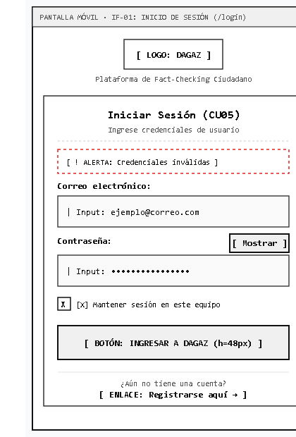
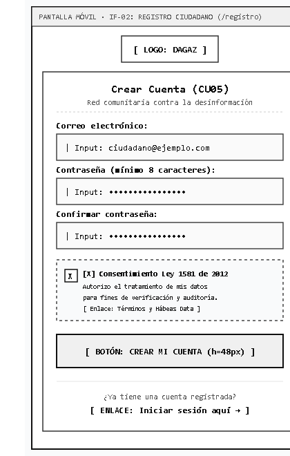
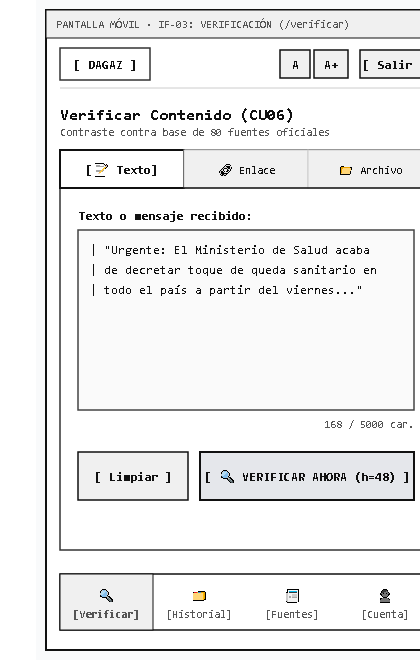
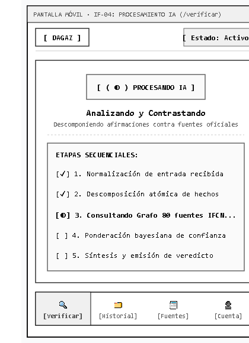
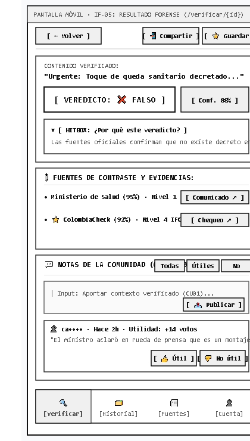
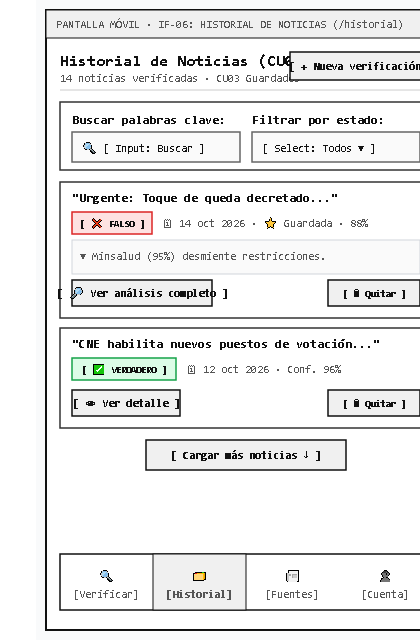
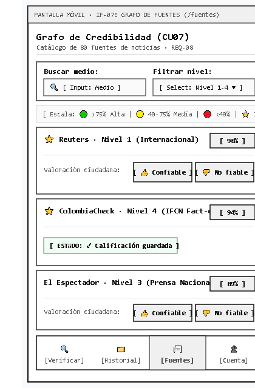
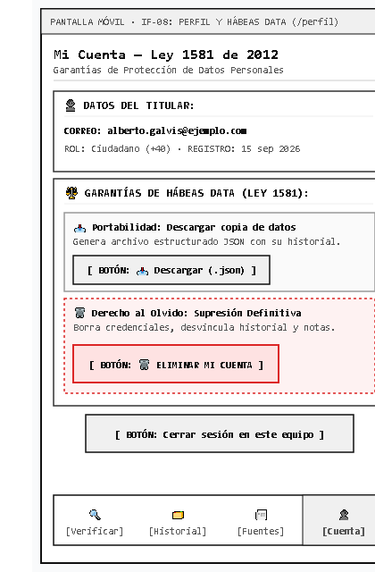
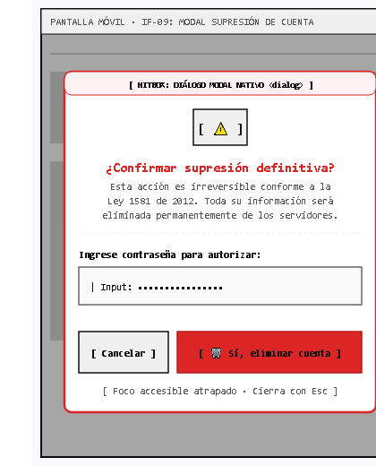
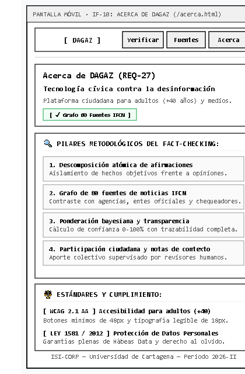

# DAGAZ — Mockups de Baja Fidelidad (Wireframes) y Análisis de la Capa Frontend y Vistas

> **Proyecto:** DAGAZ — Plataforma Ciudadana Multicanal de Detección de Desinformación y Fact-Checking  
> **Organización:** ISI-CORP (Periodo Académico 2026-II)  
> **Iteración:** Iteración 02  
> **Rama Base:** `Frontend-Raiden` | **Versión:** `v0.1.0-pre-alpha`  
> **Público Objetivo:** Adultos Mayores (+40 años) y Ciudadanía General en Colombia  
> **Estándar de Accesibilidad:** WCAG 2.1 Nivel AA  
> **Ubicación del Documento:** `docs/iteracion-02/Mockups/MockUps-Baja Fidelidad/Mockups_Baja_Fidelidad.md`  

---

## 📑 Tabla de Contenidos

1. [Visión General y Alcance](#1-visión-general-y-alcance)
2. [Análisis de la Arquitectura FrontEnd y Capa de Vistas](#2-análisis-de-la-arquitectura-frontend-y-capa-de-vistas)
   - 2.1 [Ecosistema Tecnológico y Filosofía de Diseño](#21-ecosistema-tecnológico-y-filosofía-de-diseño)
   - 2.2 [Estructura de Directorios y Desacoplamiento](#22-estructura-de-directorios-y-desacoplamiento)
   - 2.3 [Sistema de Diseño: Tokens, Tipografía y Accesibilidad (+40)](#23-sistema-de-diseño-tokens-tipografía-y-accesibilidad-40)
   - 2.4 [Layouts Maestros y Componentes Reutilizables](#24-layouts-maestros-y-componentes-reutilizables)
   - 2.5 [Matriz de Trazabilidad: Rutas ↔ Vistas ↔ Módulos JS ↔ Requisitos](#25-matriz-de-trazabilidad-rutas--vistas--módulos-js--requisitos)
3. [Diagrama de Navegación y Flujo de Interfaces](#3-diagrama-de-navegación-y-flujo-de-interfaces)
4. [Catálogo de Mockups de Baja Fidelidad (Wireframes)](#4-catálogo-de-mockups-de-baja-fidelidad-wireframes)
   - 4.1 [IF-01: Autenticación — Inicio de Sesión (`/login`)](#41-if-01-autenticación--inicio-de-sesión-login)
   - 4.2 [IF-02: Autenticación — Registro Ciudadano y Consentimiento Ley 1581 (`/registro`)](#42-if-02-autenticación--registro-ciudadano-y-consentimiento-ley-1581-registro)
   - 4.3 [IF-03: Verificación — Formulario de Ingesta Multicanal (`/` y `/verificar`)](#43-if-03-verificación--formulario-de-ingesta-multicanal--y-verificar)
     - 4.3.1 [Variante A: Pestaña Texto Directo](#431-variante-a-pestaña-texto-directo)
     - 4.3.2 [Variante B: Pestaña Enlace Web (URL)](#432-variante-b-pestaña-enlace-web-url)
     - 4.3.3 [Variante C: Pestaña Imagen (OCR) o Audio (STT)](#433-variante-c-pestaña-imagen-ocr-o-audio-stt)
   - 4.4 [IF-04: Verificación — Estado de Procesamiento y Checklist de Agentes IA](#44-if-04-verificación--estado-de-procesamiento-y-checklist-de-agentes-ia)
   - 4.5 [IF-05: Verificación — Tarjeta de Veredicto y Análisis Forense (`/verificar/{id}`)](#45-if-05-verificación--tarjeta-de-veredicto-y-análisis-forense-verificarid)
     - 4.5.1 [Bloque Central de Veredicto y Barra de Confianza](#451-bloque-central-de-veredicto-y-barra-de-confianza)
     - 4.5.2 [Desglose de Fuentes de Contraste y Citas Auditables](#452-desglose-de-fuentes-de-contraste-y-citas-auditables)
     - 4.5.3 [Módulo Comunitario: Notas y Valoración Colaborativa (CU01 / CU02)](#453-módulo-comunitario-notas-y-valoración-colaborativa-cu01--cu02)
     - 4.5.4 [Panel de Intervención Editorial Humana (REQ-13 / Rol Admin-Editor)](#454-panel-de-intervención-editorial-humana-req-13--rol-admin-editor)
   - 4.6 [IF-06: Historial — Consulta de Noticias Verificadas y Guardadas (`/historial`)](#46-if-06-historial--consulta-de-noticias-verificadas-y-guardadas-historial)
   - 4.7 [IF-07: Grafo de Credibilidad — Catálogo de Fuentes Informativas (`/fuentes`)](#47-if-07-grafo-de-credibilidad--catálogo-de-fuentes-informativas-fuentes)
   - 4.8 [IF-08: Perfil de Usuario — Gestión de Cuenta y Hábeas Data (`/perfil`)](#48-if-08-perfil-de-usuario--gestión-de-cuenta-y-hábeas-data-perfil)
   - 4.9 [IF-09: Diálogo Modal Accesible — Confirmación de Supresión de Cuenta](#49-if-09-diálogo-modal-accesible--confirmación-de-supresión-de-cuenta)
   - 4.10 [IF-10: Portal Institucional — Acerca del Proyecto DAGAZ (`/acerca.html`)](#410-if-10-portal-institucional--acerca-del-proyecto-dagaz-acercahtml)
5. [Criterios de Evaluación y Cumplimiento WCAG 2.1 AA](#5-criterios-de-evaluación-y-cumplimiento-wcag-21-aa)
6. [Conclusiones del Análisis de Vistas](#6-conclusiones-del-análisis-de-vistas)

---

## 1. Visión General y Alcance

Este documento presenta el análisis técnico integral de la capa de Frontend y Vistas del proyecto **DAGAZ**, junto con la especificación visual en formato de **Mockups de Baja Fidelidad (Wireframes)** para todas las interfaces de usuario construidas en la **Iteración 02**.

Los mockups de baja fidelidad se han concebido siguiendo los principios de la arquitectura *Mobile-First*, optimizados para terminales móviles y pantallas táctiles, cumpliendo con los estándares de diseño inclusivo para usuarios **adultos mayores de 40 años** en Colombia (población habitualmente expuesta a cadenas desinformativas en WhatsApp, Facebook y Telegram).

---

## 2. Análisis de la Arquitectura FrontEnd y Capa de Vistas

### 2.1 Ecosistema Tecnológico y Filosofía de Diseño

La capa de presentación de DAGAZ implementa una arquitectura híbrida optimizada para máximo rendimiento, bajo consumo de batería y nula latencia perceptible:

1. **Motor de Renderizado Servidor (SSR):** Vistas construidas sobre **Laravel 12 Blade Engine**, ubicadas en `frontend/views/` (replicadas en sincronía con `backend/resources/views/`). Esto garantiza que el HTML inicial posea semántica pura, sea indexable y accesible de inmediato para tecnologías de asistencia (lectores de pantalla NVDA, TalkBack y VoiceOver).
2. **Hidratación Reactiva del Cliente:** Módulos desacoplados en **JavaScript Vanilla (ES2022)** ubicados en `frontend/src/js/dagaz/`, los cuales consumen asíncronamente la API REST (`/api/v1/`) mediante autenticación basada en tokens Sanctum (`Bearer Token`). No se introducen frameworks monolíticos pesados (como React o Angular) para evitar el sobrecoste de renderizado en dispositivos móviles de gama de entrada.
3. **Estilos y Maquetación:** **Tailwind CSS v4** con configuración adaptativa (`@theme`), escala fluida (`clamp()`), variables CSS dinámicas y soporte de modos de contraste.
4. **PWA y Empaquetado Móvil:** Compatible como Progressive Web App (`manifest.webmanifest`) y empaquetable en aplicaciones Android nativas mediante el contenedor **Capacitor** presente en el directorio `mobile/`.

### 2.2 Estructura de Directorios y Desacoplamiento

El proyecto organiza sus activos frontend con clara separación de responsabilidades:

```
frontend/
├── acerca.html                        # Portal estático informativo y metodológico
├── index.html                         # Punto de entrada Web SPA / Standalone
├── resultado.html                     # Visualizador de veredictos Web Standalone
├── fuentes.html                       # Visualizador del grafo de fuentes Standalone
├── package.json                       # Dependencias Node.js, Tailwind v4 y Vitest
├── vite.config.js                     # Pipeline de compilación y optimización Vite
├── vitest.config.js                   # Configuración del entorno de pruebas Happy-DOM
├── public/
│   ├── favicon.ico                    # Isotipo de DAGAZ
│   └── manifest.webmanifest           # Configuración PWA (Mobile Installable)
├── src/
│   ├── css/
│   │   └── app.css                    # Definición de tokens, escala tipográfica y clases .dz-*
│   └── js/
│       ├── app.js                     # Inicializador del ciclo de vida y routing dinámico
│       └── dagaz/
│           ├── api.js                 # Cliente HTTP con interceptor Sanctum y manejo de 401/422
│           ├── sesion.js              # Gestor seguro de token, rol y estado de usuario
│           ├── ui.js                  # Biblioteca de componentes DOM seguros y accesibles
│           └── paginas/
│               ├── login.js           # Controlador de autenticación CU05
│               ├── registro.js        # Controlador de registro y Ley 1581
│               ├── verificar.js       # Orquestador de entrada multicanal y barra de progreso CU06
│               ├── resultado.js       # Renderizador de veredicto, notas (CU01/02) y panel editorial
│               ├── historial.js       # Gestor de historial con filtros y persistencia CU04/CU03
│               ├── fuentes.js         # Grafo de credibilidad y valoración ciudadana CU07
│               └── perfil.js          # Hábeas Data, descarga JSON y modal de derecho al olvido
├── views/                             # Plantillas Blade (SSR)
│   ├── layouts/
│   │   ├── app.blade.php              # Shell principal con cabecera y barra inferior fija
│   │   └── auth.blade.php             # Shell limpio centrado para Login y Registro
│   ├── components/
│   │   ├── barra-navegacion.blade.php # Barra táctil inferior fija de 4 botones (>=48px)
│   │   └── logo.blade.php             # Isotipo SVG accesible de DAGAZ
│   ├── partials/
│   │   └── head.blade.php             # Metadatos, fuentes y links Vite
│   ├── auth/
│   │   ├── login.blade.php            # Vista de inicio de sesión
│   │   └── register.blade.php         # Vista de creación de cuenta
│   ├── verificacion/
│   │   ├── index.blade.php            # Vista de ingesta multicanal (Texto, URL, Archivo)
│   │   └── resultado.blade.php        # Vista de veredicto forense, fuentes y notas
│   ├── historial/
│   │   └── index.blade.php            # Vista de historial y noticias guardadas
│   ├── fuentes/
│   │   └── index.blade.php            # Vista del catálogo del grafo de credibilidad
│   └── perfil/
│       └── index.blade.php            # Vista de titular, exportación y supresión de cuenta
└── tests/                             # Suite de pruebas automatizadas en Vitest (23 tests)
```

---

### 2.3 Sistema de Diseño: Tokens, Tipografía y Accesibilidad (+40)

El archivo [`frontend/src/css/app.css`](file:///c:/Users/Vss/ISI-2026-2-G06/frontend/src/css/app.css) establece las directrices que gobiernan todos los componentes:

1. **Tipografía Base Adaptada (18px):**
   - Tamaño base de `html`: `font-size: 112.5%` ($18\text{px}$ estándar).
   - Títulos dinámicos fluidos con función `clamp()`:
     - `h1`: `clamp(1.45rem, 1.2rem + 1.2vw, 1.9rem)`.
     - `h2`: `clamp(1.2rem, 1.05rem + 0.8vw, 1.45rem)`.
   - Selector en cabecera con control manual instantáneo **`A`** (Normal) y **`A+`** (Grande), permitiendo aumentar la fuente al 125% ($20\text{px}-22\text{px}$) sin romper la grilla.
2. **Áreas Táctiles Mínimas (Touch Targets $\ge 48\text{px}$):**
   - Todos los botones interactivos, enlaces de navegación y campos de formulario implementan `min-h-12` ($48\text{px}$) o `min-h-16` ($64\text{px}$ en la barra inferior), eliminando errores de pulsación en pantallas táctiles por temblores o baja motricidad fina.
3. **Semántica Visual Tricolor con Icono Obligatorio:**
   - La plataforma prohíbe transmitir información únicamente mediante color. Cada categoría de veredicto y nivel de credibilidad combina color con contraste $\ge 4.5:1$ y un icono distintivo:
     - **Verdadero:** Verde bosque (`#166534` sobre fondo `#f0fdf4`) + Icono `✅`.
     - **Parcialmente Cierto:** Amarillo ocre (`#854d0e` sobre fondo `#fefce8`) + Icono `⚠️`.
     - **Engañoso:** Naranja terracota (`#9a3412` sobre fondo `#fff7ed`) + Icono `🟠`.
     - **Falso:** Rojo carmesí (`#991b1b` sobre fondo `#fef2f2`) + Icono `❌`.
     - **No Verificable:** Gris neutro grafito (`#374151` sobre fondo `#f3f4f6`) + Icono `❔`.
4. **Respeto a Preferencias del Usuario (`prefers-reduced-motion`):**
   - Todas las transiciones y animaciones se suspenden de forma automática a $0.01\text{ms}$ para usuarios propensos a mareo o fatiga visual.

---

### 2.4 Layouts Maestros y Componentes Reutilizables

#### A. Layout Principal (`views/layouts/app.blade.php`)
Proporciona la estructura común para la navegación interna autenticada:
- **Región Viva Global (`#dz-avisos`):** Contenedor accesible `aria-live="polite"` que verbaliza avisos y cambios de estado en lectores de pantalla.
- **Cabecera Accesible (`<header>`):** Logotipo de DAGAZ, título institucional, conmutador de tamaño tipográfico `A / A+`, alias del usuario activo y botón de cierre de sesión.
- **Contenedor Principal (`<main id="main-content">`):** Margen seguro centrado con clase `.dz-contenedor` (máximo $672\text{px}$), adaptable a safe-areas de iOS y notch de Android.
- **Barra de Navegación Inferior Fija (`<x-barra-navegacion />`):** 4 módulos clave accesibles con un solo toque con retroalimentación auditiva y visual.

#### B. Layout de Autenticación (`views/layouts/auth.blade.php`)
Diseñado para eliminar distracciones cognitivas:
- Centrado vertical y horizontal en pantalla completa.
- Logotipo ampliado de DAGAZ ($64\text{px}$).
- Tarjeta contenida con sombras suaves y contraste alto.

---

### 2.5 Matriz de Trazabilidad: Rutas ↔ Vistas ↔ Módulos JS ↔ Requisitos

| ID Interfaz | Ruta Web | Plantilla Blade / HTML | Controlador / Módulo JS | Casos de Uso / Requisitos | Propósito Funcional |
| :--- | :--- | :--- | :--- | :--- | :--- |
| **IF-01** | `/login` | `auth/login.blade.php` | `dagaz/paginas/login.js` | CU05, REQ-23 | Inicio de sesión, validación Sanctum y persistencia de sesión local. |
| **IF-02** | `/registro` | `auth/register.blade.php` | `dagaz/paginas/registro.js` | CU05, Ley 1581 | Creación de cuenta y autorización explícita de tratamiento de datos personales. |
| **IF-03** | `/` y `/verificar` | `verificacion/index.blade.php` | `dagaz/paginas/verificar.js` | CU06, REQ-02, REQ-07 | Formulario de ingesta multicanal: Texto, Enlace URL, Imagen OCR y Audio STT. |
| **IF-04** | `/verificar` (Estado) | `verificacion/index.blade.php` | `dagaz/paginas/verificar.js` | CU06, Pipeline IA | Pantalla de carga y lista de comprobación reactiva de agentes de contraste. |
| **IF-05** | `/verificar/{id}` | `verificacion/resultado.blade.php`| `dagaz/paginas/resultado.js` | CU06, CU01, CU02, CU03, REQ-13, REQ-15 | Visualización de veredicto, fuentes citadas, notas comunitarias y panel editorial. |
| **IF-06** | `/historial` | `historial/index.blade.php` | `dagaz/paginas/historial.js` | CU04, CU03 | Historial cronológico, filtro por veredicto, acordeón de detalles y guardados. |
| **IF-07** | `/fuentes` | `fuentes/index.blade.php` | `dagaz/paginas/fuentes.js` | CU07, REQ-08 | Grafo de credibilidad: catálogo de 80 fuentes, filtros por nivel y votación comunitaria. |
| **IF-08** | `/perfil` | `perfil/index.blade.php` | `dagaz/paginas/perfil.js` | Ley 1581 (Hábeas Data) | Datos de cuenta, descarga de archivo estructurado JSON y derecho al olvido. |
| **IF-09** | Modal `/perfil` | `perfil/index.blade.php` | `dagaz/paginas/perfil.js` | Ley 1581 (Supresión) | Diálogo nativo `<dialog>` de confirmación con contraseña para eliminación de cuenta. |
| **IF-10** | `/acerca.html` | `acerca.html` | Estático / Alpine.js | REQ-27, Metodología | Portal explicativo de metodologías de fact-checking, IFCN y accesibilidad. |

---

## 3. Diagrama de Navegación y Flujo de Interfaces

```mermaid
flowchart TD
    %% Inicio y Autenticación
    Anon["Usuario No Autenticado"] -->|Accede a /login| IF01["IF-01: Iniciar Sesión"]
    Anon -->|Accede a /registro| IF02["IF-02: Crear Cuenta (Ley 1581)"]
    Anon -->|Accede a /acerca.html| IF10["IF-10: Acerca del Proyecto"]
    IF01 -->|¿No tiene cuenta?| IF02
    IF02 -->|¿Ya tiene cuenta?| IF01
    
    %% Flujo Principal Autenticado
    IF01 -->|Credenciales Válidas| IF03["IF-03: Ingesta Multicanal (Verificar)"]
    IF02 -->|Registro Exitoso| IF03
    
    %% Ingesta y Procesamiento
    IF03 -->|Envía Texto / URL / Archivo| IF04["IF-04: Procesando (Checklist Agentes IA)"]
    IF04 -->|Veredicto Emitido| IF05["IF-05: Resultado y Veredicto Forense"]
    
    %% Interacciones en Resultado
    IF05 -->|Guardar Noticia| IF05
    IF05 -->|Aportar Nota (CU01)| IF05
    IF05 -->|Calificar Nota (CU02)| IF05
    IF05 -->|Rol Editor/Admin: Intervenir (REQ-13)| IF05
    IF05 -->|Nueva Verificación| IF03

    %% Navegación por Barra Inferior
    IF03 <-->|Tab Historial| IF06["IF-06: Historial de Noticias"]
    IF03 <-->|Tab Fuentes| IF07["IF-07: Grafo de Credibilidad (80 Fuentes)"]
    IF03 <-->|Tab Mi Cuenta| IF08["IF-08: Mi Perfil y Hábeas Data"]
    
    IF06 -->|Toca una noticia| IF05
    IF07 -->|Votar Confiabilidad (CU07)| IF07
    IF08 -->|Clic en Eliminar Cuenta| IF09["IF-09: Modal Confirmar Supresión"]
    IF09 -->|Cancela| IF08
    IF09 -->|Confirma con Password| IF01
```

---

## 4. Catálogo de Mockups de Baja Fidelidad (Wireframes)

A continuación se presentan los mockups de baja fidelidad en formato textual de arte de cajas (*Box-Drawing*), reflejando con exactitud la disposición de elementos, proporciones, zonas táctiles, etiquetas y componentes de la capa de Vistas.

---


* **Artefactos de Imagen:** [PNG (Raster)](./imagenes/IF-01_Inicio_Sesion.png) | [SVG (Vectorial)](./imagenes/IF-01_Inicio_Sesion.svg)

<p align="center"></p>

```text
┌────────────────────────────────────────────────────────┐
│                      PANTALLA MÓVIL                    │
│                     (Ancho: 360-480px)                 │
├────────────────────────────────────────────────────────┤
│                                                        │
│                    ┌─────────────┐                     │
│                    │  [ LOGO ]   │                     │
│                    │    DAGAZ    │                     │
│                    └─────────────┘                     │
│                         DAGAZ                          │
│          Plataforma de Fact-Checking Ciudadano         │
│                                                        │
│  ┌──────────────────────────────────────────────────┐  │
│  │                                                  │  │
│  │                  Iniciar Sesión                  │  │
│  │    Ingrese sus credenciales para verificar       │  │
│  │  - - - - - - - - - - - - - - - - - - - - - - -   │  │
│  │                                                  │  │
│  │  [ ! Alerta de error: Credenciales inválidas ]   │  │
│  │                                                  │  │
│  │  Correo electrónico:                             │  │
│  │  ┌────────────────────────────────────────────┐  │  │
│  │  │ ejemplo@correo.com                         │  │  │
│  │  └────────────────────────────────────────────┘  │  │
│  │                                                  │  │
│  │  Contraseña:                     [ Mostrar ]     │  │
│  │  ┌────────────────────────────────────────────┐  │  │
│  │  │ •••••••••••••                              │  │  │
│  │  └────────────────────────────────────────────┘  │  │
│  │                                                  │  │
│  │  [X] Mantener sesión iniciada en este equipo     │  │
│  │                                                  │  │
│  │  ┌────────────────────────────────────────────┐  │  │
│  │  │         INGRESAR A DAGAZ  (>=48px)         │  │  │
│  │  └────────────────────────────────────────────┘  │  │
│  │                                                  │  │
│  │  ──────────────────────────────────────────────  │  │
│  │  ¿Aún no tiene una cuenta?                       │  │
│  │  [ Registrarse aquí ]                            │  │
│  │                                                  │  │
│  └──────────────────────────────────────────────────┘  │
│                                                        │
└────────────────────────────────────────────────────────┘
```

#### Elementos Clave y Criterios de Diseño:
1. **Logo Central:** Isotipo de DAGAZ de $64\text{px}$ con contraste absoluto sobre fondo claro (`#faf8f5`).
2. **Campos con Altura Cómoda:** Altura mínima de $48\text{px}$ con borde de $2\text{px}$ y placeholder en tono suave.
3. **Botón Mostrar Contraseña:** Permite al usuario verificar caracteres tecleados sin frustración visual.
4. **Checkbox Ampliado:** Área de toque de $24\times24\text{px}$ con etiqueta clickeable completa.
5. **Botón Principal Prominente:** Fondo oscuro (`#1f2937`), texto en blanco negrita, altura de $52\text{px}$.

---


* **Artefactos de Imagen:** [PNG (Raster)](./imagenes/IF-02_Registro_Usuario.png) | [SVG (Vectorial)](./imagenes/IF-02_Registro_Usuario.svg)

<p align="center"></p>

```text
┌────────────────────────────────────────────────────────┐
│                      PANTALLA MÓVIL                    │
├────────────────────────────────────────────────────────┤
│                    ┌─────────────┐                     │
│                    │  [ LOGO ]   │                     │
│                    │    DAGAZ    │                     │
│                    └─────────────┘                     │
│                         DAGAZ                          │
│                                                        │
│  ┌──────────────────────────────────────────────────┐  │
│  │                   Crear Cuenta                   │  │
│  │  Únase a la red comunitaria contra la mentira    │  │
│  │  - - - - - - - - - - - - - - - - - - - - - - -   │  │
│  │                                                  │  │
│  │  Correo electrónico:                             │  │
│  │  ┌────────────────────────────────────────────┐  │  │
│  │  │ ciudadano@ejemplo.com                      │  │  │
│  │  └────────────────────────────────────────────┘  │  │
│  │                                                  │  │
│  │  Contraseña (mínimo 8 caracteres):               │  │
│  │  ┌────────────────────────────────────────────┐  │  │
│  │  │ ••••••••••••                               │  │  │
│  │  └────────────────────────────────────────────┘  │  │
│  │                                                  │  │
│  │  Confirmar contraseña:                           │  │
│  │  ┌────────────────────────────────────────────┐  │  │
│  │  │ ••••••••••••                               │  │  │
│  │  └────────────────────────────────────────────┘  │  │
│  │                                                  │  │
│  │  ┌─ Consentimiento Obligatorio Ley 1581 ────────┐│  │
│  │  │ [X] Autorizo de manera previa, expresa e     ││  │
│  │  │     informada el tratamiento de mis datos    ││  │
│  │  │     personales conforme a la Ley 1581 de     ││  │
│  │  │     2012 (Colombia) y la política de DAGAZ.  ││  │
│  │  └──────────────────────────────────────────────┘│  │
│  │                                                  │  │
│  │  ┌────────────────────────────────────────────┐  │  │
│  │  │           CREAR MI CUENTA                  │  │  │
│  │  └────────────────────────────────────────────┘  │  │
│  │                                                  │  │
│  │  ──────────────────────────────────────────────  │  │
│  │  ¿Ya tiene una cuenta registrada?                │  │
│  │  [ Iniciar sesión aquí ]                         │  │
│  └──────────────────────────────────────────────────┘  │
│                                                        │
└────────────────────────────────────────────────────────┘
```

#### Elementos Clave y Criterios de Diseño:
1. **Consentimiento Expreso (Hábeas Data):** Cuadro enmarcado con fondo diferenciado (`#f3f4f6`) que explica de forma legible la autorización conforme a la **Ley Estatutaria 1581 de 2012**.
2. **Validaciones en Vivo:** Mensajes de error en color rojo de alto contraste debajo de cada campo con atributo `role="alert"`.

---


* **Artefactos de Imagen:** [PNG (Raster)](./imagenes/IF-03_Verificacion_Entrada.png) | [SVG (Vectorial)](./imagenes/IF-03_Verificacion_Entrada.svg)

<p align="center"></p>

#### 4.3.1 Variante A: Pestaña Texto Directo

```text
┌────────────────────────────────────────────────────────┐
│ [LOGO] DAGAZ  Verificación Ciudadana    [A] [A+] [Salir]│
├────────────────────────────────────────────────────────┤
│                                                        │
│  Verificar Contenido                                   │
│  Pegue una noticia, ingrese un enlace o cargue una     │
│  captura para contrastarla con +80 fuentes oficiales.  │
│                                                        │
│  ┌──────────────────────────────────────────────────┐  │
│  │  [📝 Texto]     🔗 Enlace (URL)    📁 Archivo    │  │
│  ├──────────────────────────────────────────────────┤  │
│  │                                                  │  │
│  │  Texto o mensaje recibido:                       │  │
│  │  ┌────────────────────────────────────────────┐  │  │
│  │  │ "Urgente: El Ministerio de Salud acaba     │  │  │
│  │  │ de declarar toque de queda sanitario en    │  │  │
│  │  │ todo el territorio nacional a partir de..." │  │  │
│  │  │                                            │  │  │
│  │  │                                            │  │  │
│  │  └────────────────────────────────────────────┘  │  │
│  │  (Mínimo 10 caracteres)                          │  │
│  │                                                  │  │
│  │  ──────────────────────────────────────────────  │  │
│  │  [ Limpiar campos ]    [ 🔍 VERIFICAR AHORA ]    │  │
│  │                                                  │  │
│  └──────────────────────────────────────────────────┘  │
│                                                        │
├────────────────────────────────────────────────────────┤
│  [🔍 Verificar]   [🗂️ Historial]   [📰 Fuentes]   [👤 Cuenta] │
│     (Activo)                                           │
└────────────────────────────────────────────────────────┘
```

#### 4.3.2 Variante B: Pestaña Enlace Web (URL)

```text
┌────────────────────────────────────────────────────────┐
│ [LOGO] DAGAZ  Verificación Ciudadana    [A] [A+] [Salir]│
├────────────────────────────────────────────────────────┤
│  ┌──────────────────────────────────────────────────┐  │
│  │   📝 Texto     [🔗 Enlace (URL)]   📁 Archivo    │  │
│  ├──────────────────────────────────────────────────┤  │
│  │                                                  │  │
│  │  Enlace de la publicación o sitio web:           │  │
│  │  ┌────────────────────────────────────────────┐  │  │
│  │  │ https://noticiacolombia24.xyz/toque-queda  │  │  │
│  │  └────────────────────────────────────────────┘  │  │
│  │  Admite páginas de noticias, publicaciones y     │  │
│  │  portales informativos.                          │  │
│  │                                                  │  │
│  │  ──────────────────────────────────────────────  │  │
│  │  [ Limpiar campos ]    [ 🔍 VERIFICAR AHORA ]    │  │
│  └──────────────────────────────────────────────────┘  │
├────────────────────────────────────────────────────────┤
│  [🔍 Verificar]   [🗂️ Historial]   [📰 Fuentes]   [👤 Cuenta] │
└────────────────────────────────────────────────────────┘
```

#### 4.3.3 Variante C: Pestaña Imagen (OCR) o Audio (STT)

```text
┌────────────────────────────────────────────────────────┐
│ [LOGO] DAGAZ  Verificación Ciudadana    [A] [A+] [Salir]│
├────────────────────────────────────────────────────────┤
│  ┌──────────────────────────────────────────────────┐  │
│  │   📝 Texto      🔗 Enlace (URL)   [📁 Archivo]   │  │
│  ├──────────────────────────────────────────────────┤  │
│  │                                                  │  │
│  │  Cargar captura de pantalla o nota de voz:       │  │
│  │  ┌ - - - - - - - - - - - - - - - - - - - - - - ┐ │  │
│  │  │                     [ 📂 ]                  │ │  │
│  │  │    Haga clic para seleccionar o arrastre    │ │  │
│  │  │              el archivo aquí                │ │  │
│  │  │                                             │ │  │
│  │  │ PNG, JPG, WEBP (capturas) o MP3, M4A        │ │  │
│  │  │ (audios de WhatsApp). Máximo 20 MB.         │ │  │
│  │  │                                             │ │  │
│  │  │  ✔ captura_de_chat_whatsapp.png             │ │  │
│  │  └ - - - - - - - - - - - - - - - - - - - - - - ┘ │  │
│  │                                                  │  │
│  │  Resumen o contexto del archivo (obligatorio):   │  │
│  │  ┌────────────────────────────────────────────┐  │  │
│  │  │ Cadena que afirma decreto de toque de queda │  │  │
│  │  └────────────────────────────────────────────┘  │  │
│  │                                                  │  │
│  │  ──────────────────────────────────────────────  │  │
│  │  [ Limpiar campos ]    [ 🔍 VERIFICAR AHORA ]    │  │
│  └──────────────────────────────────────────────────┘  │
├────────────────────────────────────────────────────────┤
│  [🔍 Verificar]   [🗂️ Historial]   [📰 Fuentes]   [👤 Cuenta] │
└────────────────────────────────────────────────────────┘
```

#### Elementos Clave y Criterios de Diseño:
1. **Tabs WAI-ARIA Accesibles:** Pestañas navegables con teclado (`role="tablist"`), visualmente separadas y con soporte para lectores de pantalla.
2. **Zona Drag & Drop Amigable:** Área discontinua grande con texto explicativo sin jerga técnica.
3. **Barra de Navegación Fija:** Navegación persistente en la parte inferior con altura mínima de $64\text{px}$, permitiendo cambiar de sección con el pulgar.

---


* **Artefactos de Imagen:** [PNG (Raster)](./imagenes/IF-04_Verificacion_Procesando.png) | [SVG (Vectorial)](./imagenes/IF-04_Verificacion_Procesando.svg)

<p align="center"></p>

```text
┌────────────────────────────────────────────────────────┐
│ [LOGO] DAGAZ  Verificación Ciudadana    [A] [A+] [Salir]│
├────────────────────────────────────────────────────────┤
│                                                        │
│  ┌──────────────────────────────────────────────────┐  │
│  │                                                  │  │
│  │                     ( ◐ )                        │  │
│  │           [ SPINNER ANIMADO 32px ]               │  │
│  │                                                  │  │
│  │         Analizando y Contrastando                │  │
│  │                                                  │  │
│  │  Espere un momento mientras nuestros agentes de  │  │
│  │  IA contrastan la afirmación contra las bases    │  │
│  │  de datos de noticias oficiales.                 │  │
│  │                                                  │  │
│  │  ┌─ Progreso de la Verificación ──────────────┐  │  │
│  │  │                                            │  │  │
│  │  │  ✔ 1. Entrada normalizada y recibida       │  │  │
│  │  │  ✔ 2. Descomposición de afirmaciones       │  │  │
│  │  │  (◐) 3. Contrastando con 80 fuentes IFCN... │  │  │
│  │  │  ○  4. Evaluación semántica y ponderación   │  │  │
│  │  │  ○  5. Emisión de veredicto final          │  │  │
│  │  │                                            │  │  │
│  │  └────────────────────────────────────────────┘  │  │
│  │                                                  │  │
│  └──────────────────────────────────────────────────┘  │
│                                                        │
├────────────────────────────────────────────────────────┤
│  [🔍 Verificar]   [🗂️ Historial]   [📰 Fuentes]   [👤 Cuenta] │
└────────────────────────────────────────────────────────┘
```

#### Elementos Clave y Criterios de Diseño:
1. **Reducción de Ansiedad Cognitiva:** El usuario mayor comprende qué ocurre en cada segundo gracias al listado dinámico de 5 pasos secuenciales.
2. **Foco Accesible Automático:** El foco pasa automáticamente al contenedor de carga con `tabindex="-1"` y anuncia su inicio mediante `aria-live`.

---


* **Artefactos de Imagen:** [PNG (Raster)](./imagenes/IF-05_Verificacion_Resultado.png) | [SVG (Vectorial)](./imagenes/IF-05_Verificacion_Resultado.svg)

<p align="center"></p>

```text
┌────────────────────────────────────────────────────────┐
│ [LOGO] DAGAZ  Verificación Ciudadana    [A] [A+] [Salir]│
├────────────────────────────────────────────────────────┤
│                                                        │
│  [ ← Nueva verificación ]    [ 📲 Compartir ] [⭐ Guardar]│
│                                                        │
│  ┌── TARJETA PRINCIPAL DE VEREDICTO ────────────────┐  │
│  │ CONTENIDO VERIFICADO                             │  │
│  │ "Urgente: El Ministerio de Salud acaba de        │  │
│  │ decretar toque de queda sanitario en todo el     │  │
│  │ territorio nacional..."                          │  │
│  │ Verificado el 14 de octubre de 2026              │  │
│  │                                                  │  │
│  │ ┌─ BLOQUE DESTACADO DE VEREDICTO (ROJO/FALSO) ─┐ │  │
│  │ │                                              │ │  │
│  │ │   [ ❌ ]     FALSO               [ 88% ]    │ │  │
│  │ │             Las fuentes oficiales Confianza  │ │  │
│  │ │             desmienten el hecho              │ │  │
│  │ └──────────────────────────────────────────────┘ │  │
│  │                                                  │  │
│  │ ▼ ¿Por qué este veredicto? (Explicación clara)   │  │
│  │   Ningún decreto presidencial ni boletín del     │  │
│  │   Ministerio de Salud contempla toques de queda  │  │
│  │   sanitarios para 2026. Se trata de un mensaje   │  │
│  │   reciclado del año 2020 durante la pandemia.    │  │
│  └──────────────────────────────────────────────────┘  │
│                                                        │
│  ┌── 📎 FUENTES DE CONTRASTE Y EVIDENCIAS ──────────┐  │
│  │ Medios y agencias consultadas en el Grafo:       │  │
│  │                                                  │  │
│  │ ( 95% )  Ministerio de Salud y Protección Social  │  │
│  │          Nivel 1 · Entidad Oficial Gobierno      │  │
│  │          "Boletín N° 104 desmiente restricciones"│  │
│  │          [ Ver comunicado oficial ↗ ]            │  │
│  │ - - - - - - - - - - - - - - - - - - - - - - - -  │  │
│  │ ( 92% )  ColombiaCheck                           │  │
│  │          Nivel 4 · Verificador Certificado IFCN  │  │
│  │          "Chequeo electoral confirma falsedad"   │  │
│  │          [ Leer verificación completa ↗ ]        │  │
│  └──────────────────────────────────────────────────┘  │
│                                                        │
│  ┌── 💬 NOTAS DE LA COMUNIDAD (2) ──────────────────┐  │
│  │ Contexto aportado por otros usuarios ciudadanos  │  │
│  │ Filtros: [ (Todas) ]  [ 👍 Útiles ]  [ 👎 No útiles ]│
│  │                                                  │  │
│  │ ┌─ Aportar Nota Complementaria (CU01) ─────────┐ │  │
│  │ │ ¿Tiene contexto verificado para agregar?     │ │  │
│  │ │ ┌──────────────────────────────────────────┐ │ │  │
│  │ │ │ Escriba aquí datos o enlaces de prueba...│ │ │  │
│  │ │ └──────────────────────────────────────────┘ │ │  │
│  │ │  0 / 2000 car.           [ 📤 Publicar Nota ] │ │  │
│  │ └──────────────────────────────────────────────┘ │  │
│  │                                                  │  │
│  │ 👤 ca•••• (Ciudadano verificado) · Hace 2 horas  │  │
│  │ "El Ministro aclaró en rueda de prensa en RCN que│  │
│  │ la cadena que circula es un montaje antiguo."    │  │
│  │ Utilidad: +14 votos                              │  │
│  │ ¿Le resultó útil?: [ 👍 Es útil ] [ 👎 No es útil]│  │
│  └──────────────────────────────────────────────────┘  │
│                                                        │
│  ┌── ⚖️ PANEL DE INTERVENCIÓN EDITORIAL (REQ-13) ───┐  │
│  │ (Visible exclusivamente para editores y admins)  │  │
│  │                                                  │  │
│  │ Nuevo veredicto:           Nivel de confianza:   │  │
│  │ [ ❌ Falso             ▼ ] [ 95 %              ] │  │
│  │                                                  │  │
│  │ Motivo de intervención (para registro forense):  │  │
│  │ ┌──────────────────────────────────────────────┐ │  │
│  │ │ Corrección y anclaje de boletín oficial...   │ │  │
│  │ └──────────────────────────────────────────────┘ │  │
│  │                                                  │  │
│  │ Nueva explicación editorial sustentada:          │  │
│  │ ┌──────────────────────────────────────────────┐ │  │
│  │ │ Justificación técnica con citas directas...  │ │  │
│  │ └──────────────────────────────────────────────┘ │  │
│  │                                                  │  │
│  │           [ ✍️ Registrar Intervención ]          │  │
│  └──────────────────────────────────────────────────┘  │
│                                                        │
├────────────────────────────────────────────────────────┤
│  [🔍 Verificar]   [🗂️ Historial]   [📰 Fuentes]   [👤 Cuenta] │
└────────────────────────────────────────────────────────┘
```

#### Elementos Clave y Criterios de Diseño:
1. **Medidor Circular SVG de Confianza:** Indicador gráfico con lectura de porcentaje accesible para personas con daltonismo.
2. **Citas Auditables:** Cada fuente lista su calificación en el grafo, enlace externo seguro (`rel="noopener noreferrer"`) y cita textual de contraste.
3. **Módulo Comunitario Tipo "Community Notes":** Anonimización del autor para cumplimiento de Ley 1581 (`ca••••`) y votación binaria de utilidad (+ / -).
4. **Gobernanza Humana (REQ-13):** Panel con auditoría inmutable que registra quién, por qué y en qué fecha rectificó una decisión de IA.

---


* **Artefactos de Imagen:** [PNG (Raster)](./imagenes/IF-06_Historial_Noticias.png) | [SVG (Vectorial)](./imagenes/IF-06_Historial_Noticias.svg)

<p align="center"></p>

```text
┌────────────────────────────────────────────────────────┐
│ [LOGO] DAGAZ  Verificación Ciudadana    [A] [A+] [Salir]│
├────────────────────────────────────────────────────────┤
│                                                        │
│  Historial de Noticias                                 │
│  14 noticias verificadas y consultadas                 │
│  [ + Nueva verificación ]                              │
│  ────────────────────────────────────────────────────  │
│                                                        │
│  ┌─ Buscador y Filtros Rápidos ─────────────────────┐  │
│  │ Buscar en mis noticias:                          │  │
│  │ ┌──────────────────────────────────────────────┐ │  │
│  │ │ 🔍 Escriba palabras clave...                 │ │  │
│  │ └──────────────────────────────────────────────┘ │  │
│  │                                                  │  │
│  │ Filtrar por estado:                              │  │
│  │ ┌──────────────────────────────────────────────┐ │  │
│  │ │ [ Todos los veredictos                     ▼ ]│ │  │
│  │ └──────────────────────────────────────────────┘ │  │
│  └──────────────────────────────────────────────────┘  │
│                                                        │
│  ┌─ NOTICIA 1 (Guardada) ───────────────────────────┐  │
│  │ "Urgente: Toque de queda sanitario decretado..." │  │
│  │ [ ❌ FALSO ]                                     │  │
│  │                                                  │  │
│  │ 🗓 14 oct 2026 · ⭐ Guardada · Confianza 88%      │  │
│  │                                                  │  │
│  │ [ 👁 Ver detalle ]                  [ 🗑 Quitar ] │  │
│  │                                                  │  │
│  │ ▼ Panel desplegado:                              │  │
│  │   "Ningún decreto contempla toque de queda..."   │  │
│  │   📎 Fuentes: Minsalud (95%), ColombiaCheck (92%)│  │
│  │   [ 🔎 Ver análisis completo ↗ ]                 │  │
│  └──────────────────────────────────────────────────┘  │
│                                                        │
│  ┌─ NOTICIA 2 ──────────────────────────────────────┐  │
│  │ "CNE habilita 120 nuevos puestos de votación..." │  │
│  │ [ ✅ VERDADERO ]                                 │  │
│  │                                                  │  │
│  │ 🗓 12 oct 2026 · Confianza 96%                   │  │
│  │                                                  │  │
│  │ [ 👁 Ver detalle ]                  [ 🗑 Quitar ] │  │
│  └──────────────────────────────────────────────────┘  │
│                                                        │
│        [ Cargar más noticias del historial ]           │
│                                                        │
├────────────────────────────────────────────────────────┤
│  [🔍 Verificar]   [🗂️ Historial]   [📰 Fuentes]   [👤 Cuenta] │
│                      (Activo)                          │
└────────────────────────────────────────────────────────┘
```

#### Elementos Clave y Criterios de Diseño:
1. **Acordeón con Vista Rápida:** Botón `[ 👁 Ver detalle ]` que despliega el resumen y fuentes sin abandonar la pantalla de historial.
2. **Eliminación Suave:** Botón `[ 🗑 Quitar ]` con animación de deslizamiento y confirmación visual no destructiva.
3. **Estado Vacío Amigable:** Cuando no existen registros, renderiza una tarjeta con ilustración y botón directo a realizar la primera verificación.

---


* **Artefactos de Imagen:** [PNG (Raster)](./imagenes/IF-07_Grafo_Fuentes.png) | [SVG (Vectorial)](./imagenes/IF-07_Grafo_Fuentes.svg)

<p align="center"></p>

```text
┌────────────────────────────────────────────────────────┐
│ [LOGO] DAGAZ  Verificación Ciudadana    [A] [A+] [Salir]│
├────────────────────────────────────────────────────────┤
│                                                        │
│  Grafo de Credibilidad                                 │
│  Catálogo de más de 80 fuentes periodísticas y oficiales│
│  Mostrando: 80 de 80 fuentes                           │
│  ────────────────────────────────────────────────────  │
│                                                        │
│  ┌─ Búsqueda y Clasificación IFCN ──────────────────┐  │
│  │ Buscar medio o fuente:                           │  │
│  │ ┌──────────────────────────────────────────────┐ │  │
│  │ │ 🔍 Reuters, El Espectador, ColombiaCheck...  │ │  │
│  │ └──────────────────────────────────────────────┘ │  │
│  │                                                  │  │
│  │ Filtrar por nivel:                               │  │
│  │ ┌──────────────────────────────────────────────┐ │  │
│  │ │ [ Todos los niveles                        ▼ ]│ │  │
│  │ └──────────────────────────────────────────────┘ │  │
│  └──────────────────────────────────────────────────┘  │
│                                                        │
│  ┌─ Leyenda de Confiabilidad ───────────────────────┐  │
│  │  🟢 >75% Alta    🟡 40-75% Media    🔴 <40% Baja │  │
│  │  ⭐ Verificada mundialmente por IFCN              │  │
│  └──────────────────────────────────────────────────┘  │
│                                                        │
│  ┌─ FUENTE 1 ───────────────────────────────────────┐  │
│  │ ( 98% )  ⭐ Reuters                             │  │
│  │          Nivel 1 · Agencia Internacional         │  │
│  │  - - - - - - - - - - - - - - - - - - - - - - -   │  │
│  │  Su calificación ciudadana:                      │  │
│  │  [ 👍 Confiable ]         [ 👎 No confiable ]    │  │
│  └──────────────────────────────────────────────────┘  │
│                                                        │
│  ┌─ FUENTE 2 ───────────────────────────────────────┐  │
│  │ ( 94% )  ⭐ ColombiaCheck                        │  │
│  │          Nivel 4 · Verificador Certificado IFCN  │  │
│  │  - - - - - - - - - - - - - - - - - - - - - - -   │  │
│  │  Su calificación ciudadana:                      │  │
│  │  ✔ Calificación guardada                         │  │
│  └──────────────────────────────────────────────────┘  │
│                                                        │
├────────────────────────────────────────────────────────┤
│  [🔍 Verificar]   [🗂️ Historial]   [📰 Fuentes]   [👤 Cuenta] │
│                                      (Activo)          │
└────────────────────────────────────────────────────────┘
```

#### Elementos Clave y Criterios de Diseño:
1. **Calificación Ciudadana en un Toque:** Botones de pulgar arriba/abajo que actualizan la reputación en la base de datos sin recargar la página.
2. **Jerarquía Visual Clara:** Fuentes de Nivel 1 y Nivel 4 cuentan con estrella y medidor circular con verde de alta credibilidad.

---


* **Artefactos de Imagen:** [PNG (Raster)](./imagenes/IF-08_Perfil_Habeas_Data.png) | [SVG (Vectorial)](./imagenes/IF-08_Perfil_Habeas_Data.svg)

<p align="center"></p>

```text
┌────────────────────────────────────────────────────────┐
│ [LOGO] DAGAZ  Verificación Ciudadana    [A] [A+] [Salir]│
├────────────────────────────────────────────────────────┤
│                                                        │
│  Mi Cuenta                                             │
│  Garantías de protección según Ley 1581 de 2012        │
│  ────────────────────────────────────────────────────  │
│                                                        │
│  ┌── 👤 DATOS DEL TITULAR ──────────────────────────┐  │
│  │ Correo electrónico:                              │  │
│  │ alberto.galvis@ejemplo.com                       │  │
│  │                                                  │  │
│  │ Rol en la plataforma:       Fecha de registro:   │  │
│  │ Ciudadano (+40)             15 de Septiembre 2026│  │
│  └──────────────────────────────────────────────────┘  │
│                                                        │
│  ┌── ⚖️ PROTECCIÓN DE DATOS (LEY 1581 DE 2012) ─────┐  │
│  │ Usted cuenta con plenos derechos de acceso,      │  │
│  │ rectificación, portabilidad y supresión.         │  │
│  │                                                  │  │
│  │ ┌─ Acceso y Portabilidad ──────────────────────┐ │  │
│  │ │ Descargar copia de mis datos personales      │ │  │
│  │ │ Genera un archivo estructurado en JSON con   │ │  │
│  │ │ sus consultas, notas y valoraciones.         │ │  │
│  │ │                                              │ │  │
│  │ │        [ 📥 Descargar Datos (.json) ]        │ │  │
│  │ └──────────────────────────────────────────────┘ │  │
│  │                                                  │  │
│  │ ┌─ Derecho al Olvido (Supresión Definitiva) ───┐ │  │
│  │ │ Eliminar mi cuenta permanentemente           │ │  │
│  │ │ Borra credenciales, desvincula historial y   │ │  │
│  │ │ anonimiza notas públicas en cascada.         │ │  │
│  │ │                                              │ │  │
│  │ │         [ 🗑️ ELIMINAR MI CUENTA ]             │ │  │
│  │ └──────────────────────────────────────────────┘ │  │
│  └──────────────────────────────────────────────────┘  │
│                                                        │
│        [ Cerrar sesión en este dispositivo ]           │
│                                                        │
├────────────────────────────────────────────────────────┤
│  [🔍 Verificar]   [🗂️ Historial]   [📰 Fuentes]   [👤 Cuenta] │
│                                                      (Activo)  │
└────────────────────────────────────────────────────────┘
```

#### Elementos Clave y Criterios de Diseño:
1. **Cumplimiento Jurídico Colombiano:** Se garantiza el artículo 8 de la Ley 1581 (derechos de conocer, actualizar y rectificar información).
2. **Portabilidad de Datos:** Botón para generar y descargar un archivo `.json` legible por máquina.
3. **Botón de Peligro Diferenciado:** Botón de eliminación en color carmesí con padding generoso para prevenir toques involuntarios.

---


* **Artefactos de Imagen:** [PNG (Raster)](./imagenes/IF-09_Modal_Eliminar_Cuenta.png) | [SVG (Vectorial)](./imagenes/IF-09_Modal_Eliminar_Cuenta.svg)

<p align="center"></p>

```text
┌────────────────────────────────────────────────────────┐
│ [ FOPACIDAD DE FONDO AL 60% - BACKDROP OSCURO ]       │
│                                                        │
│       ┌────────────────────────────────────────┐       │
│       │                 ⚠️                     │       │
│       │  ¿Confirmar supresión definitiva?      │       │
│       │                                        │       │
│       │  Esta acción es irreversible conforme  │       │
│       │  a la Ley 1581 de 2012. Toda su        │       │
│       │  información personal será eliminada   │       │
│       │  permanentemente de los servidores.    │       │
│       │  - - - - - - - - - - - - - - - - - -   │       │
│       │                                        │       │
│       │  Ingrese su contraseña para autorizar: │       │
│       │  ┌──────────────────────────────────┐  │       │
│       │  │ ••••••••••••                     │  │       │
│       │  └──────────────────────────────────┘  │       │
│       │                                        │       │
│       │  ────────────────────────────────────  │       │
│       │  [ Cancelar ]  [ Sí, eliminar cuenta ] │       │
│       │                                        │       │
│       └────────────────────────────────────────┘       │
│                                                        │
└────────────────────────────────────────────────────────┘
```

#### Elementos Clave y Criterios de Diseño:
1. **Modal Nativo Accesible (`<dialog>`):** Atrapa el foco de teclado (*Focus Trap*), se cierra con la tecla `Escape` y no permite clics accidentales en el fondo.
2. **Re-autenticación Obligatoria:** Requiere confirmación con contraseña para evitar supresiones por descuido o robo de sesión.

---


* **Artefactos de Imagen:** [PNG (Raster)](./imagenes/IF-10_Acerca_Proyecto.png) | [SVG (Vectorial)](./imagenes/IF-10_Acerca_Proyecto.svg)

<p align="center"></p>

```text
┌────────────────────────────────────────────────────────┐
│ [LOGO] DAGAZ             [Verificar] [Fuentes] [Acerca]│
├────────────────────────────────────────────────────────┤
│                                                        │
│  Acerca de DAGAZ                                       │
│  Tecnología cívica e inteligencia artificial al        │
│  servicio de la verdad y contra la desinformación.     │
│                                                        │
│  ┌─ NUESTRA MISIÓN ─────────────────────────────────┐  │
│  │ Empoderar a los ciudadanos colombianos, en       │  │
│  │ especial a adultos mayores de 40 años, con       │  │
│  │ herramientas intuitivas para contrastar audios,  │  │
│  │ capturas de pantalla y noticias electorales.     │  │
│  └──────────────────────────────────────────────────┘  │
│                                                        │
│  ┌─ PILARES METODOLÓGICOS ──────────────────────────┐  │
│  │ 1. 🔍 Descomposición Atómica de Afirmaciones     │  │
│  │ 2. 📰 Grafo de 80 Fuentes Certificadas por IFCN  │  │
│  │ 3. ⚖️ Ponderación Bayesiana y Transparencia     │  │
│  │ 4. 👥 Participación Ciudadana y Notas de Contexto │  │
│  └──────────────────────────────────────────────────┘  │
│                                                        │
│  ┌─ ACCESIBILIDAD Y PRIVACIDAD ─────────────────────┐  │
│  │ Cumplimiento estricto de WCAG 2.1 AA y Ley 1581  │  │
│  │ de 2012 de Hábeas Data en Colombia.              │  │
│  └──────────────────────────────────────────────────┘  │
│                                                        │
│  ISI-CORP — Universidad de Cartagena — 2026            │
└────────────────────────────────────────────────────────┘
```

---

## 5. Criterios de Evaluación y Cumplimiento WCAG 2.1 AA

Los mockups y vistas implementadas cumplen con los requisitos de la normativa internacional de accesibilidad digital:

| Criterio WCAG 2.1 AA | Requisito Técnico | Solución Implementada en Vistas de DAGAZ |
| :--- | :--- | :--- |
| **1.4.3 Contraste Mínimo** | Ratio de contraste $\ge 4.5:1$ en texto normal y $\ge 3:1$ en texto grande. | Color de tinta `#1a1a1a` sobre papel `#faf8f5` (ratio $13.5:1$). Los textos de veredicto usan variantes 700/800 sobre fondos 50 (ratio $>5.2:1$). |
| **1.4.4 Redimensionamiento** | Escalar texto al 200% sin pérdida de contenido ni scroll horizontal. | Uso de unidades relativas `rem`, escala fluida `clamp()` y conmutador `A / A+` integrado en cabecera. |
| **1.4.11 Contraste no Textual** | Ratio $\ge 3:1$ en bordes de botones, controles y estados activos. | Bordes de $2\text{px}$ a $3\text{px}$ con color `--color-borde: #8a8a8a` sobre fondo blanco (ratio $3.8:1$). |
| **2.1.1 Accesibilidad por Teclado** | Toda funcionalidad operable mediante teclado sin trampas de foco. | Tabs WAI-ARIA, navegación mediante `Tab` y `Shift+Tab`, atajos de teclado y modal nativo con captura de foco. |
| **2.5.5 Tamaño de Zona Táctil** | Tamaño mínimo de $44\times44\text{px}$ (DAGAZ eleva a $\ge 48\times48\text{px}$). | Todos los botones interactivos poseen clases `min-h-12` ($48\text{px}$) y los iconos de barra inferior `min-h-16` ($64\text{px}$). |
| **3.3.1 Identificación de Errores** | Errores descritos al usuario en texto con sugerencias de corrección. | Campos con `aria-invalid="true"`, mensajes asociados con `data-error-de` y región viva `role="alert"`. |
| **4.1.3 Mensajes de Estado** | Notificación de cambios dinámicos a tecnologías de asistencia sin foco forzado. | Región viva `#dz-avisos` configurada con `aria-live="polite"` y `aria-atomic="true"`. |

---

## 6. Conclusiones del Análisis de Vistas

1. **Coherencia e Identidad Visual:** Las 10 interfaces de DAGAZ presentan un diseño armónico, predecible y sin fricciones cognitivas, facilitando la adopción por parte de adultos mayores y ciudadanos con baja alfabetización digital.
2. **Desacoplamiento Efectivo:** La arquitectura Blade + JavaScript Modular permite que el frontend funcione como interfaz web tradicional de alto rendimiento o empaquetada como aplicación móvil mediante Capacitor.
3. **Rigor Ético y Legal:** Cada vista respeta la transparencia informativa, permitiendo auditar fuentes, calificar notas comunitarias y ejercer el control total de los datos personales bajo el marco legal colombiano (Ley 1581 de 2012).
4. **Verificación Automatizada:** La suite de pruebas de interfaz en **Vitest** (23 pruebas en `frontend/tests/`) y las pruebas de rutas web en **PHPUnit** (122 pruebas en backend) garantizan que cada elemento visual documentado en estos wireframes se encuentra plenamente operativo en código.
