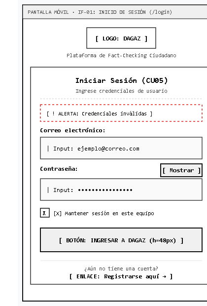
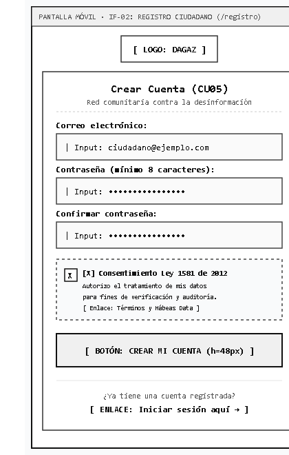
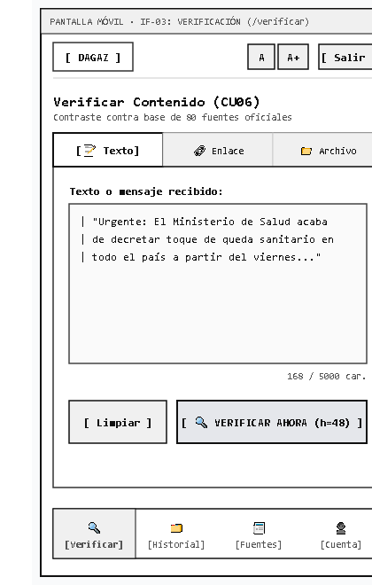
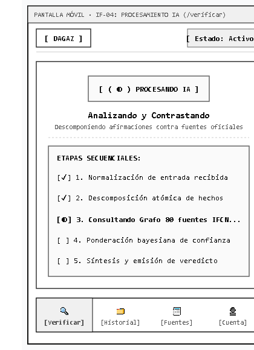
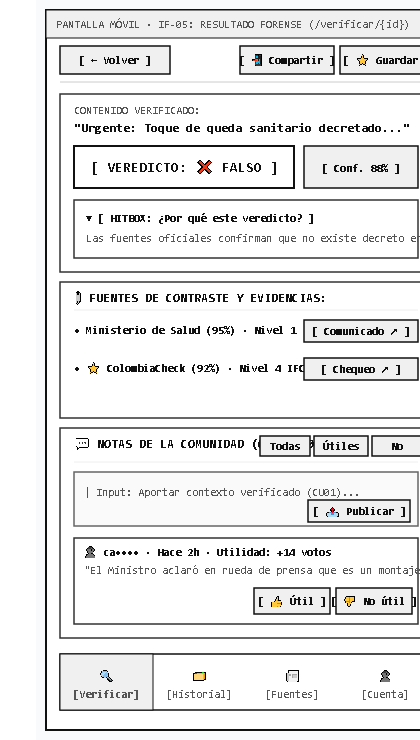
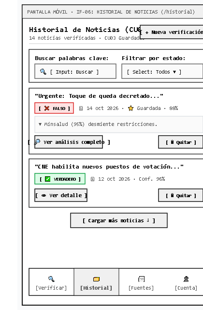
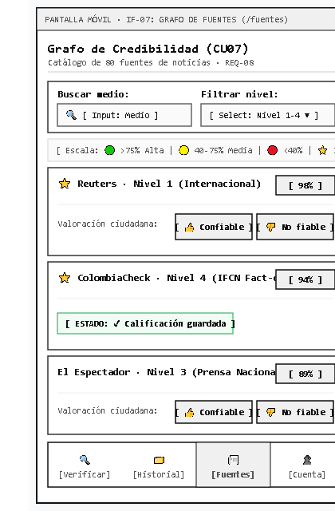
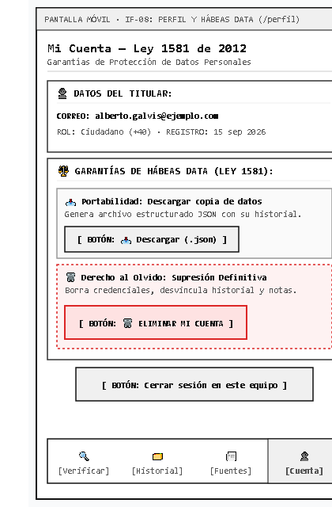
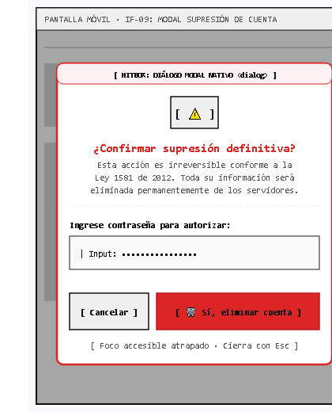
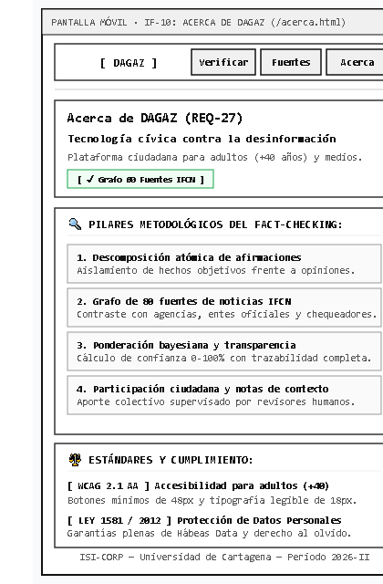

# DAGAZ — Mockups de Baja Fidelidad e Imágenes (Iteración 02)

> **Ubicación:** `docs/iteracion-02/Mockups/MockUps-Baja Fidelidad/`  
> **Documento Maestro de Análisis y Wireframes:** [`Mockups_Baja_Fidelidad.md`](file:///c:/Users/Vss/ISI-2026-2-G06/docs/iteracion-02/Mockups/MockUps-Baja%20Fidelidad/Mockups_Baja_Fidelidad.md)  
> **Directorio de Imágenes:** [`imagenes/`](file:///c:/Users/Vss/ISI-2026-2-G06/docs/iteracion-02/Mockups/MockUps-Baja%20Fidelidad/imagenes/)  
> **Estándar de Accesibilidad:** WCAG 2.1 AA | Mobile-First | Adultos (+40 años)  

Este directorio contiene el análisis técnico, los wireframes en ASCII Box-Drawing y la **galería de imágenes gráficas (PNG y SVG)** para cada una de las 10 interfaces de usuario de DAGAZ correspondientes a la **Iteración 02**.

---

## 🖼️ Galería de Mockups de Baja Fidelidad

| ID | Interfaz | Ruta | Vista Previa | Formatos de Imagen |
| :---: | :--- | :---: | :---: | :---: |
| **IF-01** | **Inicio de Sesión** | `/login` |  | [PNG](./imagenes/IF-01_Inicio_Sesion.png) · [SVG](./imagenes/IF-01_Inicio_Sesion.svg) |
| **IF-02** | **Registro Ciudadano (Ley 1581)** | `/registro` |  | [PNG](./imagenes/IF-02_Registro_Usuario.png) · [SVG](./imagenes/IF-02_Registro_Usuario.svg) |
| **IF-03** | **Ingesta Multicanal** | `/` y `/verificar` |  | [PNG](./imagenes/IF-03_Verificacion_Entrada.png) · [SVG](./imagenes/IF-03_Verificacion_Entrada.svg) |
| **IF-04** | **Progreso y Agentes IA** | `/verificar` |  | [PNG](./imagenes/IF-04_Verificacion_Procesando.png) · [SVG](./imagenes/IF-04_Verificacion_Procesando.svg) |
| **IF-05** | **Veredicto Forense y Notas** | `/verificar/{id}` |  | [PNG](./imagenes/IF-05_Verificacion_Resultado.png) · [SVG](./imagenes/IF-05_Verificacion_Resultado.svg) |
| **IF-06** | **Historial y Guardados** | `/historial` |  | [PNG](./imagenes/IF-06_Historial_Noticias.png) · [SVG](./imagenes/IF-06_Historial_Noticias.svg) |
| **IF-07** | **Grafo de 80 Fuentes IFCN** | `/fuentes` |  | [PNG](./imagenes/IF-07_Grafo_Fuentes.png) · [SVG](./imagenes/IF-07_Grafo_Fuentes.svg) |
| **IF-08** | **Mi Cuenta y Hábeas Data** | `/perfil` |  | [PNG](./imagenes/IF-08_Perfil_Habeas_Data.png) · [SVG](./imagenes/IF-08_Perfil_Habeas_Data.svg) |
| **IF-09** | **Modal Supresión de Cuenta** | `/perfil` *(Modal)* |  | [PNG](./imagenes/IF-09_Modal_Eliminar_Cuenta.png) · [SVG](./imagenes/IF-09_Modal_Eliminar_Cuenta.svg) |
| **IF-10** | **Portal Acerca de DAGAZ** | `/acerca.html` |  | [PNG](./imagenes/IF-10_Acerca_Proyecto.png) · [SVG](./imagenes/IF-10_Acerca_Proyecto.svg) |

---

## 📁 Estructura del Directorio

```
MockUps-Baja Fidelidad/
├── README.md                      # Este archivo con galería visual y tabla de rutas
├── Mockups_Baja_Fidelidad.md      # Documento técnico completo con análisis, diagramas y wireframes
└── imagenes/                      # Renderizados gráficos de alta resolución
    ├── IF-01_Inicio_Sesion.png / .svg
    ├── IF-02_Registro_Usuario.png / .svg
    ├── IF-03_Verificacion_Entrada.png / .svg
    ├── IF-04_Verificacion_Procesando.png / .svg
    ├── IF-05_Verificacion_Resultado.png / .svg
    ├── IF-06_Historial_Noticias.png / .svg
    ├── IF-07_Grafo_Fuentes.png / .svg
    ├── IF-08_Perfil_Habeas_Data.png / .svg
    ├── IF-09_Modal_Eliminar_Cuenta.png / .svg
    └── IF-10_Acerca_Proyecto.png / .svg
```

Consulte el documento maestro [`Mockups_Baja_Fidelidad.md`](file:///c:/Users/Vss/ISI-2026-2-G06/docs/iteracion-02/Mockups/MockUps-Baja%20Fidelidad/Mockups_Baja_Fidelidad.md) para acceder a los diagramas en Mermaid, wireframes en Box-Drawing y detalles técnicos de accesibilidad.
